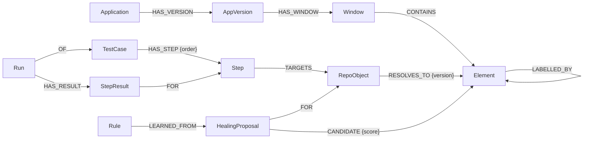

# Graph model (v0)

The server's Neo4j schema. Part of the graph-schema contract (with `server/src/main/resources/neo4j/migrations/`), frozen at G1 (week 7). Change it only with a new migration and an ADR.

- Every node has an `id`: a UUID string generated by the server, unique per label. Neo4j's internal `elementId()` is never stored or exposed, because it is not stable.
- Property names are camelCase. Only `id` (unique) and the indexed lookups below are enforced; the APIs that write each node settle the rest.
- Migrations run automatically when the server starts ([neo4j-migrations](https://michael-simons.github.io/neo4j-migrations/); applied versions are stored as `__Neo4jMigration` nodes).

## Diagram



## Nodes

| Label | Key properties | Constraint / index (migration `V0001`) |
|---|---|---|
| Application | `name`, `technology` | unique `id` · index `name` |
| AppVersion | `version` | unique `id` |
| Window | `name`, `className`, `snapshotId` | unique `id` |
| Element | `automationId`, `name`, `controlType`, `className`, `bounds`, `snapshotId` | unique `id` · index `snapshotId` · index `automationId` |
| RepoObject | `name` (logical name), primary + fallback properties, embedding | unique `id` · index `name` |
| TestCase | `name` | unique `id` |
| Step | `keyword`, `value`, `checkpoint` (shape: `schemas/step.schema.json`) | unique `id` |
| Run | `status`, `startedAt`, `duration` | unique `id` · index `startedAt` |
| StepResult | `status`, `duration`, `screenshotPath` | unique `id` |
| HealingProposal | `score`, per-property contributions, `decision` | unique `id` |
| Rule | learned matching rule | unique `id` |

Screenshots are files on the server disk; `StepResult.screenshotPath` stores the path.

## Relationships

One sample query per relationship. `$`-names are parameters.

**`(Application)-[:HAS_VERSION]->(AppVersion)`**: an application has one node per imported version.
```cypher
MATCH (a:Application {id: $appId})
CREATE (a)-[:HAS_VERSION]->(:AppVersion {id: $versionId, version: $version})
```

**`(AppVersion)-[:HAS_WINDOW]->(Window)`**: the windows captured for a version.
```cypher
MATCH (:Application {name: $appName})-[:HAS_VERSION]->(:AppVersion {version: $version})-[:HAS_WINDOW]->(w:Window)
RETURN w
```

**`(Window)-[:CONTAINS]->(Element)`**: top-level elements of a window.
```cypher
MATCH (w:Window {id: $windowId})
CREATE (w)-[:CONTAINS]->(:Element {id: $elementId, snapshotId: w.snapshotId, automationId: $automationId, controlType: $controlType})
```

**`(Element)-[:CONTAINS]->(Element)`**: the UI Automation tree below a top-level element.
```cypher
MATCH (:Window {id: $windowId})-[:CONTAINS*1..]->(e:Element {automationId: $automationId})
RETURN e
```

**`(Element)-[:LABELLED_BY]->(Element)`**: an element and the label that names it (e.g. a text box and its caption).
```cypher
MATCH (e:Element {id: $elementId})-[:LABELLED_BY]->(label:Element)
RETURN label.name
```

**`(RepoObject)-[:RESOLVES_TO {version}]->(Element)`**: where a repository object is found in one app version (`version` holds the `AppVersion.id`).
```cypher
MATCH (o:RepoObject {id: $objectId})-[:RESOLVES_TO {version: $versionId}]->(e:Element)
RETURN e
```

**`(TestCase)-[:HAS_STEP {order}]->(Step)`**: a test's steps in order.
```cypher
MATCH (:TestCase {id: $testId})-[r:HAS_STEP]->(s:Step)
RETURN s ORDER BY r.order
```

**`(Step)-[:TARGETS]->(RepoObject)`**: the repository object a step acts on (impact analysis: which steps use this object).
```cypher
MATCH (t:TestCase)-[:HAS_STEP]->(s:Step)-[:TARGETS]->(:RepoObject {id: $objectId})
RETURN t.name, s.id
```

**`(Run)-[:OF]->(TestCase)`**: run history of a test, newest first.
```cypher
MATCH (r:Run)-[:OF]->(:TestCase {id: $testId})
RETURN r ORDER BY r.startedAt DESC LIMIT 20
```

**`(Run)-[:HAS_RESULT]->(StepResult)`**: the results recorded during a run.
```cypher
MATCH (r:Run {id: $runId})
CREATE (r)-[:HAS_RESULT]->(:StepResult {id: $resultId, status: $status, duration: $duration, screenshotPath: $screenshotPath})
```

**`(StepResult)-[:FOR]->(Step)`**: which step a result belongs to.
```cypher
MATCH (:Run {id: $runId})-[:HAS_RESULT]->(sr:StepResult {status: 'FAILED'})-[:FOR]->(s:Step)
RETURN s, sr.screenshotPath
```

**`(HealingProposal)-[:FOR]->(RepoObject)`**: proposals waiting for a decision on an object.
```cypher
MATCH (p:HealingProposal)-[:FOR]->(:RepoObject {id: $objectId})
WHERE p.decision IS NULL
RETURN p
```

**`(HealingProposal)-[:CANDIDATE {score}]->(Element)`**: the candidate elements of a proposal, best first.
```cypher
MATCH (:HealingProposal {id: $proposalId})-[c:CANDIDATE]->(e:Element)
RETURN e, c.score ORDER BY c.score DESC
```

**`(Rule)-[:LEARNED_FROM]->(HealingProposal)`**: the approved proposals a rule was learned from.
```cypher
MATCH (:Rule {id: $ruleId})-[:LEARNED_FROM]->(p:HealingProposal)
RETURN p
```
