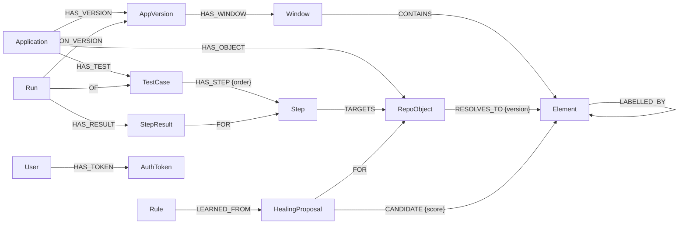

# Graph model (v0.5)

The server's Neo4j schema. Part of the graph-schema contract (with `server/src/main/resources/neo4j/migrations/`), frozen at G1 (week 7). Change it only with a new migration and an ADR.

- Every node has an `id`: a UUID string generated by the server, unique per label. Neo4j's internal `elementId()` is never stored or exposed, because it is not stable.
- Property names are camelCase. Only `id` (unique) and the indexed lookups below are enforced; the APIs that write each node settle the rest.
- v0.1 (#39, ADR `2026-10-29-graph-schema-application-links`, accepted) adds `HAS_TEST` and `HAS_OBJECT` from Application and the Step properties `timeoutMs`, `checkpoint` and `row`.
- v0.2 (#60, ADR `2026-10-31-accounts-and-tokens`, proposed, migration `V0003`) adds `User` and `AuthToken` with `HAS_TOKEN`, and who-did-it properties: `createdBy`/`createdAt`/`updatedBy`/`updatedAt` on TestCase (user id and datetime); `startedBy` on Run (#44) and `decidedBy`/`decidedAt` on HealingProposal (#74) follow the same rule. They are properties, not relationships: audit data, never traversed.
- v0.3 (#44, ADR `2026-11-05-runs-api-and-live-updates`, accepted, migration `V0004`) adds `ON_VERSION` from Run, a unique `(runId, stepIndex)` on StepResult, the Run properties `stepCount`, `document`, `finishedAt` and the StepResult properties that make a write repeatable.
- v0.4 (#15, ADR `2026-11-07-window-snapshot-unique`, proposed, migration `V0005`) makes `Window.snapshotId` unique, so one snapshot import creates one Window.
- v0.5 (#51, ADR `2026-11-08-run-screenshots-and-retention`, accepted, no migration) adds `lastActivityAt` and `endedBy` to Run and `screenshotHash`, `screenshotReceivedAt` to StepResult; `screenshotPath` is relative to the screenshot folder.
- v0.6 (#63, ADR `2026-11-15-failure-category`, proposed, no migration) adds `category` to StepResult: why a failed step failed (FR-35), absent on every other result.
- Migrations run automatically when the server starts ([neo4j-migrations](https://michael-simons.github.io/neo4j-migrations/); applied versions are stored as `__Neo4jMigration` nodes).

## Diagram



## Nodes

| Label | Key properties | Constraint / index (migration `V0001`) |
|---|---|---|
| Application | `name`, `technology` | unique `id` · index `name` |
| AppVersion | `version` | unique `id` |
| Window | `snapshotId`, `name` (window title), `className`, `capturedAt` (datetime), `featureVersion`, `exeName`, `fileVersion`, `captureDurationMs`, `readErrors`, `agentVersion` (the capture's evidence, #64); `createdBy`, `createdAt` (who imported it); written by the snapshot import (#15) | unique `id` · unique `snapshotId` (`V0005`) |
| Element | the element descriptor's properties as the snapshot carries them (`schemas/snapshot.schema.json#/$defs/element`; `bounds` as an int list), plus `snapshotId` and `snapshotElementId` (the agent's id inside the snapshot, so `(snapshotId, snapshotElementId)` finds a healing candidate) | unique `id` · index `snapshotId` · index `automationId` |
| RepoObject | `name` (logical name, `screen.element`, unique per application); `primary` and `fallback` as JSON strings (descriptor property → value, best first; only identifying properties, ADR element descriptor v0 §3); `createdBy`, `createdAt`, `updatedBy`, `updatedAt`; written by the repository API (#25); embedding (#58) | unique `id` · index `name` |
| TestCase | `name` (unique per application); `createdBy`, `createdAt`, `updatedBy`, `updatedAt` | unique `id` · index `name` (`V0002`) |
| Step | `keyword`, `value`, `timeoutMs`; `checkpoint` and `row` as JSON strings (shape: `schemas/step.schema.json`). The logical name is not stored: it comes from `TARGETS` | unique `id` |
| Run | `status` (`running`, `passed`, `failed`, `aborted`), `stepCount`, `document` (JSON string: the step document copied at the start; a result's `stepIndex` is a position in it), `startedBy`, `startedAt`, `finishedAt`, `durationMs`, `lastActivityAt` (creation, new result or new screenshot; the idle timeout reads it), `endedBy` (`idleTimeout` when the server aborted it) | unique `id` · index `startedAt` |
| StepResult | `runId`, `stepIndex`, `stepId`, `status` (`passed`, `failed`, `notRun`), `durationMs`, `message`, `category` (only on a failed result: `elementNotFound`, `unexpectedWindow`, `assertionFailed`, `timeout` or `searchIncomplete`), `body` (JSON string with sorted keys: the result as received), `bodyHash` (SHA-256 of `body`, to recognise a repeat), `receivedAt`, `screenshotPath` (relative to the screenshot folder, `<runId>/<stepIndex>.png`), `screenshotHash` (SHA-256 of the PNG, to recognise a repeat), `screenshotReceivedAt` | unique `id` · unique `(runId, stepIndex)` (`V0004`) |
| HealingProposal | `score`, per-property contributions, `decision` | unique `id` |
| Rule | learned matching rule | unique `id` |
| User | `username` (lower-case), `passwordHash` (BCrypt), `role` (`admin` / `tester`), `createdAt`; `removedAt` once removed (the node stays) | unique `id` · unique `username` (`V0003`) |
| AuthToken | `kind` (`session` / `api`), `tokenHash` (SHA-256 of the secret), `name` (api), `createdAt`, `expiresAt` (session) | unique `id` · unique `tokenHash` (`V0003`) |

Screenshots are PNG files on the server disk (`AYNA_SCREENSHOT_DIR`, one folder per run); `StepResult.screenshotPath` stores the path relative to that folder. Retention (`AYNA_RUN_RETENTION`) deletes old runs with their results and folders (#51).

## Relationships

One sample query per relationship. `$`-names are parameters.

**`(Application)-[:HAS_VERSION]->(AppVersion)`**: an application has one node per imported version.
```cypher
MATCH (a:Application {id: $appId})
CREATE (a)-[:HAS_VERSION]->(:AppVersion {id: $versionId, version: $version})
```

**`(Application)-[:HAS_TEST]->(TestCase)`**: the tests of an application, by name.
```cypher
MATCH (:Application {id: $appId})-[:HAS_TEST]->(t:TestCase)
RETURN t ORDER BY t.name
```

**`(Application)-[:HAS_OBJECT]->(RepoObject)`**: the object repository of an application; a step's `target` resolves here.
```cypher
MATCH (:Application {id: $appId})-[:HAS_OBJECT]->(o:RepoObject {name: $logicalName})
RETURN o
```

**`(AppVersion)-[:HAS_WINDOW]->(Window)`**: the windows captured for a version.
```cypher
MATCH (:Application {name: $appName})-[:HAS_VERSION]->(:AppVersion {version: $version})-[:HAS_WINDOW]->(w:Window)
RETURN w
```

**`(Window)-[:CONTAINS]->(Element)`**: the window's own root element (the snapshot's first element); every other element hangs below it.
```cypher
MATCH (:Window {id: $windowId})-[:CONTAINS]->(root:Element)
RETURN root
```

**`(Element)-[:CONTAINS]->(Element)`**: the UI Automation tree below the root element, from each snapshot entry's `parentId`.
```cypher
MATCH (:Window {id: $windowId})-[:CONTAINS*1..]->(e:Element {automationId: $automationId})
RETURN e
```

**`(Element)-[:LABELLED_BY]->(Element)`**: an element and the label that names it (e.g. a text box and its caption).
```cypher
MATCH (e:Element {id: $elementId})-[:LABELLED_BY]->(label:Element)
RETURN label.name
```

**`(RepoObject)-[:RESOLVES_TO {version}]->(Element)`**: where a repository object is found in one app version (`version` holds the `AppVersion.id`).
```cypher
MATCH (o:RepoObject {id: $objectId})-[:RESOLVES_TO {version: $versionId}]->(e:Element)
RETURN e
```

**`(TestCase)-[:HAS_STEP {order}]->(Step)`**: a test's steps in order.
```cypher
MATCH (:TestCase {id: $testId})-[r:HAS_STEP]->(s:Step)
RETURN s ORDER BY r.order
```

**`(Step)-[:TARGETS]->(RepoObject)`**: the repository object a step acts on (impact analysis: which steps use this object).
```cypher
MATCH (t:TestCase)-[:HAS_STEP]->(s:Step)-[:TARGETS]->(:RepoObject {id: $objectId})
RETURN t.name, s.id
```

**`(Run)-[:OF]->(TestCase)`**: run history of a test, newest first.
```cypher
MATCH (r:Run)-[:OF]->(:TestCase {id: $testId})
RETURN r ORDER BY r.startedAt DESC LIMIT 20
```

**`(Run)-[:ON_VERSION]->(AppVersion)`**: the version a run was played against.
```cypher
MATCH (r:Run)-[:ON_VERSION]->(:AppVersion {id: $versionId})
RETURN r ORDER BY r.startedAt DESC LIMIT 20
```

**`(Run)-[:HAS_RESULT]->(StepResult)`**: the results recorded during a run, one per step.
```cypher
MATCH (:Run {id: $runId})-[:HAS_RESULT]->(sr:StepResult)
RETURN sr ORDER BY sr.stepIndex
```

**`(StepResult)-[:FOR]->(Step)`**: which step a result belongs to. The link goes when the step is deleted; `stepIndex` still points into the run's `document`.
```cypher
MATCH (:Run {id: $runId})-[:HAS_RESULT]->(sr:StepResult {status: 'failed'})-[:FOR]->(s:Step)
RETURN s, sr.screenshotPath
```

**`(HealingProposal)-[:FOR]->(RepoObject)`**: proposals waiting for a decision on an object.
```cypher
MATCH (p:HealingProposal)-[:FOR]->(:RepoObject {id: $objectId})
WHERE p.decision IS NULL
RETURN p
```

**`(HealingProposal)-[:CANDIDATE {score}]->(Element)`**: the candidate elements of a proposal, best first.
```cypher
MATCH (:HealingProposal {id: $proposalId})-[c:CANDIDATE]->(e:Element)
RETURN e, c.score ORDER BY c.score DESC
```

**`(Rule)-[:LEARNED_FROM]->(HealingProposal)`**: the approved proposals a rule was learned from.
```cypher
MATCH (:Rule {id: $ruleId})-[:LEARNED_FROM]->(p:HealingProposal)
RETURN p
```

**`(User)-[:HAS_TOKEN]->(AuthToken)`**: the account a request's Bearer token belongs to (every request).
```cypher
MATCH (u:User)-[:HAS_TOKEN]->(t:AuthToken {tokenHash: $hash})
WHERE u.removedAt IS NULL AND (t.expiresAt IS NULL OR t.expiresAt > datetime())
RETURN u.id, u.role
```
