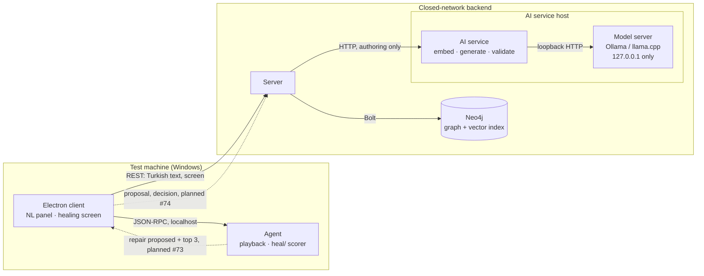
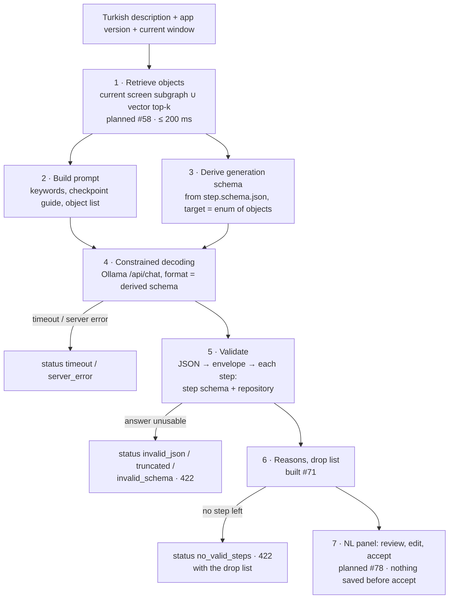
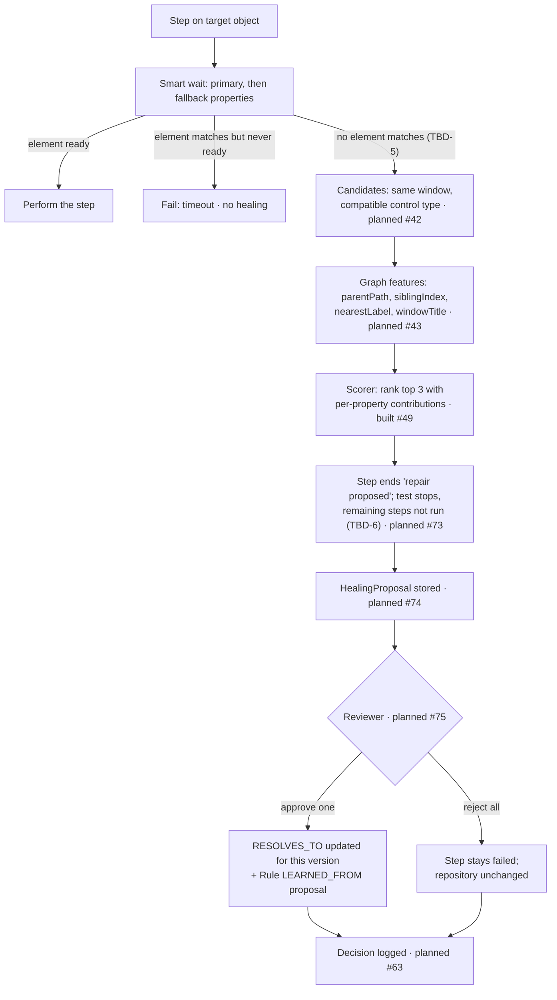

# AYNA Software Design Document: AI components

> **For the SDD editor (#53).** These are galip's AI sections of the SDD (#50). `docs/sdd/SDD.md` (#45) does not exist yet, so the sections live in this file, ready to be moved into `SDD.md` as one block. Headings are `AI-1` … `AI-10`; renumber them to fit `SDD.md`. Cross-references point at repository paths, issues and requirement IDs, never at SDD section numbers, so they survive the move.

| | |
|---|---|
| Issue | #50 · owner galip |
| Status | Draft for review, 2026-10-27 |
| Code it describes | Open PRs #134 (step schema), #141 (healing scorer), #142 (constrained generation), #146 (NL service, stacked on #142). Merge this file after them. |
| Requirement IDs | `FR-xx`, `NFR-xx`, `SC-xx`, `TBD-x` from `docs/rs/scenarios.md` (#34, PR #140), which the RS (#35) takes over unchanged |
| Decisions it follows | ADRs 2026-10-20 *Language models only at authoring time*, *Self-healing proposes, never applies mid-run*, *Calibrated decision layer moves to semester 2*; 2026-10-27 *Step schema v0* (proposed, PR #134) |

**Status labels.** **Built**: the code exists (on the open PR named). **Planned**: designed here and built in the issue named. "Proposed" marks a design choice made in this document for a planned part; the named issue settles it.

---

## AI-1 Overview and boundaries

AYNA has two AI contributions in semester 1 and collects the data for a third in semester 2:

- **C1, Turkish natural language → steps.** A local open-weight language model suggests test steps while a test is being written. Lives in the AI service (`ai/`).
- **C2, explainable, approval-gated self-healing.** When a step's element is not found, a weighted similarity ranks candidate elements and a person approves the repair. Lives in the agent (`agent/ayna_agent/heal/`). **It uses no language model.**
- **Decision log → calibrated decision layer.** Semester 1 logs every failure decision; semester 2 adds a local decision model behind a confidence threshold.

| Part | Code | Model | Runs when | Status |
|---|---|---|---|---|
| Step generation: prompt, constrained decoding, validation | `ai/ayna_ai/generate.py`, `ollama.py`, `validate.py` | Local 7–8B LLM via Ollama | Authoring | **Built**, PR #142 (#37) |
| Retrieval of repository objects | Queries and vector index migration in `server/`; `POST /ai/embed` in `ai/` | Small multilingual embedding model | Authoring | Planned, #58 |
| NL service endpoint `POST /ai/generate-steps`, `GET /ai/health` | `ai/ayna_ai/service.py`; contract `ai/API.md` | (uses the above) | Authoring | **Built**, PR #146 (#71); candidate objects come from the request, chosen by the server (AI-4) |
| NL chat panel | `client/` | none | Authoring | Planned, #78 (omer) |
| Healing candidates and graph features | `agent/ayna_agent/heal/candidates.py`, `features.py` | none | Playback; offline for RQ4 | Planned, #42, #43 |
| Healing scorer | `agent/ayna_agent/heal/scorer.py` | none | Playback; offline for RQ4 | **Built**, PR #141 (#49) |
| Healing in playback | agent playback | none | Playback | Planned, #73 (hasan) |
| Healing proposals API, approval screen | `server/`, `client/` | none | After a run | Planned, #74, #75 (omer) |
| Failure triage and decision log | agent | none | Playback | Planned, #63 (hasan) |
| Calibrated decision layer | not yet placed | Local decision model | See AI-6.3 | Semester 2, #103 |

Change-impact analysis (C3, #81) is a graph query in the server and belongs with the data model, not here.

### Boundaries

Every AI part follows these rules.

1. **Closed network** (NFR-29, NFR-30). The model server runs on the same host as the AI service. `OllamaClient` (`ai/ayna_ai/ollama.py`) accepts only a loopback URL (127.0.0.0/8, `::1`, `localhost`), ignores proxy environment variables and refuses redirects, so a request cannot leave the machine. The model weights and the embedding model are bundled into the AI service image, and nothing is downloaded at start (#82).
2. **Language models only at authoring time** (ADR; FR-28, NFR-22). Only the server calls the AI service, and only while a test is being written. The agent and the CLI runner never call a model. Systems that let a model choose actions at run time are not repeatable, so they report the best of three runs ([15], [40]); a regression test has to replay the same way every time. With the AI service stopped, everything except step generation works (SC-28).
3. **A person approves everything AI produces.** Generated steps are suggestions until the author accepts them, and nothing is saved before that (FR-27). Healing candidates are proposals until a reviewer approves one (ADR; FR-30–FR-32). No AI output changes a test or the repository on its own.
4. **Grounded in the repository.** A step targets a repository object by logical name only (step schema `target`, FR-10). Generation can only choose among the objects it was given, and a validator drops anything else (FR-26).
5. **Deterministic where it can be.** Decoding uses temperature 0 and a fixed seed. The healing scorer uses exact rational arithmetic. The same input gives the same output on the same runtime.



The dotted edges are planned. The AI service has no edge to Neo4j: the server chooses the candidate objects and sends them (AI-4).

---

## AI-2 Natural language → steps pipeline (C1)

### Contract

The JSON shape is fixed in `ai/API.md` (built, #71, PR #146); the part the client sees goes into the REST contract (#31, frozen in #52).

- **In** (built, #71): `POST /ai/generate-steps` with the Turkish description (`text`), the application (`app`), its `version` and the current window (`screen`), and the candidate `objects` the server chose (≤ 100, logical name + Turkish description; AI-4). The server adds the user. The NL panel sends it through the server (#78).
- **Out** (built, #71): `steps`, the suggested steps, each a valid `#/$defs/step` of `schemas/step.schema.json` plus a short Turkish `reason`; `dropped`, every step the model wrote that cannot be suggested, as `{index, code, reason, step}`; the `status`, the `model`, `schemaVersion`, `promptVersion` and `latencyMs`. HTTP 200 always carries at least one step.
- **In the library** (#37, #71): `StepGenerator.generate(text, objects, timeout_s=None)` takes the text and a map `logical name → Turkish description` and returns a `GenerationResult`: the status, the kept steps as a step document `{"version": "0.1", "steps": [...]}` when the status is `ok`, one reason per kept step, the dropped steps, the raw output, the errors, the latency and the token counts.

### Stages



| # | Stage | Status | Design |
|---|---|---|---|
| 1 | Retrieve | Planned #58 | See AI-4. Produces the `{logical name: description}` map, at most N objects. |
| 2 | Prompt | Built | One English system prompt (`SYSTEM_PROMPT`). It names the five keywords, says when a checkpoint uses `name` (text shown by a label, message, button or table) and when it uses `value` (text inside an input or combo box), and lists the objects with their Turkish descriptions; since prompt v3 (#71) the same line offers `none.noMatch` "if none of them fits" (AI-3, limit 3). The user message is the Turkish text, unchanged. It describes no JSON field layout, because the grammar carries the structure. About 440–470 prompt tokens with 17 objects. |
| 3 | Generation schema | Built | See AI-3. |
| 4 | Decode | Built | `stream: false`, `think: false`, temperature 0, seed 42, `num_ctx` 4096, `num_predict` 512 (768 in the service, for the reasons). The service's request deadline (30 s) bounds the call. |
| 5 | Validate | Built | `json.loads`, then the **original** step schema in two parts (`StepValidator`, #71): the envelope (`version`, the `steps` list) as a whole, then each step on its own against `#/$defs/step` and the object list (`step_problems`). Together they accept exactly what the whole schema accepts. Checking after decoding catches a gap in the derivation and a runtime that ignores `format`. |
| 6 | Reasons, drop list | **Built** #71, PR #146 | See *Built in #71* below. |
| 7 | Review | Planned #78 | Suggested steps shown as a diff, accepted all at once or one by one; accepted steps become ordinary steps (FR-27, SC-26). |

### Failure statuses (built)

A failure of the whole answer comes back as a typed `Status`, never as steps; a single bad step is dropped instead (below). HTTP codes are those of the service (`ai/API.md`).

| Status | HTTP | Cause | Observed so far |
|---|---|---|---|
| `ok` | 200 | At least one step valid against the step schema with a known target; the others in `dropped` | 20/20 with the derived schema (#37); 29/30 spike answers through the service (#71; the other one a 504) |
| `invalid_json` | 422 | Output does not parse | None |
| `truncated` | 422 | `num_predict` reached before the JSON closed (`done_reason: length`) | None since the caps; the #7 runaway was this case |
| `invalid_schema` | 422 | Parses but is not a step document: no or wrong `version`, `steps` not a list, extra fields at the root | All 10 answers of the no-schema baseline (invented fields such as `action`, `step`) |
| `no_valid_steps` | 422 | Every step was dropped (or there were none); the body carries `steps: []` and `dropped` | The SC-27 sentence when the model chose `none.noMatch` |
| `timeout` | 504 | No answer within the service's 30 s request deadline | One live: the longest spike answer (4 steps) on a busy laptop, 30.0 s |
| `server_error` | 503 | Model server unreachable or HTTP error | None |

**Drop codes** (`DropCode`, one per dropped step; the first that applies, the `reason` lists all):

| Code | Cause | Possible with the grammar |
|---|---|---|
| `unknown_keyword` | `keyword` outside Click, Type, Select, Verify, Wait (e.g. `DoubleClick`) | No |
| `unknown_target` | `target` is not one of the retrieved objects (an invalid logical name included) | No |
| `no_match` | `target` is the reserved `none.noMatch`: the model says no object fits | Yes, by design |
| `invalid_step` | Any other step-schema error (e.g. Click with `value`), or a missing or too long reason | No |

When the server cannot reach the AI service at all, the NL panel is disabled with a message that says so (FR-27, SC-28). That check lives in the server and client (#71, #78).

### Built in #71 (PR #146)

- **Per-step validation and a drop list** (FR-26, SC-27). Each step is validated on its own against `#/$defs/step` and the object list; the valid ones are suggested and every dropped step is listed as `{index, code, reason, step}`: its position in the model's answer, a drop code (table above), the reason, and the step as the model wrote it. When nothing is left the service answers **HTTP 422 with `status: "no_valid_steps"`**, `steps: []` and the drop list: 422 already meant "the model answered, but nothing is usable; ask the user to rephrase", which is what SC-27's panel shows, and 200 always carries a step to review. SC-27's stub-model test (keyword `DoubleClick`, target `login.forgotPasswordLink`) passes: no suggested step, two dropped steps (`unknown_keyword`, `unknown_target`), each with its reason. The service re-checks every kept step against the retrieved objects before answering, and a property test over 150 random grammar-ignoring answers checks `steps` and `dropped` together.
- **A reason per step** (FR-25). The step schema allows no extra fields (`additionalProperties: false`), so a reason cannot travel inside a stored step. The generation schema adds a required `reason` string (1–100 characters) to each step variant, after the step's own fields, so it explains the step rather than steering it; the generator removes it before validation and the service returns it next to the step. A step with a missing or too long reason is dropped (`invalid_step`). Reasons cost about 75 % more output tokens (median 63 → ~110). Whether `reason` should come before `keyword` (explain, then act) is left to the model comparison on the dev split (#72).
- **A no-match target.** Built; see AI-3, limit 3.
- **Service timeout.** A 30 s deadline per request (`--timeout`), well below the CLI's 120 s: retrieval and the model call share it, the model call gets the time left, and the service answers 504 `timeout` instead of hanging. That is about three times the idle p95 (#37), but on a busy laptop the longest spike answer hit it (30.0 s); the deadline is measured again on team hardware (#71, #131).

### Limits

| Limit | Value | Why |
|---|---|---|
| Steps per request | 1–12 | Bounds the output |
| Free strings (`value`, `expected`) | ≤ 200 characters (the contract allows 1000) | Stops a runaway string early (#7 finding 1) |
| Output tokens (`num_predict`) | 512; 768 in the service | About 25–40 tokens per step, so 12 steps fit; a reason adds about 15–25 per step |
| Context (`num_ctx`) | 4096 tokens | Prompt plus object list plus answer |
| Objects per request | ≤ 100 in a request until #58; then N from retrieval | Prompt-processing time and the size of the grammar grow with N; 100 keeps the prompt inside `num_ctx` |
| Turns | One instruction per request, no chat history | Semester 1 scope |
| Time per request | 30 s (service, `--timeout`) | The panel reports `timeout` instead of hanging |

Turkish characters and suffixes are handled: both models turned *Ankara'yı* into `Ankara` and kept `Kayıt başarılı` unchanged (#7 finding 4; NFR-16).

### Latency budget and measured numbers

Semester 1 commits to no end-to-end target. The p95 per scenario is measured and reported (NFR-12, #71, #77). The budget is shared like this:

| Stage | Budget | Basis |
|---|---|---|
| Retrieval | < 200 ms | NFR-11, #58 |
| Schema derivation, prompt, validation | milliseconds | Pure Python over small documents |
| Model | everything else | Prompt processing plus about 15–20 output tokens/s on a laptop CPU/GPU |

Measured on a MacBook M2 with 16 GB, Ollama 0.40.11, model already loaded, 10 Turkish spike sentences against 17 objects:

| Run | Model | Format | Valid (parse + schema + targets) | Keyword sequence right | Latency p50 / p95 | Output tokens (median) |
|---|---|---|---|---|---|---|
| #7 spike, 2026-10-25 | qwen3:8b | spike schema, no caps | 10/10 | 9/10 | median 3.4 s | — |
| #7 spike, 2026-10-25 | gemma4:e4b-it-qat | spike schema, no caps | 9/10 (one 3,712-token runaway) | 9/10 | median 5.8 s | — |
| #37, 2026-10-27 20:31 | qwen3:8b | derived schema | **10/10** | 9/10 | 5.61 / 9.07 s | 63 |
| #37, 2026-10-27 20:32 | gemma4:e4b-it-qat | derived schema | **10/10** | **10/10** | 6.22 / 8.68 s | 70.5 |
| #37, 2026-10-27 20:34 | gemma4:e4b-it-qat | any JSON (baseline) | 0/10 | — | 6.08 / 12.55 s | 66.5 |
| #71 service over HTTP, 2 runs, 2026-10-27 21:36–21:43 | qwen3:8b | derived schema + reason | 20/20 | 18/20 | 12.57 / 25.29 s | ~110 |

The #37 runs shared the machine with other jobs (load average about 6), and so did the #71 runs (about 4.5), so their latencies are pessimistic; the #71 row includes the reasons and the HTTP layer (0–3 ms). They are also higher than the spike's because each answer is about 15 tokens longer (`version`, checkpoint objects). Raw results: `ai/spikes/results/generate-20261027-*.json`. A cold model load took 7.6–10.2 s (#7), so the service loads the model at start and keeps it loaded (`warm_up()`, `OLLAMA_MAX_LOADED_MODELS=1`).

**Models and memory.** `qwen3:8b` (the default in `GenerationSettings`) and `gemma4:e4b-it-qat`, both Apache-2.0, need about 5 GB each as Q4 quantisations. One model at a time fits a 16 GB machine together with the rest of AYNA (NFR-13). At least three models are compared on the dev split (#72), and D4 (#80) picks the default. Model names and licences ship with the image (NFR-23, #82).

### Logging and input safety

Each generation logs one JSON line: `ts`, `event: generate`, `scenario`, `model`, `status`, `latency_ms`, `load_ms`, `prompt_tokens`, `output_tokens`, `steps`, `dropped`; the service adds one `event: request` line per HTTP request. The lines hold no user text, so service logs carry no test content (tested). The batch CLI (`python -m ayna_ai.generate`) writes the full results, with the environment (platform, Ollama version), for evaluation.

The user's text is untrusted input to the model. The model has no tools, and its output can only be a step document over objects that already exist, which a person then reviews. A hostile description can therefore at worst produce wrong suggestions.

---

## AI-3 Constrained decoding (built, #37)

**Why.** A JSON schema given to the decoder guarantees syntax only, not meaning ([42], [43]). In the #7 spike, a free string let one answer run for 3,712 tokens without closing. Grammar converters skip unsupported JSON Schema features silently, among them `if`/`then`, which the step schema uses for its per-keyword rules ([43]). So the AI service derives its own generation schema from the frozen contract on every request and gives it to Ollama as `format`.

**Derivation** (`generation_schema()` in `ai/ayna_ai/generate.py`):

1. Inline the local `$ref`s and drop annotations (`title`, `description`, …).
2. **Split the step by keyword.** Each `if keyword = X then …` rule becomes one variant that holds only the fields that keyword allows: `false` removes a field, `required` lists are merged, constraints are intersected (Select's `value` gets `minLength: 1`). The step becomes an `anyOf` of 5 variants.
3. **Split the checkpoint by property** the same way: `name`/`value` take a string `expected`; `enabled`/`visible`/`checked`/`selected` take `operator: "equals"` and a boolean `expected`. That gives 2 variants.
4. **`target` becomes an `enum`** of the object names passed in, after each name is checked against the logical-name pattern, plus the reserved `none.noMatch` (limit 3, #71).
5. **Leave out server fields**: `id` is assigned by the server on save.
6. **Cap free strings** at `maxLength` ≤ 200 and the list at 1–12 steps. `version` stays a `const`, so the raw output is a complete step document.
7. **Check the result is grammar-friendly**: no `$ref`, `$defs`, `allOf`, `oneOf`, `not`, `if`/`then`/`else`, `dependentRequired` or boolean subschema is left. `anyOf` appears only as a union of whole object schemas, never mixed with `properties` at the same level, which llama.cpp does not support ([43]).
8. **Fail loudly.** Any construct the derivation does not know raises `SchemaDerivationError`. A change to `step.schema.json` therefore breaks a test, and generation never silently becomes looser. A sampling test checks that the derived schema never accepts what the step schema rejects.

The Type branch for a three-object request, for example:

```json
{"type": "object",
 "properties": {
   "keyword": {"const": "Type"},
   "target": {"type": "string", "enum": ["login.userNameInput", "login.passwordInput", "login.loginButton"]},
   "value": {"type": "string", "maxLength": 200},
   "timeoutMs": {"type": "integer", "minimum": 0, "maximum": 600000}},
 "required": ["keyword", "target", "value"],
 "additionalProperties": false}
```

**Effect.** With the derived schema, both models produced 10/10 valid documents on the spike inputs. The sentence that ran away in #7 ended in 38 tokens and 4.1 s. Without the schema (`--format json`), gemma4 produced 0/10 valid documents: every answer invented its own field names, so the structure comes from the grammar and not from the prompt.

### Known limits

1. **Structure, not meaning.** A schema-valid answer can still be wrong. qwen3 dropped the first Click of a three-action sentence (#7 finding 2). Prompt v1 used `value` for every label check, which playback would fail because UIA labels have no ValuePattern; prompt v2 fixed this with the `name`/`value` guide. The author's review (FR-27) and RQ3 (#77) catch and measure this kind of error.
2. **Step schema v0 cannot check table rows.** *"Tabloda Yılmaz'ın listelendiğini kontrol et"* becomes `Verify main.customerGrid {name contains "Yılmaz"}`. That is valid, but it checks the grid's UIA Name, not its rows. A fix needs step schema v0.2 through an ADR. Until then reviewers reject such steps, and the NL dataset (#36) avoids or marks such sentences.
3. **Forced choice.** Because `keyword` and `target` are enums, the model cannot answer "no such action" or "no such object". *"Şifremi unuttum bağlantısına çift tıkla"*, with no such link in the repository, becomes a Click on some existing object: valid and wrong ([42] notes the same weakness; SC-27). **Built (#71, PR #146):** the enum always holds the reserved target `none.noMatch`, which fits the logical-name pattern, and prompt v3 offers it in the target line ("or none.noMatch if none of them fits"; as a separate line it made qwen3 add spurious Clicks). The validator drops any step that uses it (code `no_match`, reason "no repository object matches"). The derivation fails loudly if the step schema stops accepting the name, and the service answers 400 to a request object with that name; the repository should refuse it too (omer). Live, qwen3:8b sent the sentence above to `none.noMatch` in some runs and to `Click login.passwordInput` in others with the identical prompt, so how often, and how correctly, the model uses the escape is measured in #77. Keywords keep no escape value in v0: an action outside the five keywords is mapped to the closest one, the reviewer catches it, and RQ3 counts how often this happens.
4. **Runtime coverage.** The derivation was run on Ollama 0.40.11 only. It avoids every construct that llama.cpp's converter lists as unsupported, but llama.cpp itself has not been tried. If D4 picks llama.cpp, test it there (#72, #80).
5. **Determinism.** Temperature 0 with a fixed seed gave identical steps across runs on the same machine and runtime (#7: online and offline runs matched). This is not promised across runtime versions or hardware, so every results file records the Ollama version and the platform.

---

## AI-4 Retrieval of repository objects (planned, #58)

**Purpose.** Give the model the few objects that matter: the right set for H2, a short prompt (prompt-processing speed differs about 5× between the two models, #7 finding 6) and a small `target` enum. The repository acts as RAG's non-parametric memory ([41]). When the UI changes, the repository is updated or healed and the assistant follows without retraining.

**Design.**

- **What is embedded.** For each RepoObject: its logical name, the UIA Name of the element it resolves to, and that element's label (`LABELLED_BY` or nearest label). The control type may help the model choose between `name` and `value` (#37 handoff); #58 measures it. The same text, in Turkish, becomes the description in the prompt.
- **Embedding model.** A small multilingual open-weight model, bundled with the AI service, with its licence documented (NFR-23, NFR-30). #58 chooses it.
- **Storage.** The `embedding` property on RepoObject (already in `docs/graph-model.md`) with a Neo4j vector index. Community Edition has vector search, so no second database is needed (NFR-24). The index migration is a server migration (`server/`, reviewed by omer).
- **Refresh.** The embedding is recomputed whenever a RepoObject is created or changed, or resolves to a new element (#58 acceptance). The server asks the AI service for the vector (`POST /ai/embed`) and writes it itself, so the AI service never writes to the graph. While the AI service is down, the object is marked stale and refreshed later.
- **Query (run by the server).** (a) The current screen: the RepoObjects that resolve, in the current version, to an element of the current window. (b) The vector top-k over the application's RepoObjects (`HAS_OBJECT`) for the Turkish text, embedded with `POST /ai/embed`. Merge the two without duplicates, current screen first, at most N objects. k and N are tuned on the dev split. Acceptance: Recall@10 of the gold objects ≥ 90 %, query < 200 ms (NFR-11). Without embeddings (stale, or no AI service at indexing time), (a) is used alone.

```cypher
// (a) repository objects of the current window, for one app version
MATCH (:AppVersion {id: $versionId})-[:HAS_WINDOW]->(w:Window {id: $windowId})
MATCH (w)-[:CONTAINS*1..]->(e:Element)<-[:RESOLVES_TO {version: $versionId}]-(o:RepoObject)
RETURN o.name, e.name
```

**Decided 2026-10-29 (AI-9 #5).** The server runs both queries and sends the merged objects in `POST /ai/generate-steps`; the AI service has no Bolt edge and no database credentials (SDD §2.2.2 rule 5). The embedding model stays in the AI service behind `POST /ai/embed`. The queries live next to the data in `server/`, so #58's expected output changes from `ai/ayna_ai/retrieve.py` to the server queries plus `/ai/embed`; `retrieve.py` keeps the pass-through retriever.

---

## AI-5 Self-healing (C2)



### AI-5.1 Trigger (planned, #73)

Healing starts only when **no** element matches the object's primary or fallback properties by the end of the smart wait (FR-10, FR-29). An element that matches but never becomes visible and enabled is a `timeout` and gets no healing (TBD-5, owned by hasan). Healing never acts on a candidate: the step ends as "repair proposed", the test stops, and the remaining steps are marked not run (FR-30, TBD-6).

### AI-5.2 Candidate generation (planned, #42)

- **Input:** the element the object resolved to in the old version (the *target*) and the snapshot of the window now on screen (online, #73), or two version snapshots (offline: RQ4 #76, change impact #81).
- **Filter:** elements in the same window with a compatible control type. #42 defines the compatibility map; it must keep "retype" changes of #46 reachable.
- **Acceptance:** the true target is among the candidates in ≥ 95 % of the controlled-change cases (#46), in under 1 s per object (NFR-10, SC-29). Candidate recall is reported separately from scorer accuracy, so that RQ4 does not mix the two.

### AI-5.3 Graph-context features (planned, #43)

Computed from the snapshot graph (`CONTAINS`, `LABELLED_BY`) and added to each element before scoring: `parentPath` (the ancestor chain as one string), `siblingIndex`, `nearestLabel` and `windowTitle`. Keys are camelCase, as in `docs/graph-model.md`. The descriptor (#11) uses snake_case Python fields, so #11/#43 need an adapter or a shared choice (raised with hasan).

### AI-5.4 Scorer (built, #49)

`agent/ayna_agent/heal/scorer.py` is a pure function over plain mappings, so it does not depend on the descriptor or snapshot code. Its module docstring is the full reference (the Similo mapping, sources and every rule); this section is the design summary.

**Score.** Over the properties the target has:

S(c, t) = Σ wᵢ · simᵢ(c, t) / Σ wᵢ

S lies in [0, 1], so scores are comparable across targets (Similo's own score is an unnormalised sum). Each property's **contribution** is wᵢ · simᵢ / Σ wᵢ, and the contributions add up exactly to S. The approval screen draws them as bars (#75, FR-31).

**Weights and similarities.** The starting weights are Similo's hand-set ones ([7]: 1.5 for the parameters an earlier study found stable, 0.5 for the rest). Each UIA property takes the weight of its closest web counterpart.

| Property | Similo counterpart | Weight | Similarity |
|---|---|---|---|
| `automationId` | Id | 1.5 | Normalised Levenshtein of the leaf (after the last `.`) |
| `name` | Visible text | 1.5 | Normalised Levenshtein |
| `controlType` | Tag | 1.5 | Equal (case-insensitive) |
| `nearestLabel` | Neighbour texts | 1.5 | Shared-word ratio |
| `className` | Class | 0.5 | Normalised Levenshtein |
| `parentPath` | XPath (absolute) | 0.5 | Normalised Levenshtein |
| `siblingIndex` | XPath (id-relative) | 0.5 | Equal |
| location | Location | 0.5 | 1 − d / 100 px, 0 beyond 100 px (top-left corners) |
| area | Area | 0.5 | min / max |
| shape | Shape (width / height) | 0.5 | min / max |
| `windowTitle` | none (AYNA addition) | 0.5 | Normalised Levenshtein |

Similo's HTML Name, HRef, Alt and IsButton have no UIA counterpart, or are covered by another property. Location, area and shape follow the authors' code (Similo2, `WidgetLocator.java`), because the paper does not say how to normalise them.

**Rules.**

- **Missing values.** A value is missing if it is absent, `None`, blank after normalisation, or the bounds are empty (width or height ≤ 0, as UIA reports off-screen elements). If the *target* lacks it, the property is skipped and its weight leaves both sums. If only the *candidate* lacks it, its similarity is 0 and its weight counts, as in Similo; otherwise a nameless control would outrank a named one whose name differs a little. A target with nothing to compare scores 0.
- **`automationId` leaf.** Qt builds AutomationId as a dotted path over the whole object chain, so renaming an ancestor changes every descendant's id, and siblings share a long prefix (learnings 2026-10-25). Comparing only the leaf gives an ancestor rename full credit and unrelated siblings a low score. `parentPath` already scores the ancestor chain. Using Levenshtein instead of Similo's exact match gives partial credit for a renamed leaf (`usernameInput` → `userNameField`).
- **Text normalisation.** NFC, `casefold`, Turkish `İ`/`I`/`ı` folded to `i`, whitespace collapsed. Other diacritics stay significant (`ş` ≠ `s`).
- **Determinism.** Every similarity is rational, so the arithmetic uses `fractions.Fraction`. Results are exact and identical on every platform, contributions sum exactly to the score, and ties are true ties. Values become `float` only at the JSON boundary. `rank()` orders by score descending, then by candidate id.
- **No threshold.** Like Similo, `rank()` always returns the best k it has. A minimum score for raising a proposal belongs to #73. Before a score is read as a confidence, its reliability is checked on the RQ4 data and calibrated if needed ([44]; #103).

**API.** `score(target, candidate, weights=None) → ScoreResult(score, contributions, similarities)` and `rank(target, candidates, k=3, weights=None) → [RankedCandidate(id, result)]`. `weights=` replaces the whole table, so the RQ4 single-property baseline is `weights={"automationId": 1}`. Speed: about 0.4 ms per candidate (1,000 candidates in about 0.4 s on an M2, Python 3.12).

### AI-5.5 Proposal and approval (planned, #73, #74, #75)

- **Payload** (proposed; settled by #73 and #74): run, step, logical name, application version, and the top 3 candidates, each with the snapshot element id, the score, the contributions and the raw similarities. The contributions add up to the score (SC-29).
- **Storage:** `(HealingProposal)-[:FOR]->(RepoObject)` and `-[:CANDIDATE {score, …}]->(Element)`. Each candidate has its own contributions, and Neo4j cannot store a map property. *Proposed* (raised with omer): keep score and contributions on the `CANDIDATE` relationship, as a JSON string or as two parallel lists. `docs/graph-model.md` currently puts them on the proposal node.
- **Approve:** the object `RESOLVES_TO {version}` the chosen element, and a `Rule` linked to the proposal is created, with the user and the time (FR-32, FR-40, SC-30). The next run passes without any step being edited (NFR-33).
- **Reject all:** the step stays failed as "element not found", and the repository and the rule book stay unchanged (SC-31). A repair applied automatically could have passed here; that is the false pass RQ5 counts.
- **Rule semantics.** In semester 1 a Rule records an approved mapping (object, version, old element → new element). How the semester-2 rule book matches rules to new failures is part of #103 (AI-9 #13).

---

## AI-6 Failure triage, decision log, decision layer

### AI-6.1 Rule-based triage (planned, #63, hasan)

Every failed step gets exactly one category: *element not found*, *unexpected window*, *assertion failed* or *timeout* (FR-35). TBD-5 sets the boundary between the first and the last. The client shows the category with the step.

### AI-6.2 Decision log (planned, #63)

Every failure decision is logged with its context and exported as JSONL to `eval/decisions.jsonl` (FR-36). A decision here means a category, a healing proposal and its outcome. SC-25 lists the minimum fields: step, category, logical name, window title, error message. #63's target is ≥ 50 logged examples by week 12.

For the semester-2 panel the log also needs (request to hasan): stable ids (run, step, proposal); the input the decision was made on (which triage rule fired, the candidates' scores and contributions); the outcome with who decided and when; and an empty label field for later labelling. Records are append-only, and Turkish texts are kept unchanged, because the panel is Turkish.

### AI-6.3 Calibrated decision layer (semester 2, #103)

- **Decision points** as typed questions, in the Jev-compatible interface (typed options in, a probability per option out, [45]): *element not found* → which candidate (choice); *unexpected window* → expected or not (yes/no); *failed-test triage* → category or severity (score).
- **Order:** the rule book first; a local open-weight decision model only when no rule applies (D7 candidates: H2O-Lightning-4B as default, Strands Decider 2B, [46], [47]); below the confidence threshold, a person decides; an approved decision becomes a rule.
- **Calibration** is measured on our own panel (the semester-1 decision log), never taken from a vendor: reliability diagram, ECE over 15 equal-width bins with the bin counts, temperature scaling ([44]). D7's criterion is the share of decisions taken at 5 % error. H3 is tested on the bug-injected versions (#47, #86).
- **Placement constraint.** A model call inside a run conflicts with the authoring-only ADR and NFR-22. *Proposed default:* the decision layer runs after the run, on the server or the AI service, and decides on stored proposals and failures. It never changes a run's verdict while the run is in progress. Any other placement needs a new ADR.

---

## AI-7 Evaluation hooks

How the design supports each measurement. #48 (test design) describes how the experiments are run.

| RQ / hypothesis | What the design provides | Data | Issues |
|---|---|---|---|
| **RQ3 / H2**: repository context improves Turkish NL accuracy | The same `StepGenerator`, model and grammar with and without context; deterministic decoding; one log line per scenario; per-step results from #71 | `eval/nl/pairs.jsonl` (100 pairs); a 30-pair held-out split whose SHA-256 is recorded before any tuning (#57); prompts are never tuned on `heldout.jsonl` (`ai/AGENTS.md`) | #36, #57, #77 (McNemar α = 0.05, Wilson CIs, target ≥ 60 % step accuracy) |
| Model choice | `GenerationSettings.model`; latency and token counts per call | Dev split only | #72 (≥ 3 models, p50/p95, RAM), D4 #80 |
| **RQ4 / H1**: weighted similarity beats single-property lookup | `rank(..., weights=SIMILO_WEIGHTS)` against `weights={"automationId": 1}` on the same candidates; exact, reproducible scores | Controlled-change versions with ground truth (#46: rename, move, retype, re-parent, AutomationId removed, combined) | #42 (candidate recall reported separately), #76, #79 |
| **RQ5 / H3**: approval-gated healing gives fewer false passes | Auto-applied mode = act on `rank()[0]`; gated mode = stop at "repair proposed" | Bug-injected versions (#47) | #86; H3 fully in #103 |
| Calibration | Exact scores and logged decisions | RQ4 results; decision log | #73 threshold, #103 |

**Open (AI-9 #12).** RQ3's "without context" condition still needs a definition, because the grammar needs a `target` enum. *Proposed:* no object list in the prompt, and `target` constrained only by the logical-name pattern; a step counts as correct only if its target matches the gold target exactly.

---

## AI-8 Traceability

| Section | Functional requirements | Non-functional requirements | Scenarios |
|---|---|---|---|
| AI-1 Boundaries | FR-26, FR-27, FR-28, FR-30 | NFR-22, NFR-23, NFR-29, NFR-30 | SC-28, SC-36 |
| AI-2 NL pipeline | FR-11, FR-25, FR-26, FR-27, FR-28 | NFR-12, NFR-13, NFR-16, NFR-22, NFR-30 | SC-26, SC-27, SC-28, SC-36 |
| AI-3 Constrained decoding | FR-11, FR-26 | NFR-34 (step schema frozen; derivation fails loudly on a change) | SC-26, SC-27 |
| AI-4 Retrieval | FR-25 | NFR-11, NFR-23, NFR-24, NFR-30 | SC-26 |
| AI-5 Self-healing | FR-10, FR-29, FR-30, FR-31, FR-32, FR-40 | NFR-10, NFR-33 | SC-29, SC-30, SC-31 |
| AI-6 Triage, decision log | FR-35, FR-36 | — | SC-19, SC-21, SC-22, SC-25, SC-31 |
| AI-7 Evaluation | — | NFR-12 | — |

---

## AI-9 Open issues

| # | Issue | Who settles it | Where |
|---|---|---|---|
| 1 | **Closed 2026-10-27.** A reason per step: built (AI-2) | galip | #71, PR #146 |
| 2 | **Closed 2026-10-27.** Per-step drop list instead of whole-document rejection (FR-26, SC-27): built (AI-2; 422 `no_valid_steps` when nothing is left) | galip | #71, PR #146 |
| 3 | Forced choice: the reserved no-match target is built (AI-3, limit 3); how often the model uses it, and how often wrongly, is open | galip | measured in #77 |
| 4 | Step schema v0 cannot check table rows or cells; needs v0.2 and an ADR | galip, hasan, omer | new issue (from #37) |
| 5 | **Closed 2026-10-29.** The server runs the retrieval queries, writes the embeddings and passes the objects; the AI service only embeds (`POST /ai/embed`) and generates (AI-4) | galip, omer | #58; SDD §2.2.2 (#45) |
| 6 | The loopback-only model client against a separate Ollama container in Compose: run the model server in the AI service's container or share its network namespace | galip, omer | #82 |
| 7 | How a "repair proposed" result and its proposal travel from the agent to the server (via the client; the CLI runner in CI); not in agent JSON-RPC v0.1 | hasan, omer | #73, #74; freeze #52 |
| 8 | Contributions on the `CANDIDATE` relationship instead of the proposal node; `docs/graph-model.md` to update | omer | #74 |
| 9 | Element keys camelCase (graph, scorer) vs snake_case (descriptor) | hasan, galip | #11, #43 |
| 10 | Minimum score for a proposal, and its calibration | hasan, galip | #73, #103 |
| 11 | Bounds are raw pixels; location, area and shape need DPI normalisation if the versions of a pair are captured at different scales | galip | #42, #46 |
| 12 | Definition of RQ3's "without context" condition | galip | #77 |
| 13 | Rule semantics beyond "approved mapping"; placement of the decision model (AI-6.3) | galip | #103 |
| 14 | Constrained decoding not tried on llama.cpp | galip | #72, #80 |

---

## AI-10 References

Numbers follow `docs/literature.md` (#10, #20; PRs #126, #139). That file's numbering is provisional and is aligned with the plan's numbering when the SDD is assembled (#53).

- [7] M. Nass, E. Alégroth, R. Feldt, M. Leotta, F. Ricca, "Similarity-based web element localization for robust test automation," *ACM TOSEM*, 32(3), 2023 (Similo). Code: github.com/michelnass/Similo2.
- [15] Z. Liu et al., "Make LLM a testing expert: bringing human-like interaction to mobile GUI testing via functionality-aware decisions," *ICSE*, 2024 (GPTDroid).
- [40] C. Zhang et al., "UFO: a UI-focused agent for Windows OS interaction," *NAACL*, 2025.
- [41] P. Lewis et al., "Retrieval-augmented generation for knowledge-intensive NLP tasks," *NeurIPS*, 2020.
- [42] B. T. Willard, R. Louf, "Efficient guided generation for large language models," arXiv:2307.09702, 2023.
- [43] ggml-org, "GBNF guide," llama.cpp `grammars/README.md` (accessed 2026-10-27).
- [44] C. Guo, G. Pleiss, Y. Sun, K. Q. Weinberger, "On calibration of modern neural networks," *ICML*, 2017.
- [45] D. Almeida, "Introducing System One models and Jev," TypeSafe blog, 2026.
- [46] Strands Labs, *Strands Decider*, GitHub repository (Apache-2.0), 2026.
- [47] H2O.ai, *H2O-Lightning-4B* model card, 2026.

Project sources: `ai/spikes/llm-smoke.md` (#7), `memory-bank/tasks/37-constrained-generation.md`, `memory-bank/tasks/49-healing-scorer.md`, `docs/agent-rpc.md` (#16, PR #135), `docs/graph-model.md` (#14).
