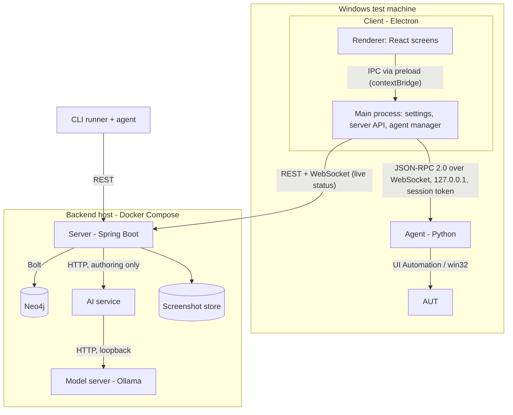
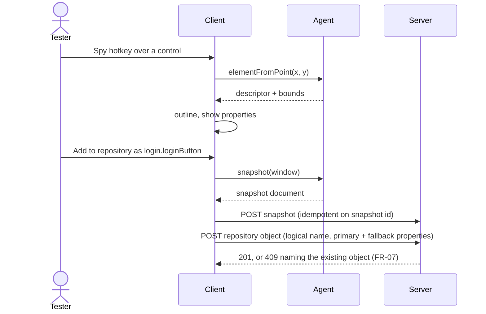
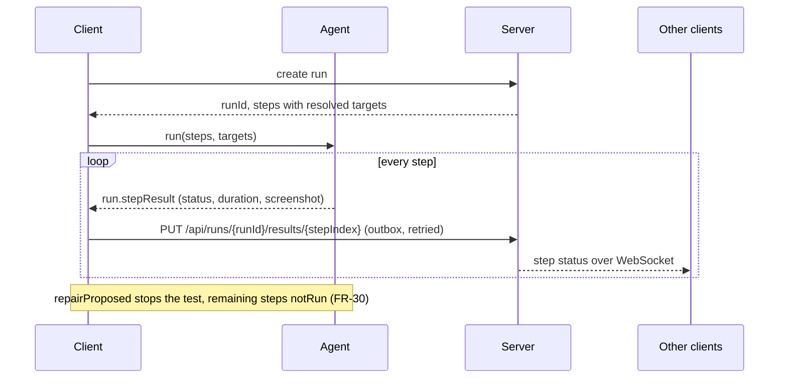
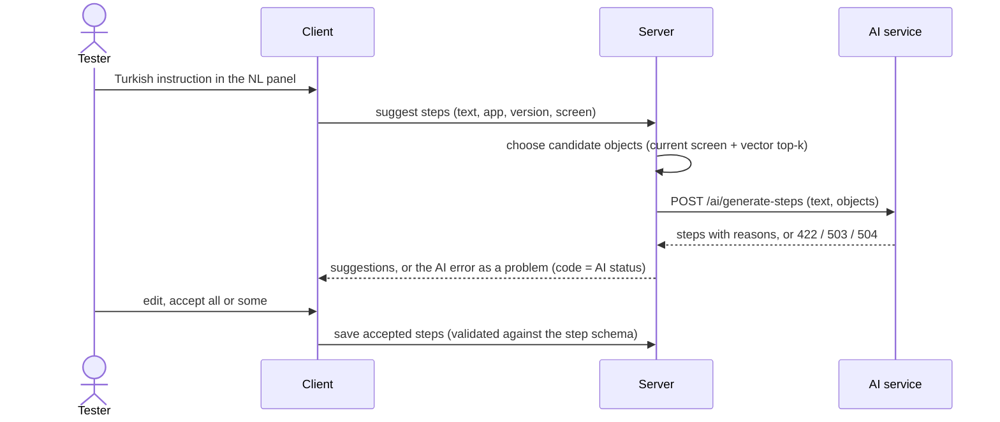
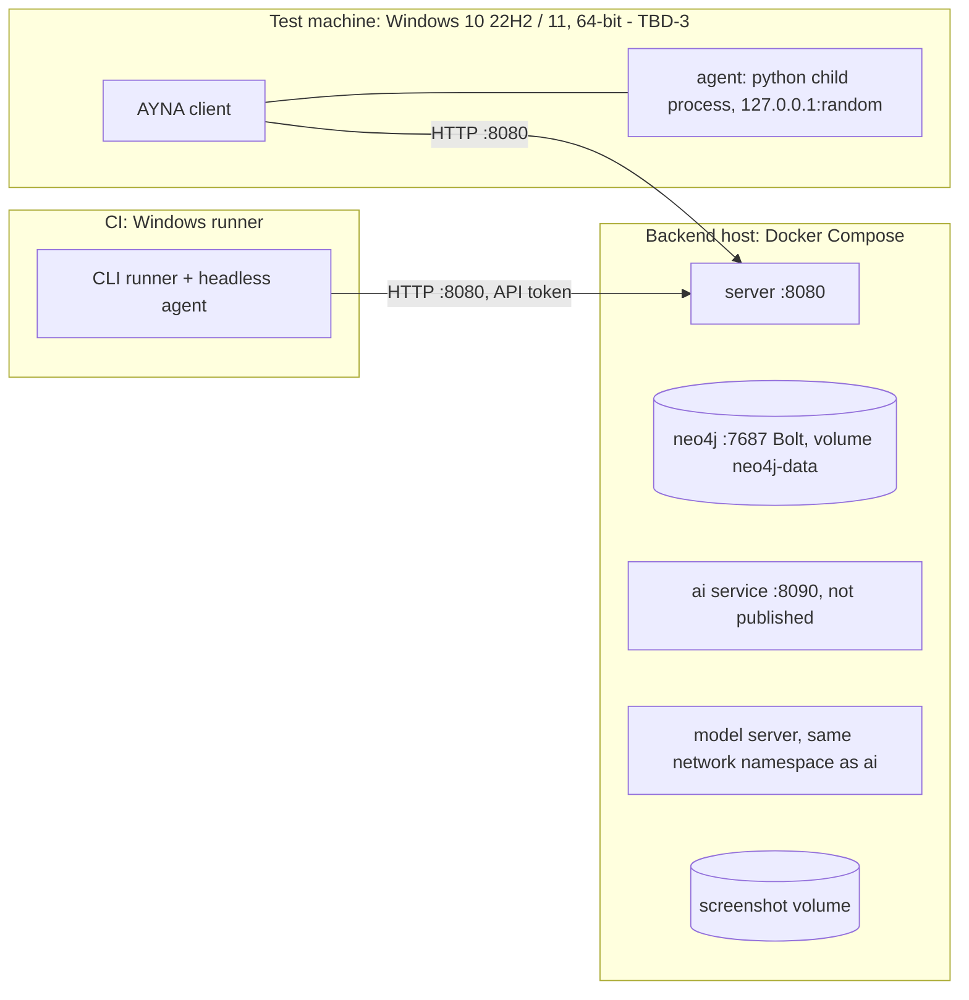
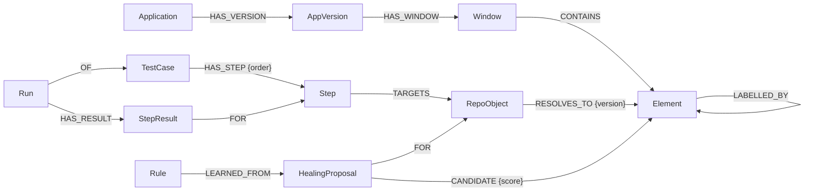

# AYNA — Software Design Description (SDD)

| | |
|---|---|
| Project | AYNA — Akıllı, Yerli, Nesne Tabanlı Arayüz Testi: codeless UI test automation for Windows desktop applications on a closed network |
| Course | COM 4061 Research Project I, Ankara University |
| Advisor | Prof. Dr. Gazi Erkan Bostancı |
| Team | Galip Enes Doğan · Ömerfaruk Sarıbal · Hasan Berk Yanıkkaya |
| Programme | HAVELSAN SUIT application |
| Document | Software Design Description in the style of IEEE 1016-2009 [1] |
| Version | 0.2 — draft of sections 1–4 and 6 |
| Date | 2026-10-31 |
| Status | Sections 1–4 (#45) and 6 (#48) drafted. Section 5: #50. Final PDF: #53, due 7 Dec 2026 |

## Document history

| Version | Date | Author | Change |
|---|---|---|---|
| 0.1 | 2026-10-29 | Ömerfaruk Sarıbal | Skeleton; introduction, architecture, data design and interface design (#45) |
| 0.1 | 2026-10-31 | Ömerfaruk Sarıbal | Status after #135, #151, #156, #158 merged; retrieval and AI errors settled (#155 review) |
| 0.2 | 2026-10-31 | Ömerfaruk Sarıbal | Test design (#48) |

---

## 1 Introduction

### 1.1 Purpose

This document describes how AYNA is built: its components, where they run, the data they keep and the interfaces between them. It is written for the three team members who build AYNA, for the advisor who reviews the design at gate G1 (week 7), and for HAVELSAN reviewers who judge whether AYNA can run on their closed network. The requirements it answers are in the Requirements Specification (RS, `docs/rs/`).

### 1.2 Scope

The design covers semester 1 (20 Oct 2026 – 25 Jan 2027): Windows desktop applications automated through UI Automation, one central server per closed network, one client and one agent per test machine, a Turkish natural-language assistant used while tests are written, and self-healing proposals that a person approves. Web and mobile drivers, the calibrated decision layer and Release 1.0 are semester 2; the design keeps room for them (NFR-21, §2.2.2) but does not describe them.

### 1.3 Stakeholders and design concerns

| Stakeholder | Concern | Where answered |
|---|---|---|
| Test author, test engineer (ROLE-1, ROLE-2) | Inspect screens, maintain the repository, build and run tests without writing code (NFR-14); see results live (NFR-06) | §2.2, §2.2.3, §4.2 |
| Healing reviewer (ROLE-3) | See why a candidate was proposed before approving a repair (FR-31) | §2.2.2, §3.3, §5 |
| Administrator (ROLE-4) | Install on a machine without internet (NFR-36); accounts and roles (FR-39) | §2.3, §2.4.2 |
| HAVELSAN reviewer | Nothing leaves the closed network (NFR-29); no per-user licence cost (NFR-23) | §2.4.1, §2.3 |
| CI system (ROLE-5) | Run suites headless and report JUnit XML (FR-23, FR-24) | §2.2, §2.3 |
| Developers (the team) | Stable contracts so three people can work in parallel (NFR-34) | §4 |
| Advisor / course | Traceable design, measurable research questions RQ1–RQ5 | §6, §8 |

### 1.4 Definitions, acronyms and abbreviations

Product terms (repository object, logical name, snapshot, checkpoint, healing proposal, …) are defined once in `memory-bank/project/glossary.md`, and the RS repeats them in its §1.4. This document adds no new terms.

| Abbreviation | Meaning |
|---|---|
| AUT | Application under test |
| UIA | Microsoft UI Automation |
| RPC | Remote procedure call; here JSON-RPC 2.0 [3] |
| ADR | Architecture decision record (`memory-bank/decisions/`) |
| G0–G3 | Project gates: walking skeleton (week 3), design baseline (week 7), MVP core (week 9), feature freeze (week 12) |

### 1.5 References

| # | Reference |
|---|---|
| [1] | IEEE Std 1016-2009, *IEEE Standard for Information Technology — Systems Design — Software Design Descriptions* |
| [2] | ISO/IEC/IEEE 29148:2018, *Systems and software engineering — Life cycle processes — Requirements engineering* (the RS follows it) |
| [3] | JSON-RPC 2.0 Specification, https://www.jsonrpc.org/specification |
| [4] | JSON Schema Draft 2020-12, https://json-schema.org/draft/2020-12 |
| [5] | Neo4j 5 Cypher Manual and Operations Manual (Community Edition) |
| [6] | Electron security checklist, https://www.electronjs.org/docs/latest/tutorial/security |

Project documents: the RS and its requirement list (`docs/rs/scenarios.md`), the ADRs (`memory-bank/decisions/README.md`), the contracts in §4.1, and the literature review (`docs/literature.md`, #10). Reference numbers will be aligned with the RS and the literature review in the final document (#53).

### 1.6 Conventions

- **Status labels.** **Built**: the code exists on `main` or on the open PR named. **Planned**: designed here and built in the issue named. **Proposed**: a design choice made in this document or in an open ADR; the named issue or ADR settles it. The status of every part is as of the date in the header.
- **Requirement IDs.** `FR-xx`, `NFR-xx`, `SC-xx`, `ROLE-x` and `TBD-x` are those of `docs/rs/scenarios.md` (#34), which the RS (#35) takes over unchanged.
- **Cross-references** point at sections of this document (§n), repository paths, issues (#n) and requirement IDs. Sections written by other members (§5, §6) do not refer to section numbers, so they survive renumbering.
- **Diagrams** are Mermaid in the Markdown source; #53 renders them for the PDF.

---

## 2 Architecture

### 2.1 Context

AYNA is used inside a closed network. Testers and administrators work in the AYNA client on Windows test machines; the client drives the application under test through a local agent; all shared data lives on one AYNA server. A CI system can run stored suites through the CLI runner. Nothing outside the closed network is reached (NFR-29).

### 2.2 Component view

AYNA has six run-time components. The table gives each one's responsibility; §2.2.2 gives the rules on which component may talk to which.

| Component | Responsibility | Technology | Code | Owner | Status |
|---|---|---|---|---|---|
| **Client** | All user screens: server connection and application choice, Object Spy, repository, codeless editor, NL chat panel, run view and history, healing approval. Starts and supervises the local agent. | Electron + React, TypeScript | `client/` | omer | **Built**: settings, server check, application picker (#32); agent process manager (#17, PR #154). Planned: the screens of #24, #30, #38, #44, #68, #75, #78 |
| **Agent** | The only component that touches the AUT: lists windows, reads the element tree and snapshots, picks the element under the cursor, plays steps with smart waits and screenshots, scores healing candidates. | Python, pywinauto (UIA, win32 fallback) | `agent/ayna_agent/` | hasan (recognition, playback), galip (`rpc.py`, `heal/`) | **Built**: JSON-RPC server with token handshake and `ping`; `listWindows` and `snapshot` in the contract, backed by UI Automation from #12 (#16, PR #135); healing scorer v0 (#49, PR #141). Planned: #12, #22, #23, #26, #40, #54, #73 |
| **CLI runner** | Runs a suite without the client: in-process agent, results to the server or to a file, JUnit XML. | Python | `agent/ayna_cli/` | hasan | Planned: #61, #66 |
| **Server** | The shared system of record: applications and versions, snapshots, object repository, tests and steps, runs and step results, screenshots, reports, healing proposals and decisions, users. Validates everything it stores and pushes live run status. Calls the AI service on behalf of the client. | Java 21, Spring Boot 4 | `server/` | omer | **Built**: health check, applications and versions API (#4, #128); tests and steps API (#39, PR #156); graph schema v0 and v0.1 migrations (#14, #39); OpenAPI contract and problem-details errors (#31, #158, PR #160). Planned: #15, #25, #51, #59, #60, #74 |
| **Database** | Graph of applications, UI elements, repository objects, tests, runs and healing data; vector index for retrieval. | Neo4j 5 Community | `server/src/main/resources/neo4j/migrations/` | omer | **Built**: schema v0 (#14), v0.1 (`V0002`, #39). Planned: vector index (#58) |
| **AI service** | Turkish instruction + candidate objects → suggested steps with reasons. Saves nothing. Uses a local model server. | Python; Ollama or llama.cpp with a 7–8B quantised model | `ai/` | galip | **Built**: constrained generation (#37, PR #142), HTTP service (#71, PR #146). Planned: retrieval (#58), offline packaging (#82). Design: §5 |

#### 2.2.1 Inside the client

The client follows Electron's process split [6]:

- The **renderer** draws the screens and has no network or file access: its Content-Security-Policy allows only the app's own files (`connect-src 'self'`, `client/src/main/security.ts`), it runs sandboxed with context isolation, and it may navigate only to its own entry page.
- The **preload** script exposes one typed API object (`client/src/shared/api.ts`) through `contextBridge`. Every call is an IPC request.
- The **main process** holds the settings file, makes every call to the server, and runs the agent manager (`client/src/main/agent.ts`, #17). Each IPC handler first checks that the sender is the app's entry page (PR #154). Main-process modules are free of Electron imports where possible, so `node --test` covers them.

This keeps the server URL, the session and the agent token out of the renderer, and gives one place to add the durable outbox for run results (#44).

#### 2.2.2 Dependency rules

1. **Only the agent touches the AUT** (NFR-21). It reaches it through a driver interface, so a web or mobile driver can be added in semester 2 without changing the step schema, the server or the client.
2. **Only the client's main process talks to the network.** The renderer reaches the server and the agent only through IPC.
3. **The agent never calls the server in interactive use.** The client forwards its results (ADR *Healing proposal transport*, accepted with PR #151). The CLI runner, which has no client, writes the same documents to the same endpoint.
4. **Only the server calls the AI service, and only while a test is being written** (ADR *Language models only at authoring time*). The agent and the CLI runner call no model; a run gives the same result with the AI service stopped (NFR-22).
5. **Only the server reads or writes Neo4j.** The server picks the candidate objects (the current screen's objects, then the vector top-k over the application's objects) and sends them in the request; for the vector query it gets the instruction's embedding from the AI service (`POST /ai/embed`, #58). The AI service has no Bolt edge and no database credentials (settled in the #155 review; SDD-ai AI-4).
6. **Self-healing proposes and never applies a repair during a run** (ADR *Self-healing proposes, never applies mid-run*; FR-30). Only an approval in the client changes the repository (FR-32).

#### 2.2.3 Main flows

The flows below are the ones that cross components. Steps inside one component are in that component's issue.

**Pick an element and add it to the repository** (SC-04, SC-10; #22, #24, #25):

**Run a test from the editor with live status** (SC-17, FR-20, NFR-06; #44, #51):

**Turkish instruction to suggested steps** (FR-25 – FR-27; #71, #78):

### 2.3 Deployment view

| Node | What runs there | How it gets there | Status |
|---|---|---|---|
| Test machine | Client and agent. The client starts the agent as a child process with a fresh token and a port chosen by the OS, restarts it up to three times after a crash, and stops it on quit (FR-05). The packaged app brings its own Python interpreter (`AYNA_AGENT_PYTHON`). | One Windows installer, no internet, no development tools (NFR-36) | Planned: installer #84; agent manager built (#17) |
| Backend host | `docker compose up` starts Neo4j, the server and, from #82, the AI service with its model server. Model weights and the embedding model are inside the image; nothing is downloaded at start (NFR-30). | Images loaded from files on an air-gapped machine (#85) | **Built**: Neo4j + server (`docker-compose.yml`, #4). Planned: AI service #82, screenshot volume #51 |
| CI runner | CLI runner with a headless agent on a Windows runner; pulls a suite from the server or reads it from a file, writes JUnit XML. | Same installer or a Python environment on the runner | Planned: #61, #66, #67 |

**Ports.** Only the server's HTTP port is meant for the network. The AI service port (8090) is not published; the server reaches it on the Compose network, and the model server shares the AI service's network namespace because the model client accepts loopback hosts only (proposed for #82). The agent listens on 127.0.0.1 only (NFR-31). The development compose file still publishes Neo4j's ports (7474, 7687); see §2.4.4.

**Sizing.** The backend must serve 10 clients at once with 1 000 repository objects and 500 tests per application (NFR-08). The AI service must run a quantised 7–8B model on 16 GB RAM without a GPU (NFR-13). The server's load test is #152.

### 2.4 Cross-cutting concerns

#### 2.4.1 Closed network

No component connects outside the closed network at run time: no CDN, telemetry, auto-update, licence check or cloud model (NFR-29). In practice:

- the client bundles all scripts, styles and fonts, its CSP forbids remote origins, and Electron's auto-update is not used;
- the AI service's model client accepts only loopback URLs, ignores proxy settings and refuses redirects (PR #142);
- Neo4j's usage reporting is turned off (`NEO4J_dbms_usage__report_enabled=false`);
- the air-gapped end-to-end test (#85) checks the whole system with the network cable out.

#### 2.4.2 Security

| Boundary | Mechanism | Status |
|---|---|---|
| Client ↔ agent | Agent listens on 127.0.0.1 only; every connection must carry the per-session token (≥ 16 characters) that the client creates and passes in `AYNA_AGENT_TOKEN`, never on the command line; the agent removes it from its environment (NFR-31) | **Built** (#16, #17) |
| Renderer | Sandbox, context isolation, no Node integration, strict CSP, navigation limited to the entry page, IPC sender check | **Built** (#5, #17) |
| Client ↔ server | Local accounts with roles admin and tester, passwords as bcrypt hashes; every REST and WebSocket request except login needs a session (NFR-32, FR-39). Every test edit, run and healing decision stores the acting user (FR-40) | Planned: #60 |
| CI ↔ server | Revocable API token for a CI service account in `AYNA_SERVER_TOKEN` (answer to TBD-10, ADR *Healing proposal transport*; RS NFR-32) | Planned: #60, #61 |
| Server ↔ AI service | No authentication; the AI service is reachable only on the Compose network | Planned: #82 |
| Test data | The AI service never logs the instruction text, which may hold passwords | **Built** (PR #146) |

#### 2.4.3 Failures, timeouts and recovery

- **Agent crash or hang.** The client's heartbeat (JSON-RPC `ping` every 5 s; replies come in any order since PR #135, so it answers at once even during a long snapshot) or the process exit triggers a restart with back-off, at most three times; the counter resets after 60 s of healthy connection; after that the status bar offers "Start again" (FR-05, SC-08; #17).
- **Server unreachable.** The client names the URL in its error (FR-37, NFR-15). Run results go through a durable outbox and are delivered when the server is back, also after a client restart (#44). Result writes are idempotent per `(runId, stepIndex)`, so retries are safe (PR #151).
- **AI service slow or down.** The AI service answers 504 after its own timeout (30 s by default, model load included) and 503 when the model server is down. The server's read timeout is 35 s, so the AI service's answer always arrives first; the server maps its 422, 503 and 504 into problem details with the same status, the AI service's `status` code in `code` and its `error` in `detail` (ADR *REST error body*, #78). Everything except NL generation keeps working (FR-28).
- **Client request timeouts.** The server check and the applications calls give up after 5 s (`client/src/main/server.ts`, `apps.ts`).

#### 2.4.4 Other concerns

- **Turkish text.** All interfaces are JSON in UTF-8, and Neo4j stores strings as Unicode, so ç, ğ, ı, İ, ö, ş, ü pass unchanged (NFR-16). Case-insensitive search must use Turkish-aware folding (İ/i, I/ı); this is settled where search is built (#30).
- **Versioned contracts.** Every contract carries a version and is frozen at G1 (§4.3, NFR-34).
- **Testability.** Each component is tested in CI on every pull request (NFR-35); the test design is §6.
- **Development defaults.** `docker-compose.yml` publishes Neo4j's ports and has a default password, for development only. The installed backend (#84) publishes only the server port and requires `NEO4J_PASSWORD`.

---

## 3 Data design

### 3.1 Store and ownership

Neo4j Community Edition is the only database (ADR *Neo4j as the single database*; NFR-24). The server is its only client (§2.2.2). Choosing a graph keeps three things in one query language: the UI element tree of each snapshot, the links from tests through repository objects to elements (which change-impact analysis, FR-33, walks), and the healing data with its context. Vector search for NL retrieval uses Neo4j's built-in vector index (#58), so no second store is needed.

- **Identity.** Every node has an `id`: a UUID string the server creates, unique per label. Neo4j's internal `elementId()` is never stored or exposed (ADR *Graph schema v0*).
- **Schema changes** are versioned Cypher migrations in `server/src/main/resources/neo4j/migrations/`, applied by neo4j-migrations when the server starts. A change needs a new migration, an update to `docs/graph-model.md` and, after G1, an ADR.
- **Files.** Screenshots are PNG files in a server volume; the graph stores only their path (`StepResult.screenshotPath`). Reports are generated on request (#59). The server keeps the last N runs, N configurable (NFR-28).

### 3.2 Graph model v0

The graph model is a contract; its full description, with one sample query per relationship, is `docs/graph-model.md` (#14). In short:

| Area | Nodes | Design idea |
|---|---|---|
| What the AUT looks like | Application, AppVersion, Window, Element | One subtree per imported snapshot (`snapshotId` on Window and Element). Versions are kept side by side, so two versions can be compared (FR-33). |
| What tests refer to | RepoObject | A logical name (`screen.element`) with primary and fallback properties. `RESOLVES_TO {version}` says where it is found in each version. Tests never store element properties, so a UI change needs repository changes only (NFR-33). |
| What tests are | TestCase, Step | Steps in order on `HAS_STEP {order}`. A step stores its keyword, value and checkpoint and points at its target with `TARGETS`; the logical name in the step document is rebuilt from the RepoObject on read, so renaming an object does not touch steps. |
| What happened | Run, StepResult | One result per step per run, with status, duration and screenshot path. |
| Healing | HealingProposal, Rule | A proposal for a RepoObject with its scored candidate elements; approved proposals can become rules. |

### 3.3 Changes planned before the G1 freeze

Schema v0 was written before the APIs that use it. The issues below change it; each adds a migration and updates `docs/graph-model.md`.

| Change | Why | Issue | Status |
|---|---|---|---|
| `(Application)-[:HAS_OBJECT]->(RepoObject)` | v0 links a RepoObject to an application only through `RESOLVES_TO`, so an object not yet resolved in any version belongs to no application, and FR-07's uniqueness check has nothing to scope by | #39, #25 | **Built**: migration `V0002` (#39, PR #156); #25 writes it. ADR *Graph schema v0.1*, accepted |
| `(Application)-[:HAS_TEST]->(TestCase)` | Tests are listed and counted per application (NFR-08); v0 has no such link | #39 | **Built** (PR #156) |
| Logical names unique per application, pattern of the step schema, `none.noMatch` refused | FR-07, SC-11; `none.noMatch` is reserved by the AI service | #25 | Planned. Per application, not per version (ADR *Graph schema v0.1*) |
| `RepoObject.columns` (list of strings) | Grid column headers from the snapshot, for the editor and for `column` in generated steps | #25, #15 | Planned |
| `Step.checkpoint` and `Step.row` as JSON strings; `Step.timeoutMs` integer | Neo4j properties cannot hold maps; v0 lists neither `timeoutMs` nor `row` | #39 | **Built** (PR #156) |
| `User` node; acting user on edits, runs and decisions | FR-39, FR-40 | #60 | Planned |
| Per-candidate data on `CANDIDATE`; whole proposal JSON on `HealingProposal`; `(StepResult)-[:PROPOSED]->(HealingProposal)` | Contributions and raw similarities per candidate; the proposal kept exactly as the agent scored it | #74 | Planned (ADR *Healing proposal transport*, accepted) |
| Vector index on `RepoObject.embedding` | NL retrieval (NFR-11) | #58 | Planned |

### 3.4 Exchange documents

Data that crosses a process boundary is a JSON document with its own JSON Schema (Draft 2020-12 [4]) in `schemas/`. The server validates against the same files it publishes, so the client, the agent, the AI service and the server cannot disagree on shape.

| Document | Schema | Produced by → consumed by | Status |
|---|---|---|---|
| Step document `{version, steps[]}` | `schemas/step.schema.json` | editor, AI service, recorder → server → agent | **Built**: v0.1 on `main` (#13); v0.2 adds grid rows (PR #150, proposed) |
| Element descriptor | `schemas/element.schema.json` | agent → client, server | Planned: #11 |
| Window snapshot | `schemas/snapshot.schema.json` | agent → server | Planned: #12 |
| Healing proposal | `schemas/healing-proposal.schema.json` | agent → client or CLI runner → server | **Built**: v0.1 on `main` (#149, PR #151) |

---

## 4 Interface design

### 4.1 Interfaces at a glance

| Interface | Between | Transport | Contract | Version | Status |
|---|---|---|---|---|---|
| REST API | client, CLI runner → server | HTTP/1.1, JSON | `docs/api/openapi.yaml`, generated from the server (#31) | v0 | **Built** in part (§4.2) |
| Live updates | server → clients | WebSocket | in the OpenAPI document's description (#31) until #52 | — | Planned: #44, #51 |
| Agent JSON-RPC | client main process → agent | JSON-RPC 2.0 [3] over WebSocket on 127.0.0.1 | `docs/agent-rpc.md` | 0.1 built; 0.2 (step results with proposals) drafted there, ADR accepted | **Built**: 0.1 (PR #135). Planned: 0.2 (#73) |
| AI service API | server → AI service | HTTP/1.1, JSON | `ai/API.md` | v0 | **Built** (PR #146); design in §5 |
| Database | server → Neo4j | Bolt | `docs/graph-model.md` + migrations | v0 | **Built** (#14) |
| Exchange documents | all | JSON in the above | `schemas/` | per schema | §3.4 |

### 4.2 REST API

Resources follow the graph (§3.2), under `/api`. JSON bodies use camelCase and the server's UUID ids. The endpoint list below is the design; `docs/api/openapi.yaml` (#31), generated from the code, is the authority once it exists.

| Resource | Endpoints | Requirement | Status |
|---|---|---|---|
| Health | `GET /api/health` → 200 `{status, db}`, or 503 when Neo4j is down | FR-37 | **Built** (#4) |
| Applications | `POST /api/apps` (201; 409 duplicate name; 400 invalid) · `GET /api/apps` | FR-38 | **Built** (#128) |
| Versions | `POST /api/apps/{id}/versions` (201; 404 unknown app; 409 duplicate) · `GET /api/apps/{id}/versions` | FR-38 | **Built** (#128) |
| Snapshots | `POST /api/apps/{id}/versions/{v}/snapshots`, idempotent on the snapshot id | FR-04 | Planned: #15 |
| Repository | create, list and search, rename and edit, delete (refused while steps target the object, naming the tests) | FR-06 – FR-09 | Planned: #25, #30 |
| Tests and steps | create, read, replace the step list (validated against the step schema), export and import | FR-11 – FR-14 | **Built** (#39, PR #156) |
| Runs and results | create a run; `PUT /api/runs/{runId}/results/{stepIndex}`, first write wins and a repeat answers 200 with the stored result, never 409; screenshot uploaded separately | FR-20, FR-28 | Planned: #51 (shape in ADR *Healing proposal transport*) |
| Reports | HTML report of a run | FR-21 | Planned: #59 |
| Healing | list proposals, approve or reject (`/api/healing/proposals…`) | FR-31, FR-32 | Planned: #74 (shape in ADR *Healing proposal transport*) |
| NL suggestions | suggest steps for an instruction; AI errors mapped to problems with `code` | FR-25 – FR-27 | Planned: #78 |
| Change impact | changed objects and affected tests between two versions | FR-33 | Planned: #81 |
| Accounts and tokens | login, users and roles, API tokens for CI | FR-39, FR-40 | Planned: #60 |

**Errors.** Every 4xx body is an RFC 9457 problem (`application/problem+json`): `status`, `title`, `detail` (the message for the user, naming the step, object, field or id, NFR-15) and `instance`. A validation 400 adds `errors: [{path, message}]` (at most 50, JSONPath into the body) and `errorCount`. `type` is `urn:ayna:error:<kind>` where a caller must tell two problems with one status apart (the CLI runner, #61), otherwise absent. One global handler writes them; each endpoint lists its statuses in `docs/api/openapi.yaml` (ADR *REST error body*, accepted; **Built** in #158, PR #160). The client reacts to the status code and shows `detail` (`client/src/main/apps.ts`).

**Performance.** 95 % of requests other than report downloads and snapshot imports within 500 ms under the NFR-08 load (NFR-07); the HTML report of a 50-step run within 5 s (NFR-09).

### 4.3 Versioning and the G1 freeze

Every contract in §4.1 carries a version and is frozen at G1, together with contract tests in CI (NFR-34, #52). After the freeze a change needs an ADR and all three members' approval (`schemas/AGENTS.md`). The step schema accepts only its own version (`version` is a `const`), so a stored document always says which rules it was checked against; moving from 0.1 to 0.2 changes only that field (PR #150).

---

## 5 AI components

_Written by galip (#50) in `docs/sdd/SDD-ai.md` (PR #144), headings AI-1 … AI-10. #53 moves the block here unchanged and renumbers the headings to 5.1 … 5.10._

## 6 Test design

This section has two parts. §6.1–§6.5 describe how AYNA itself is verified: that each component does what the RS asks. §6.6–§6.7 describe the evaluation: the experiments that answer research questions RQ1–RQ5. The RS gives the verification method for each requirement (its §4, with the codes T test, D demonstration, I inspection, A analysis); this section describes the test levels, environments and experiment designs behind those codes. §5 (AI-7) lists what the AI components provide for the experiments; §6.6 says how the experiments are run.

### 6.1 Principles

- **Every pull request is tested.** Each module's tests and linters run in CI, and a pull request merges only when CI is green (NFR-35). A change is done only when its tests pass and every acceptance criterion of its issue is met.
- **Test against the real thing where it is cheap.** The server's integration tests use a real Neo4j in Testcontainers, the same image as `docker-compose.yml`; the client's agent manager is tested against a stand-in agent that follows the real contract.
- **One set of examples per contract, used by every language.** The step schema's named cases (`schemas/examples/step/cases.json`) are checked by the Python tests (`ai/tests/test_step_schema.py`) and by the server's validator (`StepSchemaTest`, PR #156), so the two implementations of JSON Schema cannot drift apart.
- **What only a person can judge is checked by a person, with a script.** Spy overlay and hotkeys, display scaling and how a screen feels are manual checks with fixed steps and expected results (§6.3).
- **Experiments are fixed before they are run.** Targets, splits and analyses are written down before the data that tests them exists (§6.7).

### 6.2 Test levels

| Level | What it checks | Tools | Where it runs | Method (RS §4) | Status |
|---|---|---|---|---|---|
| Unit | Functions and classes without I/O: step validation, schema derivation, healing scorer, settings, URL checks | pytest (agent, ai), JUnit 5 (server), `node --test` (client main process) | CI on every PR; locally before every commit | T | **Built** in every module |
| Integration | One component with its real neighbour: server + Neo4j (Testcontainers), client agent manager + stand-in agent (`client/src/main/__tests__/fixtures/fake-agent.ts`), AI generator + stand-in Ollama on 127.0.0.1 | same, plus Testcontainers | CI | T | **Built**: server (#4, #14, #128, #39), client (#17), ai (#37) |
| Contract | Both sides of an interface agree with the frozen contract: shared schema examples, agent JSON-RPC messages, REST API against the generated OpenAPI document. CI fails on a breaking change | schema examples in `schemas/examples/`; contract tests added at the freeze | CI | T | Step schema **built**; REST, WebSocket, JSON-RPC at #52 |
| Windows | Anything that needs UI Automation on a real desktop: element under cursor, snapshots, playback, win32 fallback, process handling on Windows | pytest with `@pytest.mark.windows` (skipped on macOS with `-m "not windows"`) | CI `agent` job on `windows-latest`; the weekly Windows session for what the runner cannot show | T | Marker **built** (`agent/pyproject.toml`); tests grow with #12, #22, #26, #40 |
| System | A whole suite through the CLI runner on the sample app, as a user's CI would run it; a bug-injected build must make it fail | CLI runner + headless agent, JUnit XML | Nightly and on demand on a Windows runner | T | Planned: #61, #66, #67 |
| Acceptance | The reference scenarios (SC-01 … in `docs/rs/scenarios.md`) built in the editor and replayed without manual fixes (NFR-26) | the product itself | Weekly Windows session; at gates G0, G2 | D | Planned: #28, #62, #70 |
| Manual check | What a person must see: Spy overlay and hotkeys, 100 % and 150 % display scaling (NFR-20), status bar, screen layout. Measurements so far run at 125 % (hasan's machine), and every result names its scaling, because location similarity depends on it (#49, PR #166) | script in the shape of `AGENTS.md` §10 | macOS for layout; the weekly Windows session for the rest | D | In use (#17, #32); repeated checks move to `docs/manual-checks/` |
| Non-functional | Timing (NFR-01 – NFR-13), load (NFR-07, NFR-08), closed network (NFR-29, NFR-30), installer (NFR-36), security boundaries (NFR-31, NFR-32) | timing harnesses in `eval/`, load test (#152), air-gapped run (#85), clean-VM install (#84) | Team hardware, a clean offline Windows VM | T, A | Planned per NFR; agent token refusal **built** (#16) |

Security boundaries are tested at the unit and integration levels where they are built: the agent refuses a connection without the session token (#16), the renderer's Content-Security-Policy and navigation rules have unit tests (`client/src/main/__tests__/security.test.ts`), and the AI service's model client refuses non-loopback hosts (PR #142; it still trusts the name `localhost` without resolving it, an open point in `memory-bank/tasks/71-nl-service.md`).

### 6.3 Environments

| Environment | Who | Used for |
|---|---|---|
| macOS developer machines | galip, omer | Unit and integration tests of every module except Windows-marked ones; client layout checks |
| Windows machine (Windows 10 22H2 / 11, TBD-3) | hasan, with the others at the weekly session | Windows-marked tests, pilot apps, display scaling, manual checks, measurements for RQ1, RQ2, RQ5 |
| GitHub Actions | everyone, automatically | `server` (Ubuntu, Docker for Testcontainers), `client` (Ubuntu), `ai` (Ubuntu), `agent` (Windows) on every push and pull request; the system test on a Windows runner (#67) |
| Clean offline Windows VM | omer | Installer (#84) and air-gapped end-to-end test (#85): no development tools, network disabled |

**Weekly Windows session.** Galip and Ömerfaruk work on macOS. Work that needs Windows is labelled `needs-windows-test` with its commands and manual check in an issue comment. Once a week the three members run the queue on Hasan's machine and post pass or fail on each issue (ADR *Weekly Windows test session for macOS developers*). A failing check stays labelled and goes to the owner's inbox.

### 6.4 Applications under test

| Application | Purpose | Issue |
|---|---|---|
| Trial app (PySide6, one login screen) | First recognition and snapshot tests; the 12 trial NL pairs | **Built**: #9 (`eval/apps/trial/`) |
| Sample app v1 | The reference scenarios, the 40 NL pairs, RQ2 | #33 (technology chosen in D1, #21) |
| Controlled-change versions of the sample app | RQ4: rename, move, retype, re-parent, AutomationId removed, one combined; each with a ground-truth map old element → new element | #46 |
| Bug-injected versions of the sample app | RQ5 and the system test: wrong label, disabled button, wrong saved value, missing validation, wrong navigation; each names the scenario that must fail | #47 |
| Pilot apps on other UI technologies | RQ1 across technologies: KeePass 2 (WinForms) and HandBrake (WPF), KeePassXC (Qt) as an optional third; Notepad++ (Win32) is not a pilot but the fixture for the win32 fallback (#23). Chosen from the UIA tree dumps (`eval/spikes/uia-dump.md`) | #6 (PR #159), #21 |
| A HAVELSAN representative app, if shared | Semester-2 pilot | #105 |

### 6.5 Entry and exit criteria

- **Pull request:** CI green; the issue's acceptance criteria ticked, or the unticked ones explained; a manual check recorded in the task note when one applies; one review.
- **Weekly Windows session:** every `needs-windows-test` issue gets a pass or fail comment.
- **Gates:**

| Gate | Week | Checked by | Pass when |
|---|---|---|---|
| G0 walking skeleton | 3 | Demonstration | Spy picks an element on the sample app and it is saved in Neo4j; the agent replays Click and Type by logical name; D1 is closed; a 7–8B model returns valid JSON for a Turkish prompt on a team laptop (#28) |
| G1 design baseline | 7 | Inspection | RS and SDD submitted; graph schema, step schema and API contracts frozen with tests in CI (#52, #56) |
| G2 MVP core | 9 | Demonstration + analysis | ≥ 10 reference scenarios run end to end from editor-built steps (NFR-26); RQ1 measured; an HTML report for each run (#70) |
| G3 feature freeze | 12 | Test + analysis | First H1 and H2 results; the installer runs on a clean offline VM; only bug fixes afterwards (#88) |

### 6.6 Evaluation design

Each research question has one experiment, owned by the member who owns the component it measures. All experiments use the shared rules in §6.7.

| RQ | Question and hypothesis | Conditions | Measure | Data | Target (semester 1) | Issue · owner |
|---|---|---|---|---|---|---|
| **RQ1** | How many standard controls does multi-property identification recognise? | One condition, per app and control type | Recognition rate, reported as two numbers: (a) **stable identification**, the share of controls uniquely identified by AutomationId, Name, ControlType and ClassName alone, which is the number NFR-27's 90 % applies to; (b) **with positional fallback**, the share once `parentPath` and `siblingIndex` are allowed. Reported per app and control type, with no pooled number; each failure is listed with its reason | Pilot apps and the sample app with labelled ground truth; the population is the *interactive* set of `eval/spikes/uia_dump.py stats` (15 control types, excluding elements inside the window's TitleBar) | (a) ≥ 90 % (NFR-27); below 90 % with > 10 % unrecognised opens D3, a visual fallback (#65) | #64 · hasan |
| **RQ2** | How consistent is replay? | 10 runs of each of ≥ 10 reference scenarios on an unchanged app, reset to its baseline data before each run (#33) | Flaky rate: share of scenarios whose 10 runs do not all give the same per-step pass/fail (durations excluded); root cause per flaky scenario. A lower bound: 10 runs catch a scenario failing 26 % of the time with 95 % probability, one failing 5 % of the time only 40 % (`1 − (1 − p)¹⁰`) | Sample app v1, reference scenarios | < 10 % (NFR-25), at the flakiness 10 runs can detect | #69 · hasan |
| **RQ3 / H2** | Does repository context improve Turkish NL → steps accuracy? | With and without repository context, same model, decoding and grammar (paired per gold step; the alignment of generated and gold steps is #77's) | Step-level accuracy against gold; secondary: pair-level exact match (every step of the pair right); latency p50 / p95 on team hardware | Held-out split of 30 pairs, frozen before tuning (#57) | ≥ 60 % step accuracy with context | #77 · galip |
| **RQ4 / H1** | Does weighted multi-property similarity find the moved element more often than single-property lookup? | Weighted similarity vs AutomationId-only lookup, on the same candidates (paired per changed control) | Correct-match accuracy per change type; candidate recall reported separately. An ambiguous result is a miss: an AutomationId lookup that returns several elements (normal on Qt, #159), or a tie at the top score of the weighted scorer; the number of ambiguous results is reported separately | Controlled-change versions with ground truth (#46) | H1 tested offline | #76, #79 · galip |
| **RQ5 / H3** | Does approval-gated healing give fewer false passes than auto-applied healing? | Gated vs auto-applied, same suite (paired on each test run's verdict, not per step: the gated arm stops at the first "repair proposed", the auto-applied arm goes on) | False passes (a test passes on a version where it must fail) and bugs caught; every false pass explained | Bug-injected versions (#47) | First measurement; H3 fully tested in semester 2 | #86 · hasan; #103 · galip |

**Order of work.** The apps of §6.4 come first (weeks 6–8), then RQ1 and RQ2 (week 9), RQ4 (week 10), RQ3 (week 11) and RQ5 (week 12). The results chapters are #89.

### 6.7 Rules for every experiment

- **Statistics.** Proportions are reported with Wilson 95 % confidence intervals. Paired comparisons (RQ3, RQ4, RQ5) use the exact McNemar test (binomial on the discordant pairs) with α = 0.05, for every sample size, since the held-out split of 30 pairs will rarely give 25 discordant pairs.
- **Fixed in advance.** The target, the measure and the analysis of each RQ are the ones in this section and the issue; they are not changed after the data is seen. The NL held-out split is frozen and its SHA-256 recorded in the repository before any prompt tuning, and prompts are never tuned on it (#57, `ai/AGENTS.md`).
- **Reproducible.** Each experiment runs with one command from a clean checkout and writes its raw results (one record per item), the summary, the git commit, the model names and file hashes, and the machine's specification under `eval/` (#76 asks for this explicitly; the other RQ issues follow it).
- **Deterministic where possible.** The model runs with temperature 0 and a fixed seed; the healing scorer's scores are exact fractions. Timing and flakiness results (RQ2) name the hardware, its load and the display scaling.
- **Threats to validity are reported with the result.** Small samples (hence the intervals); scenarios and apps written by the team (hence ≥ 20 outsider NL pairs, #57, and pilot apps on other technologies); one Windows machine for timing; the steps of one NL pair are not independent (one misread instruction breaks several), so step-level intervals and tests for RQ3 are optimistic, which is why pair-level exact match is reported too.

## 7 Design rationale

_The ADRs behind this design, with one line each on the alternative that was rejected. Source: `memory-bank/decisions/README.md`. Filled at #53._

## 8 Traceability

_Requirement → section table for every FR and NFR of the RS. Filled at #53, once the RS (#35) is final._

## 9 Open issues

| # | Issue | Affects | Settled in |
|---|---|---|---|
| 1 | Uniqueness scope of logical names: per application (FR-07) or per application version (#134 review) | §3.3 | Settled: per application (ADR *Graph schema v0.1*) |
| 2 | v0 has no Application → RepoObject and Application → TestCase links | §3.3 | Settled: migration `V0002` (#39) |
| 3 | One REST error body for all endpoints (RFC 9457 proposed) | §4.2 | Settled: RFC 9457 (ADR *REST error body*, #158) |
| 4 | Retrieval: the server picks the candidate objects and the AI service has no Bolt edge (proposed), or the AI service reads Neo4j | §2.2.2 rule 5, §5 | Settled: the server picks them (#155 review, PR #165); built in #58 |
| 5 | How live updates are framed on the WebSocket (topics, message shape) | §4.1 | #44, #51 |
| 6 | `architecture.md` foresees an nginx container; its role (TLS, static files) is not designed | §2.3 | #84 |
| 7 | `/api/health` has no bound on how long it waits while Neo4j shuts down (`memory-bank/tasks/32-server-settings.md`) | §4.2 | #31 |
| 8 | RQ1's measure: settled in the #157 review (stable vs positional, interactive population); the labelling procedure for ground truth is not written yet | §6.6 | #64 |
| 9 | RQ2's flaky definition | §6.6 | Settled: per-step comparison, reset between runs, detection limit stated (#157 review) |
| 10 | RQ3's "without context" condition needs a definition, because the grammar needs a `target` enum (§5, AI-9 #12) | §6.6 | #77 |
| 11 | Exact McNemar below 25 discordant pairs (proposed) | §6.7 | Settled: exact test for every sample size (#157 review) |
| 12 | Whether GitHub's `windows-latest` runner gives UI Automation a usable desktop for the system test | §6.2, §6.3 | #67 |
