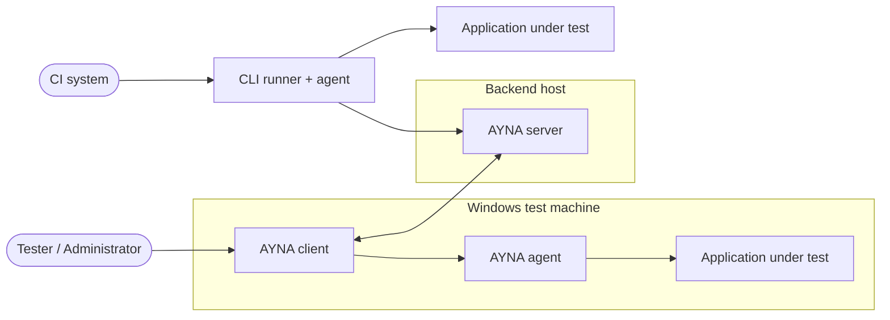
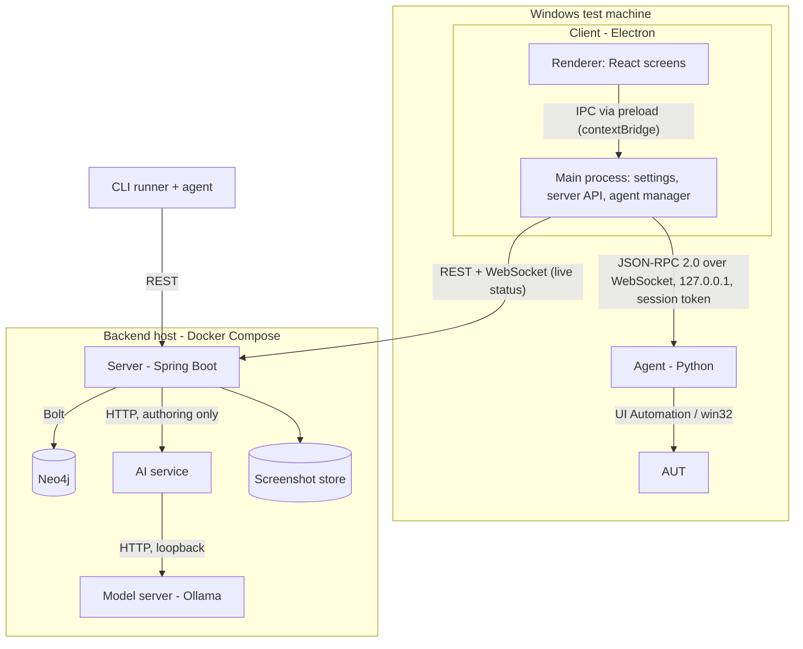
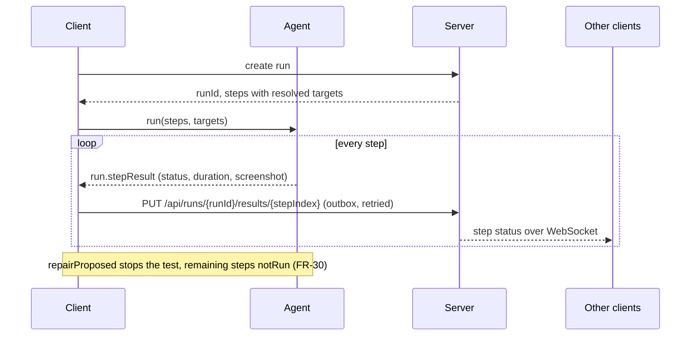
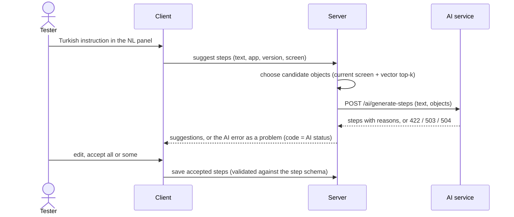
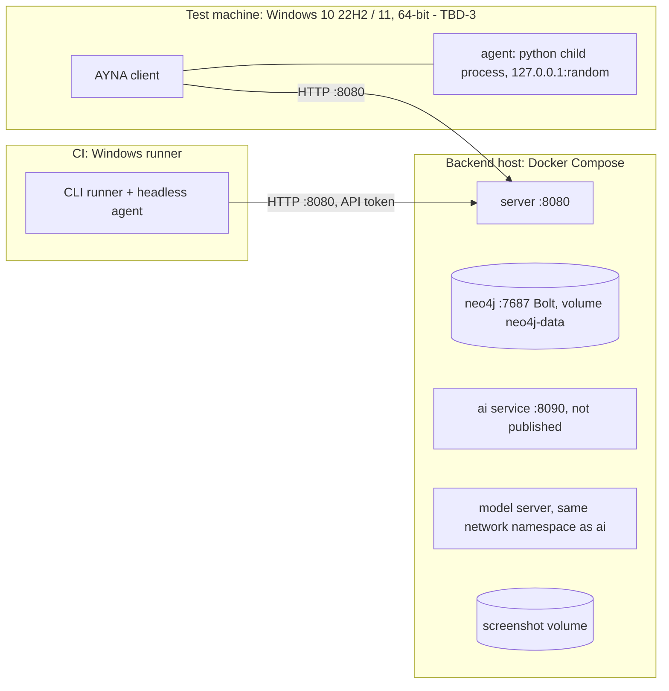
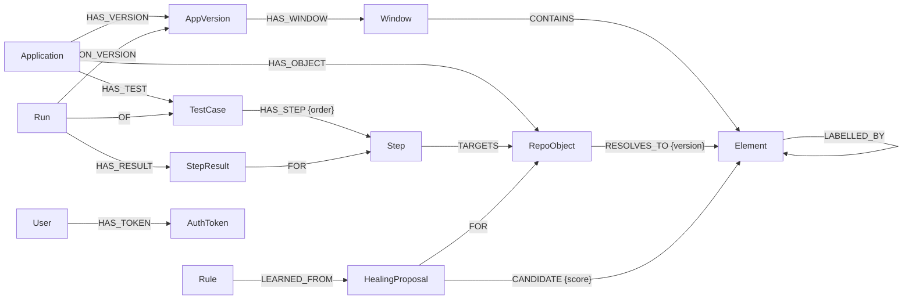
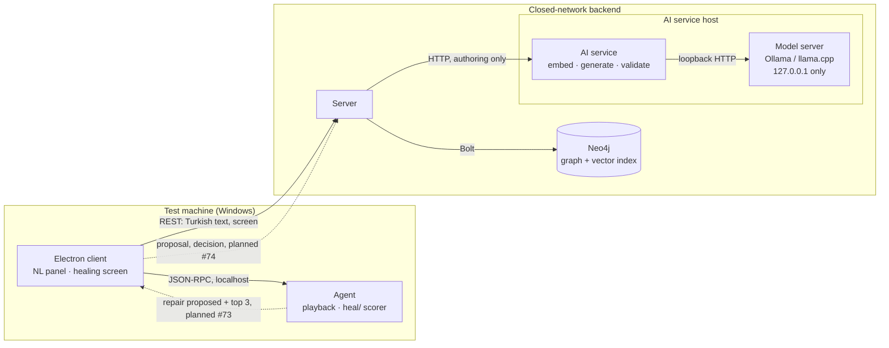
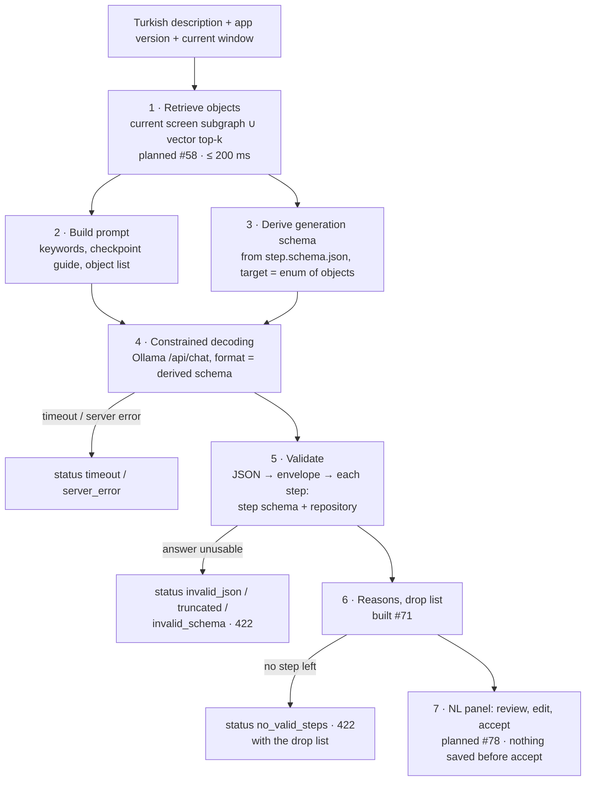
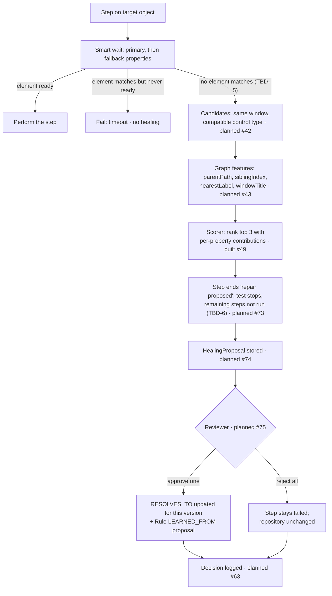

# AYNA — Software Design Description (SDD)

| | |
|---|---|
| Project | AYNA — Akıllı, Yerli, Nesne Tabanlı Arayüz Testi: codeless UI test automation for Windows desktop applications on a closed network |
| Course | COM 4061 Research Project I, Ankara University |
| Advisor | Prof. Dr. Gazi Erkan Bostancı |
| Team | Galip Enes Doğan · Ömerfaruk Sarıbal · Hasan Berk Yanıkkaya |
| Programme | HAVELSAN SUIT application |
| Document | Software Design Description in the style of IEEE 1016-2009 [1] |
| Version | 0.5 — draft of sections 1–7 and 9 |
| Date | 2026-11-15 |
| Status | Sections 1–4 (#45), 5 (#50), 6 (#48) and 7 (#53) drafted. Section 8 waits for the final RS (#41). Final PDF: #53, due 7 Dec 2026 |

## Document history

| Version | Date | Author | Change |
|---|---|---|---|
| 0.1 | 2026-10-29 | Ömerfaruk Sarıbal | Skeleton; introduction, architecture, data design and interface design (#45) |
| 0.1 | 2026-10-31 | Ömerfaruk Sarıbal | Status after #135, #151, #156, #158 merged; retrieval and AI errors settled (#155 review) |
| 0.2 | 2026-10-31 | Ömerfaruk Sarıbal | Test design (#48) |
| 0.3 | 2026-11-07 | Ömerfaruk Sarıbal | AI components moved in as §5 (#50, #53); design rationale, §7 (#53); status after #11, #12, #21 and #60 merged, and PR #173, PR #174, PR #193 |
| 0.4 | 2026-11-08 | Ömerfaruk Sarıbal | Status after the client stack (#17, #24, #25, #30, #38, #183–#185), #15 and step schema v0.2 merged; §7 rows for *Step schema v0.2*, *Client UI language* and *Graph schema v0.4*; RQ1's dump script renamed (#199) (#53) |
| 0.5 | 2026-11-15 | Ömerfaruk Sarıbal | Status after #22, #23, #26, #29, #33, #46, #51, #52, #59, #68, #152 and #221 merged; contracts frozen as 1.0 (§4.1, §4.3, §6.2); graph model v0.5 and its diagram with accounts; the AI service's token (§2.4.2); measured load (§2.3); §7 rows for *Run screenshots* and *Contracts v1*; PR #240's failure category noted as planned (#53) |

---

## 1 Introduction

### 1.1 Purpose

This document describes how AYNA is built: its components, where they run, the data they keep and the interfaces between them. It is written for the three team members who build AYNA, for the advisor who reviews the design at gate G1 (week 7), and for HAVELSAN reviewers who judge whether AYNA can run on their closed network. The requirements it answers are in the Requirements Specification (RS, `docs/rs/`).

### 1.2 Scope

The design covers semester 1 (20 Oct 2026 – 25 Jan 2027): Windows desktop applications automated through UI Automation, one central server per closed network, one client and one agent per test machine, a Turkish natural-language assistant used while tests are written, and self-healing proposals that a person approves. Web and mobile drivers, the calibrated decision layer and Release 1.0 are semester 2; the design keeps room for them (NFR-21, §2.2.2) but does not describe them.

### 1.3 Stakeholders and design concerns

| Stakeholder | Concern | Where answered |
|---|---|---|
| Test author, test engineer (ROLE-1, ROLE-2) | Inspect screens, maintain the repository, build and run tests without writing code (NFR-14); see results live (NFR-06) | §2.2, §2.2.3, §4.2 |
| Healing reviewer (ROLE-3) | See why a candidate was proposed before approving a repair (FR-31) | §2.2.2, §3.3, §5 |
| Administrator (ROLE-4) | Install on a machine without internet (NFR-36); accounts and roles (FR-39) | §2.3, §2.4.2 |
| HAVELSAN reviewer | Nothing leaves the closed network (NFR-29); no per-user licence cost (NFR-23) | §2.4.1, §2.3 |
| CI system (ROLE-5) | Run suites headless and report JUnit XML (FR-23, FR-24) | §2.2, §2.3 |
| Developers (the team) | Stable contracts so three people can work in parallel (NFR-34) | §4 |
| Advisor / course | Traceable design, measurable research questions RQ1–RQ5 | §6, §8 |

### 1.4 Definitions, acronyms and abbreviations

Product terms (repository object, logical name, snapshot, checkpoint, healing proposal, …) are defined once in `memory-bank/project/glossary.md`, and the RS repeats them in its §1.4. This document adds no new terms.

| Abbreviation | Meaning |
|---|---|
| AUT | Application under test |
| UIA | Microsoft UI Automation |
| RPC | Remote procedure call; here JSON-RPC 2.0 [3] |
| ADR | Architecture decision record (`memory-bank/decisions/`) |
| G0–G3 | Project gates: walking skeleton (week 3), design baseline (week 7), MVP core (week 9), feature freeze (week 12) |

### 1.5 References

| # | Reference |
|---|---|
| [1] | IEEE Std 1016-2009, *IEEE Standard for Information Technology — Systems Design — Software Design Descriptions* |
| [2] | ISO/IEC/IEEE 29148:2018, *Systems and software engineering — Life cycle processes — Requirements engineering* (the RS follows it) |
| [3] | JSON-RPC 2.0 Specification, https://www.jsonrpc.org/specification |
| [4] | JSON Schema Draft 2020-12, https://json-schema.org/draft/2020-12 |
| [5] | Neo4j 5 Cypher Manual and Operations Manual (Community Edition) |
| [6] | Electron security checklist, https://www.electronjs.org/docs/latest/tutorial/security |

Project documents: the RS and its requirement list (`docs/rs/scenarios.md`), the ADRs (`memory-bank/decisions/README.md`), the contracts in §4.1, and the literature review (`docs/literature.md`, #10). §5 cites its own list (§5.10). Reference numbers will be aligned with the RS and the literature review in the final document (#53).

### 1.6 Conventions

- **Status labels.** **Built**: the code exists on `main` or on the open PR named. **Planned**: designed here and built in the issue named. **Proposed**: a design choice made in this document or in an open ADR; the named issue or ADR settles it. The status of every part is as of the date in the header.
- **Requirement IDs.** `FR-xx`, `NFR-xx`, `SC-xx`, `ROLE-x` and `TBD-x` are those of `docs/rs/scenarios.md` (#34), which the RS (#35) takes over unchanged.
- **Cross-references** point at sections of this document (§n), repository paths, issues (#n) and requirement IDs.
- **Diagrams** are Mermaid in the Markdown source; #53 renders them for the PDF.

---

## 2 Architecture

### 2.1 Context

AYNA is used inside a closed network. Testers and administrators work in the AYNA client on Windows test machines; the client drives the application under test through a local agent; all shared data lives on one AYNA server. A CI system can run stored suites through the CLI runner. Nothing outside the closed network is reached (NFR-29).



### 2.2 Component view

AYNA has six run-time components. The table gives each one's responsibility; §2.2.2 gives the rules on which component may talk to which.

| Component | Responsibility | Technology | Code | Owner | Status |
|---|---|---|---|---|---|
| **Client** | All user screens: server connection and application choice, Object Spy, repository, codeless editor, NL chat panel, run view and history, healing approval. Starts and supervises the local agent. | Electron + React, TypeScript | `client/` | omer | **Built**: settings, server check, application picker (#32); login, users and API tokens (#60, PR #179); agent process manager (#17, PR #154; its last Windows check is pending); app shell and style (#183, PR #188); Turkish and English UI (#185, PR #190); Object Spy (#24, #184, PRs #186, #189; the pick hotkey in PR #234, its Windows check pending); add to repository (#25, PR #187); repository view (#30, PR #191); codeless step editor (#38, PR #192; grid rows in PR #220, #205); column dropdown from the captured table headers (#221, PR #228); run history with the report in its own window, without script, and a save to file (#68, PR #231; its Windows check pending). Planned: the screens of #44, #75, #78 |
| **Agent** | The only component that touches the AUT: lists windows, reads the element tree and snapshots, picks the element under the cursor, plays steps with smart waits and screenshots, scores healing candidates. | Python, pywinauto (UI Automation; a win32 fallback was measured and not built, #23, PR #236) | `agent/ayna_agent/` | hasan (recognition, playback), galip (`rpc.py`, `heal/`) | **Built**: JSON-RPC server with token handshake and `ping` (#16, PR #135); element descriptor (#11, PR #175); `listWindows` and `snapshot` on UI Automation (#12, PR #180); healing scorer v0 (#49, PR #141); `runSteps` with Click and Type by logical name (#26, PR #200); `elementFromPoint`, the element under the cursor in the client's snapshot (#22, PR #227). Planned: #40 (PR #237), #54, #63, #73 |
| **CLI runner** | Runs a suite without the client: in-process agent, results to the server or to a file, JUnit XML. | Python | `agent/ayna_cli/` | hasan | Planned: #61, #66 |
| **Server** | The shared system of record: applications and versions, snapshots, object repository, tests and steps, runs and step results, screenshots, reports, healing proposals and decisions, users. Validates everything it stores and pushes live run status. Calls the AI service on behalf of the client. | Java 21, Spring Boot 4 | `server/` | omer | **Built**: health check, applications and versions API (#4, #128); tests and steps API (#39, PR #156); graph schema v0 and v0.1 migrations (#14, #39); OpenAPI contract and problem-details errors (#31, #158, PR #160); accounts, roles and API tokens (#60, PR #179); runs API and live run updates (#44, PR #193); snapshot import (#15, PR #182); repository objects API (#25, #30, PRs #187, #191); step screenshots, run retention and idle timeout (#51, PR #223); HTML run report (#59, PR #229); table column headers read from the capture (#221, PR #228); run history API with filters (#68, PR #231); REST, WebSocket and agent contracts frozen as v1 with breaking-change checks in CI (#52, PR #224); load test, NFR-07 met (#152, PR #225). Planned: #74; a failed step's category (#63, PR #240) |
| **Database** | Graph of applications, UI elements, repository objects, tests, runs and healing data; vector index for retrieval. | Neo4j 5 Community | `server/src/main/resources/neo4j/migrations/` | omer | **Built**: schema v0 (#14), v0.1 (`V0002`, #39), v0.2 (`V0003`, #60), v0.3 (`V0004`, #44), v0.4 (`V0005`, #15), v0.5 (#51, properties only). Planned: v0.6 (#63, PR #240, properties only), vector index (#58) |
| **AI service** | Turkish instruction + candidate objects → suggested steps with reasons. Saves nothing. Uses a local model server. | Python; Ollama or llama.cpp with a 7–8B quantised model | `ai/` | galip | **Built**: constrained generation (#37, PR #142), HTTP service (#71, PR #146). Planned: retrieval (#58), offline packaging (#82). Design: §5 |



#### 2.2.1 Inside the client

The client follows Electron's process split [6]:

- The **renderer** draws the screens and has no network or file access: its Content-Security-Policy allows only the app's own files (`connect-src 'self'`, `client/src/main/security.ts`), it runs sandboxed with context isolation, and it may navigate only to its own entry page.
- The **preload** script exposes one typed API object (`client/src/shared/api.ts`) through `contextBridge`. Every call is an IPC request.
- The **main process** holds the settings file, makes every call to the server, and runs the agent manager (`client/src/main/agent.ts`, #17). Each IPC handler first checks that the sender is the app's entry page (PR #154). Main-process modules are free of Electron imports where possible, so `node --test` covers them.

This keeps the server URL, the session and the agent token out of the renderer, and gives one place to add the durable outbox for run results (#44).

#### 2.2.2 Dependency rules

1. **Only the agent touches the AUT** (NFR-21). It reaches it through a driver interface, so a web or mobile driver can be added in semester 2 without changing the step schema, the server or the client.
2. **Only the client's main process talks to the network.** The renderer reaches the server and the agent only through IPC.
3. **The agent never calls the server in interactive use.** The client forwards its results (ADR *Healing proposal transport*, accepted with PR #151). The CLI runner, which has no client, writes the same documents to the same endpoint.
4. **Only the server calls the AI service, and only while a test is being written** (ADR *Language models only at authoring time*). The agent and the CLI runner call no model; a run gives the same result with the AI service stopped (NFR-22).
5. **Only the server reads or writes Neo4j.** The server picks the candidate objects (the current screen's objects, then the vector top-k over the application's objects) and sends them in the request; for the vector query it gets the instruction's embedding from the AI service (`POST /ai/embed`, #58). The AI service has no Bolt edge and no database credentials (settled in the #155 review; §5.4).
6. **Self-healing proposes and never applies a repair during a run** (ADR *Self-healing proposes, never applies mid-run*; FR-30). Only an approval in the client changes the repository (FR-32).

#### 2.2.3 Main flows

The flows below are the ones that cross components. Steps inside one component are in that component's issue.

**Pick an element and add it to the repository** (SC-04, SC-10; #22, #24, #25):

```mermaid
sequenceDiagram
  actor T as Tester
  participant C as Client
  participant A as Agent
  participant S as Server
  T->>C: Spy hotkey over a control
  C->>A: elementFromPoint(x, y), physical pixels
  A-->>C: the node of the client's snapshot (snapshotId, elementId), or none
  C->>C: select it in the tree, outline it; else offer to capture (again)
  T->>C: Add to repository as login.loginButton
  C->>A: snapshot(window)
  A-->>C: snapshot document
  C->>S: POST snapshot (idempotent on snapshot id)
  C->>S: POST repository object (logical name, primary + fallback properties)
  S-->>C: 201, or 409 naming the existing object (FR-07)
```

**Run a test from the editor with live status** (SC-17, FR-20, NFR-06; #44, #51):



**Turkish instruction to suggested steps** (FR-25 – FR-27; #71, #78):



### 2.3 Deployment view



| Node | What runs there | How it gets there | Status |
|---|---|---|---|
| Test machine | Client and agent. The client starts the agent as a child process with a fresh token and a port chosen by the OS, restarts it up to three times after a crash, and stops it on quit (FR-05). The packaged app brings its own Python interpreter (`AYNA_AGENT_PYTHON`). | One Windows installer, no internet, no development tools (NFR-36) | Planned: installer #84; agent manager built (#17, PR #154; its last Windows check pending) |
| Backend host | `docker compose up` starts Neo4j, the server and, from #82, the AI service with its model server. Model weights and the embedding model are inside the image; nothing is downloaded at start (NFR-30). | Images loaded from files on an air-gapped machine (#85) | **Built**: Neo4j + server (`docker-compose.yml`, #4). Screenshot volume `screenshots` (#51). Planned: AI service #82 |
| CI runner | CLI runner with a headless agent on a Windows runner; pulls a suite from the server or reads it from a file, writes JUnit XML. | Same installer or a Python environment on the runner | Planned: #61, #66, #67 |

**Ports.** Only the server's HTTP port is meant for the network. The AI service port (8090) is not published; the server reaches it on the Compose network, and the model server shares the AI service's network namespace because the model client accepts loopback hosts only (proposed for #82). The agent listens on 127.0.0.1 only (NFR-31). The development compose file still publishes Neo4j's ports (7474, 7687); see §2.4.4.

**Sizing.** The backend must serve 10 clients at once with 1 000 repository objects and 500 tests per application (NFR-08). The AI service must run a quantised 7–8B model on 16 GB RAM without a GPU (NFR-13). The server's load test (#152, PR #225, `server/loadtest/`) met NFR-07 under that load on one Apple M3 running both sides: 100 % of 105 443 requests within 500 ms, p95 31.9 ms, no errors (`server/loadtest/results/2026-11-10-apple-m3.md`); a run on the Windows demo machine is still to do.

### 2.4 Cross-cutting concerns

#### 2.4.1 Closed network

No component connects outside the closed network at run time: no CDN, telemetry, auto-update, licence check or cloud model (NFR-29). In practice:

- the client bundles all scripts, styles and fonts, its CSP forbids remote origins, and Electron's auto-update is not used;
- the AI service's model client accepts only loopback URLs, ignores proxy settings and refuses redirects (PR #142);
- Neo4j's usage reporting is turned off (`NEO4J_dbms_usage__report_enabled=false`);
- the air-gapped end-to-end test (#85) checks the whole system with the network cable out.

#### 2.4.2 Security

| Boundary | Mechanism | Status |
|---|---|---|
| Client ↔ agent | Agent listens on 127.0.0.1 only; every connection must carry the per-session token (≥ 16 characters) that the client creates and passes in `AYNA_AGENT_TOKEN`, never on the command line; the agent removes it from its environment (NFR-31) | **Built** (#16, #17) |
| Renderer | Sandbox, context isolation, no Node integration, strict CSP, navigation limited to the entry page, IPC sender check | **Built** (#5, #17) |
| Client ↔ server | Local accounts with roles admin and tester, passwords as bcrypt hashes; every REST and WebSocket request needs a session or API token, except login, the health check and the API docs (NFR-32, FR-39). Every test edit, run and healing decision stores the acting user (FR-40) | **Built** for REST, the WebSocket handshake and the user on test edits and runs (#60, PR #179; #44, PR #193). Planned: the user on a healing decision (#74) |
| CI ↔ server | Revocable API token for a CI service account in `AYNA_SERVER_TOKEN` (answer to TBD-10, ADR *Healing proposal transport*; RS NFR-32) | **Built** on the server (#60, PR #179). Planned: the CLI runner's side, #61 |
| Server ↔ AI service | On loopback, no authentication. As soon as the service listens off loopback (`--allow-remote`, as on the Compose network of #82) it refuses to start without `AYNA_AI_TOKEN`, and every request must carry it as a Bearer token (`ai/API.md`) | **Built** in the AI service (#71, PR #165). Planned: the server's side (#78), Compose (#82) |
| Test data | The AI service never logs the instruction text, which may hold passwords | **Built** (PR #146) |

#### 2.4.3 Failures, timeouts and recovery

- **Agent crash or hang.** The client's heartbeat (JSON-RPC `ping` every 5 s; replies come in any order since PR #135, so it answers at once even during a long snapshot) or the process exit triggers a restart with back-off, at most three times; the counter resets after 60 s of healthy connection; after that the status bar offers "Start again" (FR-05, SC-08; #17).
- **Server unreachable.** The client names the URL in its error (FR-37, NFR-15). Run results go through a durable outbox and are delivered when the server is back, also after a client restart (#44). Result writes are idempotent per `(runId, stepIndex)`, so retries are safe (PR #151).
- **AI service slow or down.** The AI service answers 504 after its own timeout (30 s by default, model load included) and 503 when the model server is down. The server's read timeout is 35 s, so the AI service's answer always arrives first; the server maps its 422, 503 and 504 into problem details with the same status, the AI service's `status` code in `code` and its `error` in `detail` (ADR *REST error body*, #78). Everything except NL generation keeps working (FR-28).
- **Client request timeouts.** The server check and the applications calls give up after 5 s (`client/src/main/server.ts`, `apps.ts`).

#### 2.4.4 Other concerns

- **Turkish text.** All interfaces are JSON in UTF-8, and Neo4j stores strings as Unicode, so ç, ğ, ı, İ, ö, ş, ü pass unchanged (NFR-16). Case-insensitive search uses Turkish-aware folding: İ, I and ı fold to i and diacritics are dropped, so "giris" finds "Giriş" (**Built** in the client, `client/src/shared/tree.ts`, used by the Spy, the repository and the test list; #30, #184).
- **Versioned contracts.** Every contract carries a version; the REST, WebSocket and agent contracts are frozen as 1.0, and CI refuses a breaking change (§4.3, NFR-34).
- **Testability.** Each component is tested in CI on every pull request (NFR-35); the test design is §6.
- **Development defaults.** `docker-compose.yml` publishes Neo4j's ports and has a default password, for development only. The installed backend (#84) publishes only the server port and requires `NEO4J_PASSWORD`.

---

## 3 Data design

### 3.1 Store and ownership

Neo4j Community Edition is the only database (ADR *Neo4j as the single database*; NFR-24). The server is its only client (§2.2.2). Choosing a graph keeps three things in one query language: the UI element tree of each snapshot, the links from tests through repository objects to elements (which change-impact analysis, FR-33, walks), and the healing data with its context. Vector search for NL retrieval uses Neo4j's built-in vector index (#58), so no second store is needed.

- **Identity.** Every node has an `id`: a UUID string the server creates, unique per label. Neo4j's internal `elementId()` is never stored or exposed (ADR *Graph schema v0*).
- **Schema changes** are versioned Cypher migrations in `server/src/main/resources/neo4j/migrations/`, applied by neo4j-migrations when the server starts. A change needs a new migration, an update to `docs/graph-model.md` and, after G1, an ADR.
- **Files.** Screenshots are PNG files in a server volume, one folder per run; the graph stores only their path (`StepResult.screenshotPath`). Reports are rendered on request and never stored (#59), so retention has nothing more to delete. The server keeps the newest N runs of the whole server (`AYNA_RUN_RETENTION`, default 1000; NFR-28) and deletes older ended runs with their screenshots (NFR-40); a running run with no write for `AYNA_RUN_IDLE_TIMEOUT` (60 min) ends as aborted (ADR *Run screenshots, idle timeout and retention*).

### 3.2 Graph model

The graph model is a contract; its full description, with one sample query per relationship and its version history (v0.5 on `main`), is `docs/graph-model.md` (#14). In short:



| Area | Nodes | Design idea |
|---|---|---|
| What the AUT looks like | Application, AppVersion, Window, Element | One subtree per imported snapshot (`snapshotId` on Window and Element). Versions are kept side by side, so two versions can be compared (FR-33). |
| What tests refer to | RepoObject | A logical name (`screen.element`) with primary and fallback properties. `RESOLVES_TO {version}` says where it is found in each version. Tests never store element properties, so a UI change needs repository changes only (NFR-33). |
| What tests are | TestCase, Step | Steps in order on `HAS_STEP {order}`. A step stores its keyword, value and checkpoint and points at its target with `TARGETS`; the logical name in the step document is rebuilt from the RepoObject on read, so renaming an object does not touch steps. |
| What happened | Run, StepResult | One result per step per run, with status, duration, message and screenshot path; from v0.6 a failed step's category (FR-35, #63, PR #240). |
| Healing | HealingProposal, Rule | A proposal for a RepoObject with its scored candidate elements; approved proposals can become rules. |
| Who did it | User, AuthToken | Local accounts and revocable API tokens; the acting user is a property on what it writes (`createdBy`, `startedBy`, …), never a relationship (FR-40). |

### 3.3 Changes to schema v0

Schema v0 was written before the APIs that use it. The issues below change it; each updates `docs/graph-model.md`, and a migration where Neo4j needs a constraint or index.

| Change | Why | Issue | Status |
|---|---|---|---|
| `(Application)-[:HAS_OBJECT]->(RepoObject)` | v0 links a RepoObject to an application only through `RESOLVES_TO`, so an object not yet resolved in any version belongs to no application, and FR-07's uniqueness check has nothing to scope by | #39, #25 | **Built**: migration `V0002` (#39, PR #156); #25 writes it. ADR *Graph schema v0.1*, accepted |
| `(Application)-[:HAS_TEST]->(TestCase)` | Tests are listed and counted per application (NFR-08); v0 has no such link | #39 | **Built** (PR #156) |
| Logical names unique per application, pattern of the step schema, `none.noMatch` refused | FR-07, SC-11; `none.noMatch` is reserved by the AI service | #25 | **Built** in `RepoObjectService` (#25, PR #187). Per application, not per version (ADR *Graph schema v0.1*) |
| `columns` (list of strings) on the repository API's objects | Grid column headers from the snapshot, for the editor and for `column` in generated steps | #221 | **Built**, with no graph change: the captured `Header`/`HeaderItem` Elements keep their order in `siblingIndex`, so the server reads the headers from the tree of the object's latest capture (`GridColumns`). Possibly incomplete, so never used to reject a column |
| `Step.checkpoint` and `Step.row` as JSON strings; `Step.timeoutMs` integer | Neo4j properties cannot hold maps; v0 lists neither `timeoutMs` nor `row` | #39 | **Built** (PR #156) |
| `User` and `AuthToken` nodes; acting user on edits, runs and decisions | FR-39, FR-40 | #60, #44, #74 | **Built**: `V0003`, the user on test edits (#60, PR #179) and on runs (#44, PR #193). Planned: on decisions (#74) |
| `(Run)-[:ON_VERSION]->(AppVersion)`; a copy of the steps on Run; unique `(runId, stepIndex)` on StepResult | History by version (FR-22); results keep their meaning when a test is edited; overlapping retries cannot store a result twice | #44 | **Built** (`V0004`) |
| Per-candidate data on `CANDIDATE`; whole proposal JSON on `HealingProposal`; `(StepResult)-[:PROPOSED]->(HealingProposal)` | Contributions and raw similarities per candidate; the proposal kept exactly as the agent scored it | #74 | Planned (ADR *Healing proposal transport*, accepted) |
| `lastActivityAt`, `endedBy` on Run; `screenshotHash`, `screenshotReceivedAt` on StepResult (v0.5) | Idle timeout, retention and repeatable screenshot writes | #51 | **Built**, no migration (PR #223) |
| `category` on StepResult (v0.6) | A failed step's category (FR-35) | #63 | Planned: PR #240, no migration |
| Vector index on `RepoObject.embedding` | NL retrieval (NFR-11) | #58 | Planned |

### 3.4 Exchange documents

Data that crosses a process boundary is a JSON document with its own JSON Schema (Draft 2020-12 [4]) in `schemas/`. The server validates against the same files it publishes, so the client, the agent, the AI service and the server cannot disagree on shape.

| Document | Schema | Produced by → consumed by | Status |
|---|---|---|---|
| Step document `{version, steps[]}` | `schemas/step.schema.json` | editor, AI service, recorder → server → agent | **Built**: v0.2 on `main` (#13, #147, PR #150), which adds grid and list rows; the editor's rows in PR #220 (#205) |
| Element descriptor | `schemas/element.schema.json` | agent → client, server | **Built**: v0.1 on `main` (#11, PR #175) |
| Window snapshot | `schemas/snapshot.schema.json` | agent → server | **Built**: v0.1 on `main` (#12, PR #180) |
| Healing proposal | `schemas/healing-proposal.schema.json` | agent → client or CLI runner → server | **Built**: v0.2 on `main` (#149, PR #174) |
| Live run messages | `schemas/ws-runs.schema.json` | server → clients | **Built**: 1.0 (#52, PR #224); 1.1 adds a failed step's category (PR #240) |
| Agent messages | `schemas/agent-rpc.schema.json` | client ↔ agent | **Built**: 1.0 (#52, PR #224); 1.1 adds a failed step's category (PR #240) |

---

## 4 Interface design

### 4.1 Interfaces at a glance

| Interface | Between | Transport | Contract | Version | Status |
|---|---|---|---|---|---|
| REST API | client, CLI runner → server | HTTP/1.1, JSON | `docs/api/openapi.yaml`, generated from the server (#31) | 1.0, frozen (#52) | **Built** in part (§4.2) |
| Live updates | server → clients | WebSocket `/ws/runs`, JSON messages | `schemas/ws-runs.schema.json` (#52); ADR *Runs API and live run updates* | 1.0, frozen (#52) | **Built** on the server (#44); the client's screen comes with #44's client half |
| Agent JSON-RPC | client main process → agent | JSON-RPC 2.0 [3] over WebSocket on 127.0.0.1 | `schemas/agent-rpc.schema.json` (shapes) and `docs/agent-rpc.md` (behaviour) | 1.0, frozen (#52): 0.1 + `runSteps` (#26) + `elementFromPoint` (#22) | **Built**: 1.0 (PRs #135, #200, #227). Planned: 1.1 failure category (PR #240); step results with healing proposals (#73) |
| AI service API | server → AI service | HTTP/1.1, JSON | `ai/API.md` | v0 | **Built** (PR #146); design in §5 |
| Database | server → Neo4j | Bolt | `docs/graph-model.md` + migrations | v0.5 | **Built** (#14 and §3.3) |
| Exchange documents | all | JSON in the above | `schemas/` | per schema | §3.4 |

### 4.2 REST API

Resources follow the graph (§3.2), under `/api`. JSON bodies use camelCase and the server's UUID ids. The endpoint list below is the design; `docs/api/openapi.yaml` (#31), generated from the code, is the authority once it exists.

| Resource | Endpoints | Requirement | Status |
|---|---|---|---|
| Health | `GET /api/health` → 200 `{status, db}`, or 503 when Neo4j is down | FR-37 | **Built** (#4) |
| Applications | `POST /api/apps` (201; 409 duplicate name; 400 invalid) · `GET /api/apps` | FR-38 | **Built** (#128) |
| Versions | `POST /api/apps/{id}/versions` (201; 404 unknown app; 409 duplicate) · `GET /api/apps/{id}/versions` | FR-38 | **Built** (#128) |
| Snapshots | `POST /api/apps/{id}/versions/{v}/snapshots`, idempotent on the snapshot id | FR-04 | **Built** (#15, PR #182); one Window per snapshot id (`V0005`) |
| Repository | create, list and search, rename and edit, delete (refused while steps target the object, naming the tests); a grid object's `columns` from its latest capture | FR-06 – FR-09 | **Built** (`/api/apps/{id}/repo-objects`, `/api/repo-objects/{id}`; #25, #30, #221, PRs #187, #191, #228) |
| Tests and steps | create, read, replace the step list (validated against the step schema), export and import | FR-11 – FR-14 | **Built** (#39, PR #156) |
| Runs and results | `POST /api/runs` (copies the steps), `GET /api/runs/{id}`, `GET /api/tests/{id}/runs`, `POST /api/runs/{id}/finish`; `PUT /api/runs/{runId}/results/{stepIndex}`: 201, 200 for an identical repeat, 409 for another body (ADR *Healing proposal schema 0.2*); `PUT`/`GET /api/runs/{runId}/results/{stepIndex}/screenshot` (raw `image/png` after its result; 201, 200 for the same image, 409 for another, 413 over 8 MB); `GET /api/apps/{id}/runs?testId=&status=` (newest 100 of the application, for the run history) | FR-20, FR-21, FR-22, FR-28 | **Built** (#44): plain results; (#51) screenshots, retention, idle timeout; (#68) the application's run list. Planned: #74 (`repairProposed`) |
| Reports | `GET /api/runs/{runId}/report.html?lang=en\|tr` (default `en`): one self-contained file rendered on request for a run in any state (summary, step table, each screenshot as a `data:` URI, a CSP that allows nothing else); 400 other `lang`, 404 unknown run | FR-21, NFR-09 | **Built** (#59, PR #229): a 50-step run with 222 KB screenshots in 216 ms (`RunReportIntegrationTest`) |
| Healing | list proposals, approve or reject (`/api/healing/proposals…`) | FR-31, FR-32 | Planned: #74 (shape in ADR *Healing proposal transport*) |
| NL suggestions | suggest steps for an instruction; AI errors mapped to problems with `code` | FR-25 – FR-27 | Planned: #78 |
| Change impact | changed objects and affected tests between two versions | FR-33 | Planned: #81 |
| Accounts and tokens | login, logout, current user (`/api/auth`); admin only: users and roles, API tokens for CI (`/api/users`, `/api/tokens`) | FR-39, FR-40 | **Built** (#60, PR #179); the user on runs with #44 (PR #193), on healing decisions with #74 |

**Errors.** Every 4xx body is an RFC 9457 problem (`application/problem+json`): `status`, `title`, `detail` (the message for the user, naming the step, object, field or id, NFR-15) and `instance`. A validation 400 adds `errors: [{path, message}]` (at most 50, JSONPath into the body) and `errorCount`. `type` is `urn:ayna:error:<kind>` where a caller must tell two problems with one status apart (the CLI runner, #61), otherwise absent. One global handler writes them; each endpoint lists its statuses in `docs/api/openapi.yaml` (ADR *REST error body*, accepted; **Built** in #158, PR #160). The client reacts to the status code and shows `detail` (`client/src/main/apps.ts`).

**Performance.** 95 % of requests other than report downloads, snapshot imports and screenshot uploads within 500 ms under the NFR-08 load (NFR-07; measured, §2.3); the HTML report of a 50-step run within 5 s (NFR-09).

### 4.3 Versioning and the G1 freeze

Every contract in §4.1 carries a version. The REST, WebSocket and agent contracts were frozen as **1.0** on 2026-11-15 (NFR-34, #52, PR #224; ADR *Contracts v1*). After the freeze, additions (a new optional field, endpoint, method, message or enum value) raise the minor version and every reader ignores what it does not know; anything that removes or narrows needs a new major version. A change to `schemas/` still needs an ADR and all three members' approval (`schemas/AGENTS.md`). The CI job `contracts` fails a pull request on a breaking change: `.github/contracts/schema_compat.py` compares every schema with the base branch, and oasdiff compares the generated `openapi.yaml`. The step schema accepts only its own version (`version` is a `const`), so a stored document always says which rules it was checked against; moving from 0.1 to 0.2 changes only that field (PR #150).

---

## 5 AI components

_Written by galip (#50, PR #144). It follows the ADRs *Language models only at authoring time*, *Self-healing proposes, never applies mid-run*, *Calibrated decision layer moves to semester 2* and *Step schema v0* (§7)._

### 5.1 Overview and boundaries

AYNA has two AI contributions in semester 1 and collects the data for a third in semester 2:

- **C1, Turkish natural language → steps.** A local open-weight language model suggests test steps while a test is being written. Lives in the AI service (`ai/`).
- **C2, explainable, approval-gated self-healing.** When a step's element is not found, a weighted similarity ranks candidate elements and a person approves the repair. Lives in the agent (`agent/ayna_agent/heal/`). **It uses no language model.**
- **Decision log → calibrated decision layer.** Semester 1 logs every failure decision; semester 2 adds a local decision model behind a confidence threshold.

| Part | Code | Model | Runs when | Status |
|---|---|---|---|---|
| Step generation: prompt, constrained decoding, validation | `ai/ayna_ai/generate.py`, `ollama.py`, `validate.py` | Local 7–8B LLM via Ollama | Authoring | **Built**, PR #142 (#37) |
| Retrieval of repository objects | Queries and vector index migration in `server/`; `POST /ai/embed` in `ai/` | Small multilingual embedding model | Authoring | Planned, #58 |
| NL service endpoint `POST /ai/generate-steps`, `GET /ai/health` | `ai/ayna_ai/service.py`; contract `ai/API.md` | (uses the above) | Authoring | **Built**, PR #146 (#71); candidate objects come from the request, chosen by the server (§5.4) |
| NL chat panel | `client/` | none | Authoring | Planned, #78 (omer) |
| Healing candidates and graph features | `agent/ayna_agent/heal/candidates.py`, `features.py` | none | Playback; offline for RQ4 | Planned, #42, #43 |
| Healing scorer | `agent/ayna_agent/heal/scorer.py` | none | Playback; offline for RQ4 | **Built**, PR #141 (#49) |
| Healing in playback | agent playback | none | Playback | Planned, #73 (hasan) |
| Healing proposals API, approval screen | `server/`, `client/` | none | After a run | Planned, #74, #75 (omer) |
| Failure triage and decision log | agent | none | Playback | Planned, #63 (hasan) |
| Calibrated decision layer | not yet placed | Local decision model | See §5.6.3 | Semester 2, #103 |

Change-impact analysis (C3, #81) is a graph query in the server and belongs with the data model, not here.

#### Boundaries

Every AI part follows these rules.

1. **Closed network** (NFR-29, NFR-30). The model server runs on the same host as the AI service. `OllamaClient` (`ai/ayna_ai/ollama.py`) accepts only a loopback URL (127.0.0.0/8, `::1`, or a name such as `localhost` only if every address it resolves to is loopback; it then connects to the checked address, never to the name), ignores proxy environment variables and refuses redirects, so a request cannot leave the machine. The service's own listen address follows the same rule. The model weights and the embedding model are bundled into the AI service image, and nothing is downloaded at start (#82).
2. **Language models only at authoring time** (ADR; FR-28, NFR-22). Only the server calls the AI service, and only while a test is being written. The agent and the CLI runner never call a model. Systems that let a model choose actions at run time are not repeatable, so they report the best of three runs ([15], [40]); a regression test has to replay the same way every time. With the AI service stopped, everything except step generation works (SC-28).
3. **A person approves everything AI produces.** Generated steps are suggestions until the author accepts them, and nothing is saved before that (FR-27). Healing candidates are proposals until a reviewer approves one (ADR; FR-30–FR-32). No AI output changes a test or the repository on its own.
4. **Grounded in the repository.** A step targets a repository object by logical name only (step schema `target`, FR-10). Generation can only choose among the objects it was given, and a validator drops anything else (FR-26).
5. **Deterministic where it can be.** Decoding uses temperature 0 and a fixed seed. The healing scorer uses exact rational arithmetic. The same input gives the same output on the same runtime.



The dotted edges are planned. The AI service has no edge to Neo4j: the server chooses the candidate objects and sends them (§5.4).

### 5.2 Natural language → steps pipeline (C1)

#### Contract

The JSON shape is fixed in `ai/API.md` (built, #71, PR #146); the part the client sees goes into the REST contract (#31, frozen in #52).

- **In** (built, #71): `POST /ai/generate-steps` with the Turkish description (`text`), the application (`app`), its `version` and the current window (`screen`), and the candidate `objects` the server chose (≤ 100, logical name + Turkish description; §5.4). The server adds the user. The NL panel sends it through the server (#78).
- **Out** (built, #71): `steps`, the suggested steps, each a valid `#/$defs/step` of `schemas/step.schema.json` plus a short Turkish `reason`; `dropped`, every step the model wrote that cannot be suggested, as `{index, code, reason, step}`; `stepLimitReached`, true when the model wrote as many steps as the grammar allows (12), so later steps may be missing; the `status`, the `model`, `schemaVersion`, `promptVersion` and `latencyMs`. HTTP 200 always carries at least one step.
- **In the library** (#37, #71): `StepGenerator.generate(text, objects, timeout_s=None)` takes the text and a map `logical name → Turkish description` and returns a `GenerationResult`: the status, the kept steps as a step document `{"version": "0.1", "steps": [...]}` when the status is `ok`, one reason per kept step, the dropped steps, the raw output, the errors, the latency and the token counts.

#### Stages



| # | Stage | Status | Design |
|---|---|---|---|
| 1 | Retrieve | Planned #58 | See §5.4. Produces the `{logical name: description}` map, at most N objects. |
| 2 | Prompt | Built | One English system prompt (`SYSTEM_PROMPT`). It names the five keywords, says when a checkpoint uses `name` (text shown by a label, message, button or table) and when it uses `value` (text inside an input or combo box), and lists the objects with their Turkish descriptions; since prompt v3 (#71) the same line offers `none.noMatch` "if none of them fits" (§5.3, limit 3). The user message is the Turkish text, unchanged. It describes no JSON field layout, because the grammar carries the structure. About 440–470 prompt tokens with 17 objects. |
| 3 | Generation schema | Built | See §5.3. |
| 4 | Decode | Built | `stream: false`, `think: false`, temperature 0, seed 42, `num_ctx` 4096, `num_predict` 512 (768 in the service, for the reasons). The service's request deadline (30 s) bounds the call. |
| 5 | Validate | Built | `json.loads`, then the **original** step schema in two parts (`StepValidator`, #71): the envelope (`version`, the `steps` list) as a whole, then each step on its own against `#/$defs/step` and the object list (`step_problems`). Together they accept exactly what the whole schema accepts. Checking after decoding catches a gap in the derivation and a runtime that ignores `format`. |
| 6 | Reasons, drop list | **Built** #71, PR #146 | See *Built in #71* below. |
| 7 | Review | Planned #78 | Suggested steps shown as a diff, accepted all at once or one by one; accepted steps become ordinary steps (FR-27, SC-26). |

#### Failure statuses (built)

A failure of the whole answer comes back as a typed `Status`, never as steps; a single bad step is dropped instead (below). HTTP codes are those of the service (`ai/API.md`).

| Status | HTTP | Cause | Observed so far |
|---|---|---|---|
| `ok` | 200 | At least one step valid against the step schema with a known target; the others in `dropped` | 20/20 with the derived schema (#37); 29/30 spike answers through the service (#71; the other one a 504) |
| `invalid_json` | 422 | Output does not parse | None |
| `truncated` | 422 | `num_predict` reached before the JSON closed (`done_reason: length`) | None since the caps; the #7 runaway was this case |
| `invalid_schema` | 422 | Parses but is not a step document: no or wrong `version`, `steps` not a list, extra fields at the root | All 10 answers of the no-schema baseline (invented fields such as `action`, `step`) |
| `no_valid_steps` | 422 | Every step was dropped (or there were none); the body carries `steps: []` and `dropped` | The SC-27 sentence when the model chose `none.noMatch` |
| `timeout` | 504 | No answer within the service's 30 s request deadline | One live: the longest spike answer (4 steps) on a busy laptop, 30.0 s |
| `server_error` | 503 | Model server unreachable or HTTP error | None |

**Drop codes** (`DropCode`, one per dropped step; the first that applies, the `reason` lists all):

| Code | Cause | Possible with the grammar |
|---|---|---|
| `unknown_keyword` | `keyword` outside Click, Type, Select, Verify, Wait (e.g. `DoubleClick`) | No |
| `unknown_target` | `target` is not one of the retrieved objects (an invalid logical name included) | No |
| `no_match` | `target` is the reserved `none.noMatch`: the model says no object fits | Yes, by design |
| `invalid_step` | Any other step-schema error (e.g. Click with `value`), or a missing or too long reason | No |

When the server cannot reach the AI service at all, the NL panel is disabled with a message that says so (FR-27, SC-28). That check lives in the server and client (#71, #78).

#### Built in #71 (PR #146)

- **Per-step validation and a drop list** (FR-26, SC-27). Each step is validated on its own against `#/$defs/step` and the object list; the valid ones are suggested and every dropped step is listed as `{index, code, reason, step}`: its position in the model's answer, a drop code (table above), the reason, and the step as the model wrote it. When nothing is left the service answers **HTTP 422 with `status: "no_valid_steps"`**, `steps: []` and the drop list: 422 already meant "the model answered, but nothing is usable; ask the user to rephrase", which is what SC-27's panel shows, and 200 always carries a step to review. SC-27's stub-model test (keyword `DoubleClick`, target `login.forgotPasswordLink`) passes: no suggested step, two dropped steps (`unknown_keyword`, `unknown_target`), each with its reason. The service re-checks every kept step against the retrieved objects before answering, and a property test over 150 random grammar-ignoring answers checks `steps` and `dropped` together.
- **A reason per step** (FR-25). The step schema allows no extra fields (`additionalProperties: false`), so a reason cannot travel inside a stored step. The generation schema adds a required `reason` string (1–100 characters) to each step variant, after the step's own fields, so it explains the step rather than steering it; the generator removes it before validation and the service returns it next to the step. A step with a missing or too long reason is dropped (`invalid_step`). Reasons cost about 75 % more output tokens (median 63 → ~110). Whether `reason` should come before `keyword` (explain, then act) is left to the model comparison on the dev split (#72).
- **A no-match target.** Built; see §5.3, limit 3.
- **Service timeout.** A 30 s deadline per request (`--timeout`), well below the CLI's 120 s: retrieval and the model call share it, the model call gets the time left, and the service answers 504 `timeout` instead of hanging. That is about three times the idle p95 (#37), but on a busy laptop the longest spike answer hit it (30.0 s); the deadline is measured again on team hardware (#71, #131).

#### Limits

| Limit | Value | Why |
|---|---|---|
| Steps per request | 1–12 | Bounds the output; an answer of exactly 12 is flagged (`stepLimitReached`), so the cap never shortens it silently |
| Free strings (`value`, `expected`) | ≤ 200 characters (the contract allows 1000) | Stops a runaway string early (#7 finding 1) |
| Output tokens (`num_predict`) | 512; 768 in the service | About 25–40 tokens per step, so 12 steps fit; a reason adds about 15–25 per step |
| Context (`num_ctx`) | 4096 tokens | Prompt plus object list plus answer |
| Objects per request | ≤ 100 in a request until #58; then N from retrieval | Prompt-processing time and the size of the grammar grow with N; 100 keeps the prompt inside `num_ctx` |
| Turns | One instruction per request, no chat history | Semester 1 scope |
| Time per request | 30 s (service, `--timeout`) | The panel reports `timeout` instead of hanging |

Turkish characters and suffixes are handled: both models turned *Ankara'yı* into `Ankara` and kept `Kayıt başarılı` unchanged (#7 finding 4; NFR-16).

#### Latency budget and measured numbers

Semester 1 commits to no end-to-end target. The p95 per scenario is measured and reported (NFR-12, #71, #77). The budget is shared like this:

| Stage | Budget | Basis |
|---|---|---|
| Retrieval | < 200 ms | NFR-11, #58 |
| Schema derivation, prompt, validation | milliseconds | Pure Python over small documents |
| Model | everything else | Prompt processing plus about 15–20 output tokens/s on a laptop CPU/GPU |

Measured on a MacBook M2 with 16 GB, Ollama 0.40.11, model already loaded, 10 Turkish spike sentences against 17 objects:

| Run | Model | Format | Valid (parse + schema + targets) | Keyword sequence right | Latency p50 / p95 | Output tokens (median) |
|---|---|---|---|---|---|---|
| #7 spike, 2026-10-25 | qwen3:8b | spike schema, no caps | 10/10 | 9/10 | median 3.4 s | — |
| #7 spike, 2026-10-25 | gemma4:e4b-it-qat | spike schema, no caps | 9/10 (one 3,712-token runaway) | 9/10 | median 5.8 s | — |
| #37, 2026-10-27 20:31 | qwen3:8b | derived schema | **10/10** | 9/10 | 5.61 / 9.07 s | 63 |
| #37, 2026-10-27 20:32 | gemma4:e4b-it-qat | derived schema | **10/10** | **10/10** | 6.22 / 8.68 s | 70.5 |
| #37, 2026-10-27 20:34 | gemma4:e4b-it-qat | any JSON (baseline) | 0/10 | — | 6.08 / 12.55 s | 66.5 |
| #71 service over HTTP, 2 runs, 2026-10-27 21:36–21:43 | qwen3:8b | derived schema + reason | 20/20 | 18/20 | 12.57 / 25.29 s | ~110 |

The #37 runs shared the machine with other jobs (load average about 6), and so did the #71 runs (about 4.5), so their latencies are pessimistic; the #71 row includes the reasons and the HTTP layer (0–3 ms). They are also higher than the spike's because each answer is about 15 tokens longer (`version`, checkpoint objects). Raw results: `ai/spikes/results/generate-20261027-*.json`. A cold model load took 7.6–10.2 s (#7), so the service loads the model at start and keeps it loaded (`warm_up()`, `OLLAMA_MAX_LOADED_MODELS=1`).

**Models and memory.** `qwen3:8b` (the default in `GenerationSettings`) and `gemma4:e4b-it-qat`, both Apache-2.0, need about 5 GB each as Q4 quantisations. One model at a time fits a 16 GB machine together with the rest of AYNA (NFR-13). At least three models are compared on the dev split (#72), and D4 (#80) picks the default. Model names and licences ship with the image (NFR-23, #82).

#### Logging and input safety

Each generation logs one JSON line: `ts`, `event: generate`, `scenario`, `model`, `status`, `latency_ms`, `load_ms`, `prompt_tokens`, `output_tokens`, `steps`, `dropped`, `step_limit_reached`; the service adds one `event: request` line per HTTP request. The lines hold no user text, so service logs carry no test content (tested). The batch CLI (`python -m ayna_ai.generate`) writes the full results, with the environment (platform, Ollama version), for evaluation.

The user's text is untrusted input to the model. The model has no tools, and its output can only be a step document over objects that already exist, which a person then reviews. A hostile description can therefore at worst produce wrong suggestions.

### 5.3 Constrained decoding (built, #37)

**Why.** A JSON schema given to the decoder guarantees syntax only, not meaning ([42], [43]). In the #7 spike, a free string let one answer run for 3,712 tokens without closing. Grammar converters skip unsupported JSON Schema features silently, among them `if`/`then`, which the step schema uses for its per-keyword rules ([43]). So the AI service derives its own generation schema from the frozen contract on every request and gives it to Ollama as `format`.

**Derivation** (`generation_schema()` in `ai/ayna_ai/generate.py`):

1. Inline the local `$ref`s and drop annotations (`title`, `description`, …).
2. **Split the step by keyword.** Each `if keyword = X then …` rule becomes one variant that holds only the fields that keyword allows: `false` removes a field, `required` lists are merged, constraints are intersected (Select's `value` gets `minLength: 1`). The step becomes an `anyOf` of 5 variants.
3. **Split the checkpoint by property** the same way: `name`/`value` take a string `expected`; `enabled`/`visible`/`checked`/`selected` take `operator: "equals"` and a boolean `expected`. That gives 2 variants.
4. **`target` becomes an `enum`** of the object names passed in, after each name is checked against the logical-name pattern, plus the reserved `none.noMatch` (limit 3, #71).
5. **Leave out server fields**: `id` is assigned by the server on save.
6. **Cap free strings** at `maxLength` ≤ 200 and the list at 1–12 steps. `version` stays a `const`, so the raw output is a complete step document.
7. **Check the result is grammar-friendly**: no `$ref`, `$defs`, `allOf`, `oneOf`, `not`, `if`/`then`/`else`, `dependentRequired` or boolean subschema is left. `anyOf` appears only as a union of whole object schemas, never mixed with `properties` at the same level, which llama.cpp does not support ([43]).
8. **Fail loudly.** Any construct the derivation does not know raises `SchemaDerivationError`. A change to `step.schema.json` therefore breaks a test, and generation never silently becomes looser. A sampling test checks that the derived schema never accepts what the step schema rejects.

The Type branch for a three-object request, for example:

```json
{"type": "object",
 "properties": {
   "keyword": {"const": "Type"},
   "target": {"type": "string", "enum": ["login.userNameInput", "login.passwordInput", "login.loginButton"]},
   "value": {"type": "string", "maxLength": 200},
   "timeoutMs": {"type": "integer", "minimum": 0, "maximum": 600000}},
 "required": ["keyword", "target", "value"],
 "additionalProperties": false}
```

**Effect.** With the derived schema, both models produced 10/10 valid documents on the spike inputs. The sentence that ran away in #7 ended in 38 tokens and 4.1 s. Without the schema (`--format json`), gemma4 produced 0/10 valid documents: every answer invented its own field names, so the structure comes from the grammar and not from the prompt.

#### Known limits

1. **Structure, not meaning.** A schema-valid answer can still be wrong. qwen3 dropped the first Click of a three-action sentence (#7 finding 2). Prompt v1 used `value` for every label check, which playback would fail because UIA labels have no ValuePattern; prompt v2 fixed this with the `name`/`value` guide. The author's review (FR-27) and RQ3 (#77) catch and measure this kind of error.
2. **Table rows: the schema can check them, the NL path cannot yet.** *"Tabloda Yılmaz'ın listelendiğini kontrol et"* used to become `Verify main.customerGrid {name contains "Yılmaz"}`: valid, but it checks the grid's UIA Name, not its rows. Step schema v0.2 (ADR *Step schema v0.2: rows*, PR #150) adds `SelectRow`, `row` and the `rowCount`, `rowExists` and `cell` checks; playback performs them in PR #237 (#40). What is left is #147's follow-up on this side: the prompt lines and the derived schema for rows, with the object's `columns` (#221) listed in its description rather than forced into an enum, since a capture's column list can be incomplete. Until then reviewers reject such steps, and the NL dataset (#36) marks such sentences.
3. **Forced choice.** Because `keyword` and `target` are enums, the model cannot answer "no such action" or "no such object". *"Şifremi unuttum bağlantısına çift tıkla"*, with no such link in the repository, becomes a Click on some existing object: valid and wrong ([42] notes the same weakness; SC-27). **Built (#71, PR #146):** the enum always holds the reserved target `none.noMatch`, which fits the logical-name pattern, and prompt v3 offers it in the target line ("or none.noMatch if none of them fits"; as a separate line it made qwen3 add spurious Clicks). The validator drops any step that uses it (code `no_match`, reason "no repository object matches"). The derivation fails loudly if the step schema stops accepting the name, and the service answers 400 to a request object with that name, and the repository refuses it as a logical name (`RepoObjectService.NO_MATCH`, #25). Live, qwen3:8b sent the sentence above to `none.noMatch` in some runs and to `Click login.passwordInput` in others with the identical prompt, so how often, and how correctly, the model uses the escape is measured in #77. Keywords keep no escape value in v0: an action outside the five keywords is mapped to the closest one, the reviewer catches it, and RQ3 counts how often this happens.
4. **Runtime coverage.** The derivation was run on Ollama 0.40.11 only. It avoids every construct that llama.cpp's converter lists as unsupported, but llama.cpp itself has not been tried. If D4 picks llama.cpp, test it there (#72, #80).
5. **Determinism.** Temperature 0 with a fixed seed gave identical steps across runs on the same machine and runtime (#7: online and offline runs matched). This is not promised across runtime versions or hardware, so every results file records the Ollama version and the platform.

### 5.4 Retrieval of repository objects (planned, #58)

**Purpose.** Give the model the few objects that matter: the right set for H2, a short prompt (prompt-processing speed differs about 5× between the two models, #7 finding 6) and a small `target` enum. The repository acts as RAG's non-parametric memory ([41]). When the UI changes, the repository is updated or healed and the assistant follows without retraining.

**Design.**

- **What is embedded.** For each RepoObject: its logical name, the UIA Name of the element it resolves to, and that element's label (`LABELLED_BY` or nearest label). The control type may help the model choose between `name` and `value` (#37 handoff); #58 measures it. The same text, in Turkish, becomes the description in the prompt.
- **Embedding model.** A small multilingual open-weight model, bundled with the AI service, with its licence documented (NFR-23, NFR-30). #58 chooses it.
- **Storage.** The `embedding` property on RepoObject (already in `docs/graph-model.md`) with a Neo4j vector index. Community Edition has vector search, so no second database is needed (NFR-24). The index migration is a server migration (`server/`, reviewed by omer).
- **Refresh.** The embedding is recomputed whenever a RepoObject is created or changed, or resolves to a new element (#58 acceptance). The server asks the AI service for the vector (`POST /ai/embed`) and writes it itself, so the AI service never writes to the graph. While the AI service is down, the object is marked stale and refreshed later.
- **Query (run by the server).** (a) The current screen: the RepoObjects that resolve, in the current version, to an element of the current window. (b) The vector top-k over the application's RepoObjects (`HAS_OBJECT`) for the Turkish text, embedded with `POST /ai/embed`. Merge the two without duplicates, current screen first, at most N objects. k and N are tuned on the dev split. Acceptance: Recall@10 of the gold objects ≥ 90 %, query < 200 ms (NFR-11). Without embeddings (stale, or no AI service at indexing time), (a) is used alone.

```cypher
// (a) repository objects of the current window, for one app version
MATCH (:AppVersion {id: $versionId})-[:HAS_WINDOW]->(w:Window {id: $windowId})
MATCH (w)-[:CONTAINS*1..]->(e:Element)<-[:RESOLVES_TO {version: $versionId}]-(o:RepoObject)
RETURN o.name, e.name
```

**Decided 2026-10-29 (§5.9 #5).** The server runs both queries and sends the merged objects in `POST /ai/generate-steps`; the AI service has no Bolt edge and no database credentials (§2.2.2 rule 5). The embedding model stays in the AI service behind `POST /ai/embed`. The queries live next to the data in `server/`, so #58's expected output changes from `ai/ayna_ai/retrieve.py` to the server queries plus `/ai/embed`; `retrieve.py` keeps the pass-through retriever.

### 5.5 Self-healing (C2)



#### 5.5.1 Trigger (planned, #73)

Healing starts only when **no** element matches the object's primary or fallback properties by the end of the smart wait (FR-10, FR-29). An element that matches but never becomes visible and enabled is a `timeout` and gets no healing. A search or snapshot that runs out of its time budget before it covers the window is `search incomplete` and gets no healing either, because candidates from a partial tree would give a confident but unfounded proposal (FR-29, FR-35; TBD-5, closed 2026-10-29). Healing never acts on a candidate: the step ends as "repair proposed", the test stops, and the remaining steps are marked not run (FR-30, TBD-6).

#### 5.5.2 Candidate generation (planned, #42)

- **Input:** the element the object resolved to in the old version (the *target*) and the snapshot of the window now on screen (online, #73), or two version snapshots (offline: RQ4 #76, change impact #81).
- **Filter:** elements in the same window with a compatible control type. #42 defines the compatibility map; it must keep "retype" changes of #46 reachable.
- **Acceptance:** the true target is among the candidates in ≥ 95 % of the controlled-change cases (#46), in under 1 s per object, measured from an available snapshot (NFR-10, SC-29); capture time is NFR-02 / #12, and on a slow window it dominates the healing path (278.5 s for one KeePass 2 window in #6). Candidate recall is reported separately from scorer accuracy, so that RQ4 does not mix the two.

#### 5.5.3 Graph-context features (planned, #43)

Computed from the snapshot graph (`CONTAINS`, `LABELLED_BY`) and added to each element before scoring: `parentPath` (the ancestor chain as one string), `siblingIndex`, `nearestLabel` and `windowTitle`. Keys are camelCase in JSON, as in `docs/graph-model.md` and the descriptor schema; Python code uses snake_case fields (ADR *Element descriptor v0*).

#### 5.5.4 Scorer (built, #49)

`agent/ayna_agent/heal/scorer.py` is a pure function over plain mappings, so it does not depend on the descriptor or snapshot code. Its module docstring is the full reference (the Similo mapping, sources and every rule); this section is the design summary.

**Score.** Over the properties the target has:

S(c, t) = Σ wᵢ · simᵢ(c, t) / Σ wᵢ

S lies in [0, 1], so scores are comparable across targets (Similo's own score is an unnormalised sum). Each property's **contribution** is wᵢ · simᵢ / Σ wᵢ, and the contributions add up exactly to S. The approval screen draws them as bars (#75, FR-31).

**Weights and similarities.** The starting weights are Similo's hand-set ones ([7]: 1.5 for the parameters an earlier study found stable, 0.5 for the rest). Each UIA property takes the weight of its closest web counterpart.

| Property | Similo counterpart | Weight | Similarity |
|---|---|---|---|
| `automationId` | Id | 1.5 | Normalised Levenshtein of the leaf (after the last `.`) |
| `name` | Visible text | 1.5 | Normalised Levenshtein |
| `controlType` | Tag | 1.5 | Equal (case-insensitive) |
| `nearestLabel` | Neighbour texts | 1.5 | Shared-word ratio |
| `className` | Class | 0.5 | Normalised Levenshtein |
| `parentPath` | XPath (absolute) | 0.5 | Normalised Levenshtein |
| `siblingIndex` | XPath (id-relative) | 0.5 | Equal |
| location | Location | 0.5 | 1 − d / 100 DIP, 0 beyond 100 DIP (top-left corners; physical px × 96 / dpi of each element's window) |
| area | Area | 0.5 | min / max |
| shape | Shape (width / height) | 0.5 | min / max |
| `windowTitle` | none (AYNA addition) | 0.5 | Normalised Levenshtein |

Similo's HTML Name, HRef, Alt and IsButton have no UIA counterpart, or are covered by another property. Location, area and shape follow the authors' code (Similo2, `WidgetLocator.java`), because the paper does not say how to normalise them.

**Rules.**

- **Missing values.** A value is missing if it is absent, `None`, blank after normalisation, or the bounds are empty (width or height ≤ 0, as UIA reports off-screen elements). If the *target* lacks it, the property is skipped and its weight leaves both sums. If only the *candidate* lacks it, its similarity is 0 and its weight counts, as in Similo; otherwise a nameless control would outrank a named one whose name differs a little. A target with nothing to compare scores 0.
- **`automationId` leaf.** Qt builds AutomationId as a dotted path over the whole object chain, so renaming an ancestor changes every descendant's id, and siblings share a long prefix (learnings 2026-10-25). Comparing only the leaf gives an ancestor rename full credit and unrelated siblings a low score. `parentPath` already scores the ancestor chain. Using Levenshtein instead of Similo's exact match gives partial credit for a renamed leaf (`usernameInput` → `userNameField`).
- **Text normalisation.** NFC, `casefold`, Turkish `İ`/`I`/`ı` folded to `i`, whitespace collapsed. Other diacritics stay significant (`ş` ≠ `s`).
- **Determinism.** Every similarity is rational, so the arithmetic uses `fractions.Fraction`. Results are exact and identical on every platform, contributions sum exactly to the score, and ties are true ties. Values become `float` only at the JSON boundary. `rank()` orders by score descending, then by candidate id.
- **No threshold.** Like Similo, `rank()` always returns the best k it has. A minimum score for raising a proposal belongs to #73. Before a score is read as a confidence, its reliability is checked on the RQ4 data and calibrated if needed ([44]; #103).

**API.** `score(target, candidate, weights=None) → ScoreResult(score, contributions, similarities)` and `rank(target, candidates, k=3, weights=None) → [RankedCandidate(id, result)]`. `weights=` replaces the whole table, so the RQ4 single-property baseline is `weights={"automationId": 1}`. Speed: about 0.4 ms per candidate (1,000 candidates in about 0.4 s on an M2, Python 3.12).

#### 5.5.5 Proposal and approval (planned, #73, #74, #75)

- **Payload:** `schemas/healing-proposal.schema.json`, settled by ADR *Healing proposal transport* (#149, accepted) and extended to version 0.2 by ADR *Healing proposal schema 0.2* (proposed). It holds run, step, logical name, application version and snapshot id; the target (server Element id, properties as scored); the scorer id, its weights and the feature versions of the target and the candidates; and the top 3 candidates, each with the snapshot element id, its properties as scored (with `dpi`), the score, the contributions and the raw similarities. Numbers are exact fractions written as strings, so the contributions add up **exactly** to the score (SC-29); a consumer never compares floats for equality.
- **Storage** (ADR *Healing proposal transport*): `(HealingProposal)-[:FOR]->(RepoObject)`, `(StepResult)-[:PROPOSED]->(HealingProposal)` and `-[:CANDIDATE]->(Element)`. Neo4j cannot store a map property, so each `CANDIDATE` carries `rank`, `score` (a double, for sorting), `scoreExact` and `properties`, `contributions` and `similarities` as parallel lists in scorer order. The node keeps the logical name, snapshot id, scorer id, weights, the target and the decision. The candidates' Elements come from the snapshot imported with the result. `docs/graph-model.md` follows when #74 builds it.
- **Approve:** the object `RESOLVES_TO {version}` the chosen element, and a `Rule` linked to the proposal is created, with the user and the time (FR-32, FR-40, SC-30). The next run passes without any step being edited (NFR-33).
- **Reject all:** the step stays failed as "element not found", and the repository and the rule book stay unchanged (SC-31). A repair applied automatically could have passed here; that is the false pass RQ5 counts.
- **Rule semantics.** In semester 1 a Rule records an approved mapping (object, version, old element → new element). How the semester-2 rule book matches rules to new failures is part of #103 (§5.9 #13).

### 5.6 Failure triage, decision log, decision layer

#### 5.6.1 Rule-based triage (planned, #63, hasan)

Every failed step gets exactly one category: *element not found*, *unexpected window*, *assertion failed*, *timeout* or *search incomplete* (FR-35). TBD-5 (closed) set the boundaries; only *element not found* starts healing (§5.5.1). The client shows the category with the step.

#### 5.6.2 Decision log (planned, #63)

Every failure decision is logged with its context and exported as JSONL to `eval/decisions.jsonl` (FR-36). A decision here means a category, a healing proposal and its outcome. SC-25 lists the minimum fields: step, category, logical name, window title, error message. #63's target is ≥ 50 logged examples by week 12.

For the semester-2 panel the log also needs (request to hasan): stable ids (run, step, proposal); the input the decision was made on (which triage rule fired, the candidates' scores and contributions); the outcome with who decided and when; and an empty label field for later labelling. Records are append-only, and Turkish texts are kept unchanged, because the panel is Turkish.

#### 5.6.3 Calibrated decision layer (semester 2, #103)

- **Decision points** as typed questions, in the Jev-compatible interface (typed options in, a probability per option out, [45]): *element not found* → which candidate (choice); *unexpected window* → expected or not (yes/no); *failed-test triage* → category or severity (score).
- **Order:** the rule book first; a local open-weight decision model only when no rule applies (D7 candidates: H2O-Lightning-4B as default, Strands Decider 2B, [46], [47]); below the confidence threshold, a person decides; an approved decision becomes a rule.
- **Calibration** is measured on our own panel (the semester-1 decision log), never taken from a vendor: reliability diagram, ECE over 15 equal-width bins with the bin counts, temperature scaling ([44]). D7's criterion is the share of decisions taken at 5 % error. H3 is tested on the bug-injected versions (#47, #86).
- **Placement constraint.** A model call inside a run conflicts with the authoring-only ADR and NFR-22. *Proposed default:* the decision layer runs after the run, on the server or the AI service, and decides on stored proposals and failures. It never changes a run's verdict while the run is in progress. Any other placement needs a new ADR.

### 5.7 Evaluation hooks

How the design supports each measurement. #48 (test design) describes how the experiments are run.

| RQ / hypothesis | What the design provides | Data | Issues |
|---|---|---|---|
| **RQ3 / H2**: repository context improves Turkish NL accuracy | The same `StepGenerator`, model and grammar with and without context; deterministic decoding; one log line per scenario; per-step results from #71 | `eval/nl/pairs.jsonl` (100 pairs); a 30-pair held-out split whose SHA-256 is recorded before any tuning (#57); prompts are never tuned on `heldout.jsonl` (`ai/AGENTS.md`) | #36, #57, #77 (McNemar α = 0.05, Wilson CIs, target ≥ 60 % step accuracy) |
| Model choice | `GenerationSettings.model`; latency and token counts per call | Dev split only | #72 (≥ 3 models, p50/p95, RAM), D4 #80 |
| **RQ4 / H1**: weighted similarity beats single-property lookup | `rank(..., weights=SIMILO_WEIGHTS)` against `weights={"automationId": 1}` on the same candidates; exact, reproducible scores | Controlled-change versions with ground truth (#46: rename, move, retype, re-parent, AutomationId removed, combined) | #42 (candidate recall reported separately), #76, #79 |
| **RQ5 / H3**: approval-gated healing gives fewer false passes | Auto-applied mode = act on `rank()[0]`; gated mode = stop at "repair proposed" | Bug-injected versions (#47) | #86; H3 fully in #103 |
| Calibration | Exact scores and logged decisions | RQ4 results; decision log | #73 threshold, #103 |

**Open (§5.9 #12).** RQ3's "without context" condition still needs a definition, because the grammar needs a `target` enum. *Proposed:* no object list in the prompt, and `target` constrained only by the logical-name pattern; a step counts as correct only if its target matches the gold target exactly.

### 5.8 Traceability

| Section | Functional requirements | Non-functional requirements | Scenarios |
|---|---|---|---|
| §5.1 Boundaries | FR-26, FR-27, FR-28, FR-30 | NFR-22, NFR-23, NFR-29, NFR-30 | SC-28, SC-36 |
| §5.2 NL pipeline | FR-11, FR-25, FR-26, FR-27, FR-28 | NFR-12, NFR-13, NFR-16, NFR-22, NFR-30 | SC-26, SC-27, SC-28, SC-36 |
| §5.3 Constrained decoding | FR-11, FR-26 | NFR-34 (step schema frozen; derivation fails loudly on a change) | SC-26, SC-27 |
| §5.4 Retrieval | FR-25 | NFR-11, NFR-23, NFR-24, NFR-30 | SC-26 |
| §5.5 Self-healing | FR-10, FR-29, FR-30, FR-31, FR-32, FR-40 | NFR-10, NFR-33 | SC-29, SC-30, SC-31 |
| §5.6 Triage, decision log | FR-35, FR-36 | — | SC-19, SC-21, SC-22, SC-25, SC-31 |
| §5.7 Evaluation | — | NFR-12 | — |

### 5.9 Open issues

| # | Issue | Who settles it | Where |
|---|---|---|---|
| 1 | **Closed 2026-10-27.** A reason per step: built (§5.2) | galip | #71, PR #146 |
| 2 | **Closed 2026-10-27.** Per-step drop list instead of whole-document rejection (FR-26, SC-27): built (§5.2; 422 `no_valid_steps` when nothing is left) | galip | #71, PR #146 |
| 3 | Forced choice: the reserved no-match target is built (§5.3, limit 3); how often the model uses it, and how often wrongly, is open | galip | measured in #77 |
| 4 | Table rows and cells: step schema v0.2 and its ADR are done (PR #150), playback in PR #237 (#40); left: the prompt and the derived schema for rows (limit 2) | galip | #147 |
| 5 | **Closed 2026-10-29.** The server runs the retrieval queries, writes the embeddings and passes the objects; the AI service only embeds (`POST /ai/embed`) and generates (§5.4) | galip, omer | #58; §2.2.2 (#45) |
| 6 | The loopback-only model client against a separate Ollama container in Compose: run the model server in the AI service's container or share its network namespace | galip, omer | #82 |
| 7 | **Settled 2026-10-29** by ADR *Healing proposal transport* (accepted): the result carries the proposal and its snapshot to the client or CLI runner, which delivers it to the server through an outbox; the agent messages are the draft in `docs/agent-rpc.md`, a later 1.x of the frozen contract | hasan, omer | built in #73, #74 |
| 8 | **Settled 2026-10-29** by ADR *Healing proposal transport*: per-candidate `rank`, `score`, `scoreExact` and parallel lists of properties, contributions and similarities on `CANDIDATE` (§5.5.5); `docs/graph-model.md` follows when #74 builds it | omer | #74 |
| 9 | **Settled 2026-11-02** by ADR *Element descriptor v0*: camelCase in JSON, snake_case in Python (§5.5.3) | hasan, galip | #11 |
| 10 | Minimum score for a proposal, and its calibration | hasan, galip | #73, #103 |
| 11 | **Closed 2026-10-29.** Location and area are compared in device-independent pixels from each element's `dpi`; shape needs none (hasan's #141 review) | galip | #49 follow-up; #43 supplies `dpi` |
| 12 | Definition of RQ3's "without context" condition | galip | #77 |
| 13 | Rule semantics beyond "approved mapping"; placement of the decision model (§5.6.3) | galip | #103 |
| 14 | Constrained decoding not tried on llama.cpp | galip | #72, #80 |

### 5.10 References

Numbers follow `docs/literature.md` (#10, #20; PRs #126, #139). That file's numbering is provisional and is aligned with the plan's numbering when the SDD is assembled (#53).

- [7] M. Nass, E. Alégroth, R. Feldt, M. Leotta, F. Ricca, "Similarity-based web element localization for robust test automation," *ACM TOSEM*, 32(3), 2023 (Similo). Code: github.com/michelnass/Similo2.
- [15] Z. Liu et al., "Make LLM a testing expert: bringing human-like interaction to mobile GUI testing via functionality-aware decisions," *ICSE*, 2024 (GPTDroid).
- [40] C. Zhang et al., "UFO: a UI-focused agent for Windows OS interaction," *NAACL*, 2025.
- [41] P. Lewis et al., "Retrieval-augmented generation for knowledge-intensive NLP tasks," *NeurIPS*, 2020.
- [42] B. T. Willard, R. Louf, "Efficient guided generation for large language models," arXiv:2307.09702, 2023.
- [43] ggml-org, "GBNF guide," llama.cpp `grammars/README.md` (accessed 2026-10-27).
- [44] C. Guo, G. Pleiss, Y. Sun, K. Q. Weinberger, "On calibration of modern neural networks," *ICML*, 2017.
- [45] D. Almeida, "Introducing System One models and Jev," TypeSafe blog, 2026.
- [46] Strands Labs, *Strands Decider*, GitHub repository (Apache-2.0), 2026.
- [47] H2O.ai, *H2O-Lightning-4B* model card, 2026.

Project sources: `ai/spikes/llm-smoke.md` (#7), `memory-bank/tasks/37-constrained-generation.md`, `memory-bank/tasks/49-healing-scorer.md`, `docs/agent-rpc.md` (#16, PR #135), `docs/graph-model.md` (#14).

## 6 Test design

This section has two parts. §6.1–§6.5 describe how AYNA itself is verified: that each component does what the RS asks. §6.6–§6.7 describe the evaluation: the experiments that answer research questions RQ1–RQ5. The RS gives the verification method for each requirement (its §4, with the codes T test, D demonstration, I inspection, A analysis); this section describes the test levels, environments and experiment designs behind those codes. §5.7 lists what the AI components provide for the experiments; §6.6 says how the experiments are run.

### 6.1 Principles

- **Every pull request is tested.** Each module's tests and linters run in CI, and a pull request merges only when CI is green (NFR-35). A change is done only when its tests pass and every acceptance criterion of its issue is met.
- **Test against the real thing where it is cheap.** The server's integration tests use a real Neo4j in Testcontainers, the same image as `docker-compose.yml`; the client's agent manager is tested against a stand-in agent that follows the real contract.
- **One set of examples per contract, used by every language.** The step schema's named cases (`schemas/examples/step/cases.json`) are checked by the Python tests (`ai/tests/test_step_schema.py`) and by the server's validator (`StepSchemaTest`, PR #156), so the two implementations of JSON Schema cannot drift apart.
- **What only a person can judge is checked by a person, with a script.** Spy overlay and hotkeys, display scaling and how a screen feels are manual checks with fixed steps and expected results (§6.3).
- **Experiments are fixed before they are run.** Targets, splits and analyses are written down before the data that tests them exists (§6.7).

### 6.2 Test levels

| Level | What it checks | Tools | Where it runs | Method (RS §4) | Status |
|---|---|---|---|---|---|
| Unit | Functions and classes without I/O: step validation, schema derivation, healing scorer, settings, URL checks | pytest (agent, ai), JUnit 5 (server), `node --test` (client main process) | CI on every PR; locally before every commit | T | **Built** in every module |
| Integration | One component with its real neighbour: server + Neo4j (Testcontainers), client agent manager + stand-in agent (`client/src/main/__tests__/fixtures/fake-agent.ts`), AI generator + stand-in Ollama on 127.0.0.1 | same, plus Testcontainers | CI | T | **Built**: server (#4, #14, #128, #39), client (#17), ai (#37) |
| Contract | Both sides of an interface agree with the frozen contract: shared schema examples, agent JSON-RPC messages, REST API against the generated OpenAPI document. CI fails on a breaking change | schema examples in `schemas/examples/`; the server checks every `/ws/runs` message against `ws-runs.schema.json` (`RunEventsIntegrationTest`); the client checks its agent requests and the replies it reads against `agent-rpc.schema.json` (`agentContract.test.ts`); the CI job `contracts` runs `schema_compat.py` and oasdiff against the base branch | CI | T | **Built**: step schema; REST, WebSocket and JSON-RPC (#52, PR #224). The agent's own check of its replies is still to do (galip) |
| Windows | Anything that needs UI Automation on a real desktop: element under cursor, snapshots, playback, win32 fallback, process handling on Windows | pytest with `@pytest.mark.windows` (skipped on macOS with `-m "not windows"`) | CI `agent` job on `windows-latest`; the weekly Windows session for what the runner cannot show | T | **Built**: the marker (`agent/pyproject.toml`) and tests for #12, #22 and #26; they grow with #40 |
| System | A whole suite through the CLI runner on the sample app, as a user's CI would run it; a bug-injected build must make it fail | CLI runner + headless agent, JUnit XML | Nightly and on demand on a Windows runner | T | Planned: #61, #66, #67 |
| Acceptance | The reference scenarios (SC-01 … in `docs/rs/scenarios.md`) built in the editor and replayed without manual fixes (NFR-26) | the product itself | Weekly Windows session; at gates G0, G2 | D | Planned: #28, #62, #70 |
| Manual check | What a person must see: Spy overlay and hotkeys, 100 % and 150 % display scaling (NFR-20), status bar, screen layout. Measurements so far run at 125 % (hasan's machine), and every result names its scaling, because location similarity depends on it (#49, PR #166) | script in the shape of `AGENTS.md` §10 | macOS for layout; the weekly Windows session for the rest | D | In use (#17, #32); repeated checks move to `docs/manual-checks/` |
| Non-functional | Timing (NFR-01 – NFR-13), load (NFR-07, NFR-08), closed network (NFR-29, NFR-30), installer (NFR-36), security boundaries (NFR-31, NFR-32) | timing harnesses in `eval/`, load test (#152), air-gapped run (#85), clean-VM install (#84) | Team hardware, a clean offline Windows VM | T, A | **Built**: security boundaries (agent token refusal #16, server request refusal #60); load test, NFR-07 met (#152, PR #225; §2.3); report timing, NFR-09 met (#59). Planned: the others per NFR |

Security boundaries are tested at the unit and integration levels where they are built: the agent refuses a connection without the session token (#16), the renderer's Content-Security-Policy and navigation rules have unit tests (`client/src/main/__tests__/security.test.ts`), the AI service's model client refuses non-loopback hosts, and a name such as `localhost` unless every address it resolves to is loopback (PR #142, PR #173), and the server answers 401 to a request without a valid token (`AuthIntegrationTest`, #60).

### 6.3 Environments

| Environment | Who | Used for |
|---|---|---|
| macOS developer machines | galip, omer | Unit and integration tests of every module except Windows-marked ones; client layout checks |
| Windows machine (Windows 10 22H2 / 11, TBD-3) | hasan, with the others at the weekly session | Windows-marked tests, pilot apps, display scaling, manual checks, measurements for RQ1, RQ2, RQ5 |
| GitHub Actions | everyone, automatically | `server` (Ubuntu, Docker for Testcontainers), `client` (Ubuntu), `ai` (Ubuntu), `agent` and `eval` (Windows), `contracts` (breaking-change checks, #52) on every push and pull request; the system test on a Windows runner (#67) |
| Clean offline Windows VM | omer | Installer (#84) and air-gapped end-to-end test (#85): no development tools, network disabled |

**Weekly Windows session.** Galip and Ömerfaruk work on macOS. Work that needs Windows is labelled `needs-windows-test` with its commands and manual check in an issue comment. Once a week the three members run the queue on Hasan's machine and post pass or fail on each issue (ADR *Weekly Windows test session for macOS developers*). A failing check stays labelled and goes to the owner's inbox.

### 6.4 Applications under test

| Application | Purpose | Issue |
|---|---|---|
| Trial app (PySide6, one login screen) | First recognition and snapshot tests; the 12 trial NL pairs | **Built**: #9 (`eval/apps/trial/`) |
| Sample app v1 (PySide6, six screens) | The reference scenarios, the 40 NL pairs, RQ2 | **Built**: #33 (PR #230; technology chosen in D1, #21) |
| Controlled-change versions of the sample app | RQ4: rename, move, retype, re-parent, AutomationId removed, one combined; each with a ground-truth map old element → new element | **Built**: #46 (PR #238) |
| Bug-injected versions of the sample app | RQ5 and the system test: wrong label, disabled button, wrong saved value, missing validation, wrong navigation; each names the scenario that must fail | #47 (PR #239) |
| Pilot apps on other UI technologies | RQ1 across technologies: KeePass 2 (WinForms) and HandBrake (WPF), KeePassXC (Qt) as an optional third; Notepad++ (Win32) is not a pilot but the fixture on which the win32 fallback was measured and not built (#23, PR #236). Chosen from the UIA tree dumps (`eval/spikes/uia-dump.md`) | #6 (PR #159), #21 |
| A HAVELSAN representative app, if shared | Semester-2 pilot | #105 |

### 6.5 Entry and exit criteria

- **Pull request:** CI green; the issue's acceptance criteria ticked, or the unticked ones explained; a manual check recorded in the task note when one applies; one review.
- **Weekly Windows session:** every `needs-windows-test` issue gets a pass or fail comment.
- **Gates:**

| Gate | Week | Checked by | Pass when |
|---|---|---|---|
| G0 walking skeleton | 3 | Demonstration | Spy picks an element on the sample app and it is saved in Neo4j; the agent replays Click and Type by logical name; D1 is closed; a 7–8B model returns valid JSON for a Turkish prompt on a team laptop (#28) |
| G1 design baseline | 7 | Inspection | RS and SDD submitted; graph schema, step schema and API contracts frozen with tests in CI (#52, #56) |
| G2 MVP core | 9 | Demonstration + analysis | ≥ 10 reference scenarios run end to end from editor-built steps (NFR-26); RQ1 measured; an HTML report for each run (#70) |
| G3 feature freeze | 12 | Test + analysis | First H1 and H2 results; the installer runs on a clean offline VM; only bug fixes afterwards (#88) |

### 6.6 Evaluation design

Each research question has one experiment, owned by the member who owns the component it measures. All experiments use the shared rules in §6.7.

| RQ | Question and hypothesis | Conditions | Measure | Data | Target (semester 1) | Issue · owner |
|---|---|---|---|---|---|---|
| **RQ1** | How many standard controls does multi-property identification recognise? | One condition, per app and control type | Recognition rate, reported as two numbers: (a) **stable identification**, the share of controls uniquely identified by AutomationId, Name, ControlType and ClassName alone, which is the number NFR-27's 90 % applies to; (b) **with positional fallback**, the share once `parentPath` and `siblingIndex` are allowed. Reported per app and control type, with no pooled number; each failure is listed with its reason | Pilot apps and the sample app with labelled ground truth; the population is the *interactive* set of `eval/spikes/uia_tree_dump.py stats` (15 control types, excluding elements inside the window's TitleBar) | (a) ≥ 90 % (NFR-27); below 90 % with > 10 % unrecognised opens D3, a visual fallback (#65) | #64 · hasan |
| **RQ2** | How consistent is replay? | 10 runs of each of ≥ 10 reference scenarios on an unchanged app, reset to its baseline data before each run (#33) | Flaky rate: share of scenarios whose 10 runs do not all give the same per-step pass/fail (durations excluded); root cause per flaky scenario. A lower bound: 10 runs catch a scenario failing 26 % of the time with 95 % probability, one failing 5 % of the time only 40 % (`1 − (1 − p)¹⁰`) | Sample app v1, reference scenarios | < 10 % (NFR-25), at the flakiness 10 runs can detect | #69 · hasan |
| **RQ3 / H2** | Does repository context improve Turkish NL → steps accuracy? | With and without repository context, same model, decoding and grammar (paired per gold step; the alignment of generated and gold steps is #77's) | Step-level accuracy against gold; secondary: pair-level exact match (every step of the pair right); latency p50 / p95 on team hardware | Held-out split of 30 pairs, frozen before tuning (#57) | ≥ 60 % step accuracy with context | #77 · galip |
| **RQ4 / H1** | Does weighted multi-property similarity find the moved element more often than single-property lookup? | Weighted similarity vs AutomationId-only lookup, on the same candidates (paired per changed control) | Correct-match accuracy per change type; candidate recall reported separately. An ambiguous result is a miss: an AutomationId lookup that returns several elements (normal on Qt, #159), or a tie at the top score of the weighted scorer; the number of ambiguous results is reported separately | Controlled-change versions with ground truth (#46) | H1 tested offline | #76, #79 · galip |
| **RQ5 / H3** | Does approval-gated healing give fewer false passes than auto-applied healing? | Gated vs auto-applied, same suite (paired on each test run's verdict, not per step: the gated arm stops at the first "repair proposed", the auto-applied arm goes on) | False passes (a test passes on a version where it must fail) and bugs caught; every false pass explained | Bug-injected versions (#47) | First measurement; H3 fully tested in semester 2 | #86 · hasan; #103 · galip |

**Order of work.** The apps of §6.4 come first (weeks 6–8), then RQ1 and RQ2 (week 9), RQ4 (week 10), RQ3 (week 11) and RQ5 (week 12). The results chapters are #89.

### 6.7 Rules for every experiment

- **Statistics.** Proportions are reported with Wilson 95 % confidence intervals. Paired comparisons (RQ3, RQ4, RQ5) use the exact McNemar test (binomial on the discordant pairs) with α = 0.05, for every sample size, since the held-out split of 30 pairs will rarely give 25 discordant pairs.
- **Fixed in advance.** The target, the measure and the analysis of each RQ are the ones in this section and the issue; they are not changed after the data is seen. The NL held-out split is frozen and its SHA-256 recorded in the repository before any prompt tuning, and prompts are never tuned on it (#57, `ai/AGENTS.md`).
- **Reproducible.** Each experiment runs with one command from a clean checkout and writes its raw results (one record per item), the summary, the git commit, the model names and file hashes, and the machine's specification under `eval/` (#76 asks for this explicitly; the other RQ issues follow it).
- **Deterministic where possible.** The model runs with temperature 0 and a fixed seed; the healing scorer's scores are exact fractions. Timing and flakiness results (RQ2) name the hardware, its load and the display scaling.
- **Threats to validity are reported with the result.** Small samples (hence the intervals); scenarios and apps written by the team (hence ≥ 20 outsider NL pairs, #57, and pilot apps on other technologies); one Windows machine for timing; the steps of one NL pair are not independent (one misread instruction breaks several), so step-level intervals and tests for RQ3 are optimistic, which is why pair-level exact match is reported too.

## 7 Design rationale

The decisions behind this design are ADRs in `memory-bank/decisions/`. The table follows their index (`README.md`) in order and with its status, as of the date in the header. The last column gives what the ADR itself rejected and why; "None recorded" means the ADR names no alternative, and the column then gives its reasons. Elsewhere this document names an ADR by the start of its title. ADRs in open pull requests join the table when they merge.

| Date | ADR | Status | Rejected alternative |
|---|---|---|---|
| 2026-10-20 | *Technology stack* | Accepted; client language superseded by *Client in TypeScript* | None recorded. The choice follows the languages the team knows and the reach of pywinauto into UI Automation. |
| 2026-10-20 | *Neo4j as the single database* | Accepted | PostgreSQL / pgvector. Neo4j alone serves the tree queries and the vector search, so there is one store to operate. |
| 2026-10-20 | *Electron client per test machine, one central server* | Accepted | None recorded. The Object Spy must run on the same machine as the AUT, and many engineers must share one repository without licence limits. |
| 2026-10-20 | *Windows desktop only in semester 1* | Accepted | Web and mobile drivers in semester 1: time is limited and the HAVELSAN mentor has not fixed a target technology. The agent keeps a driver interface so they can be added. |
| 2026-10-20 | *Language models only at authoring time* | Accepted | A model that chooses every action at run time, as in agent-style tools such as UFO: not repeatable, which regression testing cannot accept. |
| 2026-10-20 | *Self-healing proposes, never applies mid-run* | Accepted | Applying a repair during the run, as TestComplete does: it can make a broken build pass (a false pass). |
| 2026-10-20 | *Calibrated decision layer moves to semester 2* | Accepted | All three AI contributions in semester 1: that overloads the AI owner, and the decision layer is not part of the HAVELSAN value proposition. |
| 2026-10-25 | *GitHub Issues + Project as the task source of truth* | Accepted | The earlier claude.ai board: agents could not read it. It stays as read-only history. |
| 2026-10-25 | *Shared memory bank structure and English as memory language* | Accepted | A classic single-user memory bank with shared activeContext and progress files: with three agents on parallel branches it would conflict or lose notes. |
| 2026-10-25 | *Weekly Windows test session for macOS developers* | Accepted | None recorded. A Windows VM is planned but not set up yet; the ADR is revisited when it is available. |
| 2026-10-25 | *Client in TypeScript* | Accepted | JavaScript with JSDoc types checked by `tsc`, the first skeleton: the same type checker with more verbose syntax. |
| 2026-10-25 | *Windows-bound work moves to Hasan* | Accepted | Writing UI Automation code on a Mac and looping it through Hasan's inbox, the weekly session and PRs: it turned out slow. |
| 2026-10-25 | *Graph schema v0: neo4j-migrations and UUID ids* | Accepted | An own `ApplicationRunner` with idempotent scripts: no record of what ran, no checksum, hand-written guards for data migrations. Neo4j's `elementId()` as the identity: it can be reused after a delete. |
| 2026-10-27 | *Step schema v0* | Accepted | A version on every step: repeated in every step and in the graph. A looser `target`: relaxing later is backward compatible, tightening is not. |
| 2026-10-27 | *Agent JSON-RPC v0: handshake token, env-var token, ready line* | Accepted | The token in a query parameter (it ends up in logs) or in a first `hello` message (an unauthenticated socket stays open). Named pipes instead of TCP: Windows-specific code in Node and Python, awkward to test on macOS. |
| 2026-10-28 | *Healing proposal transport: agent → client or CLI runner → server* | Accepted | The agent posting to the server itself: the user's session in a second process and a second network client. A separate `heal.proposed` message and `POST`: two writes for one fact, with an ordering rule. Floats with a tolerance: the contributions would add up to the score only within it. |
| 2026-10-28 | *Step schema v0.2: grid and list rows* | Accepted; extends *Step schema v0* | A `row` on any step: rules that tie two fields together, which the schema and the generator's grammar derivation (#37) cannot express. A row inside the logical name: `target` would stop being a repository object id. One repository object per row: rows are data that change between runs. |
| 2026-10-29 | *Graph schema v0.1: tests and repository objects belong to an application* | Accepted | An `appId` property: a foreign key that graph queries such as change impact cannot see. Tests per application version: copying a test for every version breaks NFR-33. |
| 2026-10-29 | *REST error body: RFC 9457 problem details* | Accepted | A project-specific body: every error Spring raises before a controller runs would need its own mapping. Spring Boot's default body: no field list, and it leaks the messages of unexpected exceptions. |
| 2026-10-31 | *D1: sample app stays PySide6; pilots are KeePass 2 and HandBrake* | Accepted | A WPF sample app, the plan's exception: Qt's measured weakness is id uniqueness in other people's apps, which does not apply to one we name ourselves, the stack is Python, and HandBrake already covers WPF. Notepad++ as a pilot: 59 % id-or-Name, and UIA does not see its Scintilla editor. |
| 2026-10-31 | *Element descriptor v0: properties, priority and the label rule* | Accepted | Reusing `scoredElement` as the descriptor: no `dpi`, no state, no provenance for the label, and shaped for one consumer. Computing the label at healing time only: stored and live labels would come from different rules. |
| 2026-10-31 | *Healing proposal schema 0.2: per-element DPI, feature versions, #151 review follow-ups* | Proposed (#149); extends the transport ADR | One `dpi` per proposal: the target and the candidates may come from machines with different scaling. Required feature versions: 0.2 would stop being a superset of 0.1. |
| 2026-10-31 | *Accounts, roles, sessions and API tokens* | Proposed (#60) | A servlet session cookie: sessions lost on restart, CSRF protection needed, a second path for CI tokens. JWT: a library and a signing key, and revocation needs a deny list, which is a token store again. |
| 2026-11-01 | *Snapshot schema v0: flat pre-order tree, one window, no partial document* | Accepted | Nested children instead of parent ids: every consumer would gain a recursion it does not need. A partial document with `truncated: true`: exactly the input FR-29 forbids healing to use. |
| 2026-11-03 | *Client UI language: Turkish and English, chosen by the user* | Accepted | Turkish only: the English material (report, advisor demo) would need translated screenshots. English only: testers who do not read English are left out. An i18n library (i18next, FormatJS): a new dependency for about 300 texts whose plurals the code already handles. |
| 2026-11-05 | *Runs API and live run updates* | Proposed (#44) | STOMP over WebSocket: a framing layer and a client library for one kind of event on one server. Server-sent events: the RS, the SDD and the issue would change. Results that point into the test's current steps: an edit silently changes what old results mean. |
| 2026-11-07 | *Graph schema v0.4: one Window per snapshot id* | Proposed (#15) | A plain index and a lock node: the index fixes the scans, but the race needs extra code and a second node type. Leaving it to the client's retry (#61): a client cannot know whether a timed-out write committed. |
| 2026-11-08 | *Run screenshots, idle timeout and retention* | Proposed (#51); extends *Runs API* | The screenshot as base64 inside the step result: megabytes of JSON in the outbox and in every repeat check. Retention per test: disk grows with the number of tests. Leaving an abandoned run running: a stuck entry in every history. Building `repairProposed` now: it would define #74's graph before #74. |
| 2026-11-08 | *Contracts v1: what the G1 freeze means and how CI enforces it* | Proposed (#52) | An ADR for every change after v1: one for each endpoint the plan already holds. An own Java test against a frozen `openapi-v1.yaml`: our own rules to maintain, and only a comparison with v1. A frozen set of example messages: it does not notice a removed field. |

These ADRs are still listed as Proposed in the index, although the work they describe is on `main`: *Healing proposal schema 0.2* (#149, PR #174), *Accounts, roles, sessions and API tokens* (#60, PR #179), *Runs API and live run updates* (#44, PR #193), *Graph schema v0.4* (#15, PR #182, migration `V0005`), *Run screenshots, idle timeout and retention* (#51, PR #223) and *Contracts v1* (#52, PR #224).

## 8 Traceability

_Requirement → section table for every FR and NFR of the RS. Filled at #53, once the RS (#35) is final._

## 9 Open issues

| # | Issue | Affects | Settled in |
|---|---|---|---|
| 1 | Uniqueness scope of logical names: per application (FR-07) or per application version (#134 review) | §3.3 | Settled: per application (ADR *Graph schema v0.1*) |
| 2 | v0 has no Application → RepoObject and Application → TestCase links | §3.3 | Settled: migration `V0002` (#39) |
| 3 | One REST error body for all endpoints (RFC 9457 proposed) | §4.2 | Settled: RFC 9457 (ADR *REST error body*, #158) |
| 4 | Retrieval: the server picks the candidate objects and the AI service has no Bolt edge (proposed), or the AI service reads Neo4j | §2.2.2 rule 5, §5 | Settled: the server picks them (#155 review, PR #165); built in #58 |
| 5 | How live updates are framed on the WebSocket (topics, message shape) | §4.1 | Settled: subscribe per test, JSON messages, no replay (ADR *Runs API and live run updates*, #44) |
| 6 | `architecture.md` foresees an nginx container; its role (TLS, static files) is not designed | §2.3 | #84 |
| 7 | `/api/health` has no bound on how long it waits while Neo4j shuts down (`memory-bank/tasks/32-server-settings.md`) | §4.2 | Open: #31 closed without it, so it needs an issue of its own |
| 8 | RQ1's measure: settled in the #157 review (stable vs positional, interactive population); the labelling procedure for ground truth | §6.6 | Settled: labelling guide and harness in `eval/rq1/` (#29, PR #233); results in #64 |
| 9 | RQ2's flaky definition | §6.6 | Settled: per-step comparison, reset between runs, detection limit stated (#157 review) |
| 10 | RQ3's "without context" condition needs a definition, because the grammar needs a `target` enum (§5.9 #12) | §6.6 | #77 |
| 11 | Exact McNemar below 25 discordant pairs (proposed) | §6.7 | Settled: exact test for every sample size (#157 review) |
| 12 | Whether GitHub's `windows-latest` runner gives UI Automation a usable desktop for the system test | §6.2, §6.3 | #67 |
| 13 | FR-35 asks a category for every failed step, but a step the agent refuses and an action the application rejects fit none of the five | §3.2, §4.1 | #63 (PR #240 leaves the category out for them until then) |
