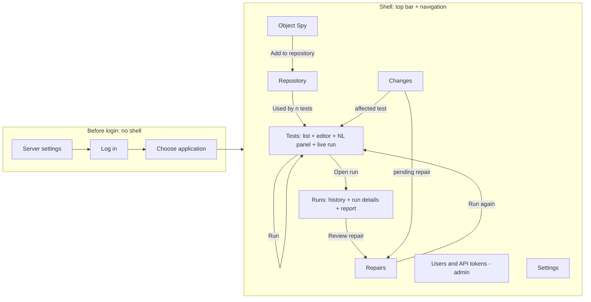
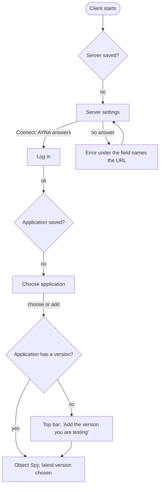
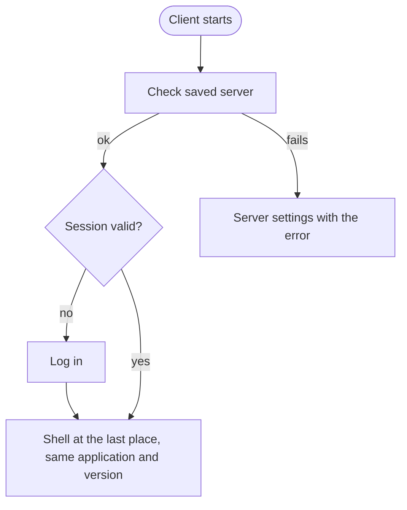
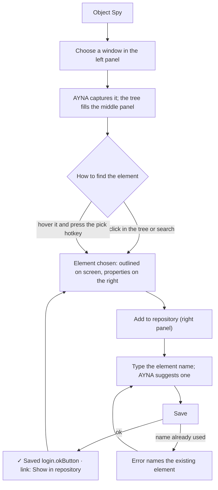
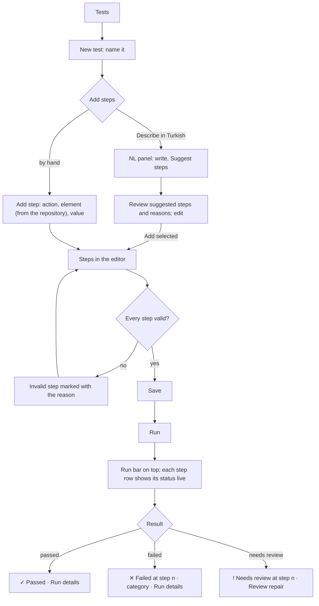
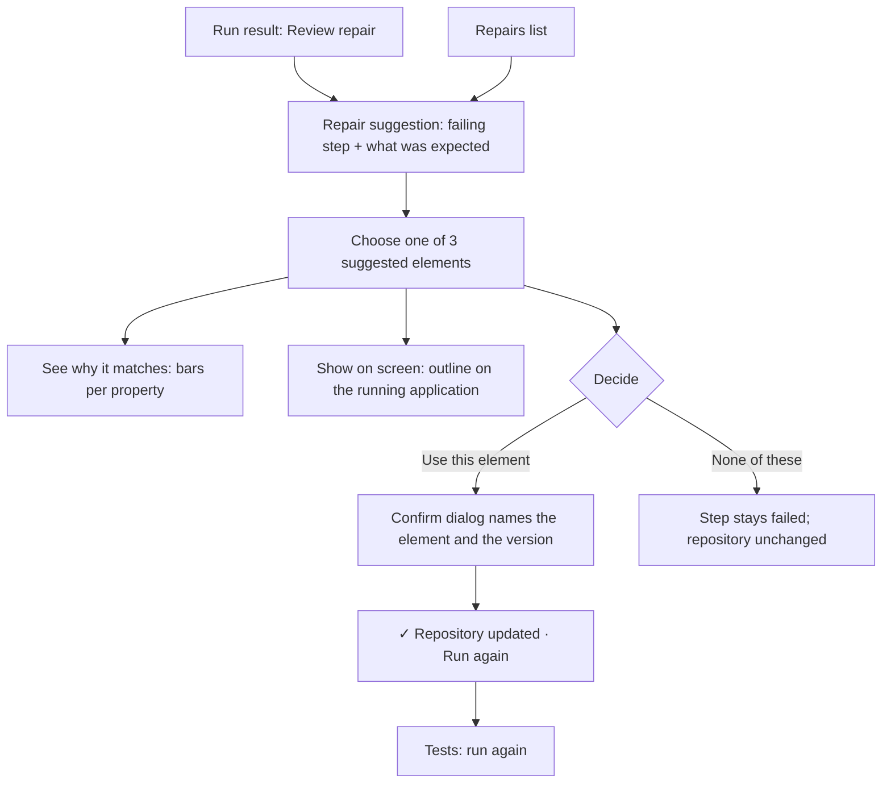
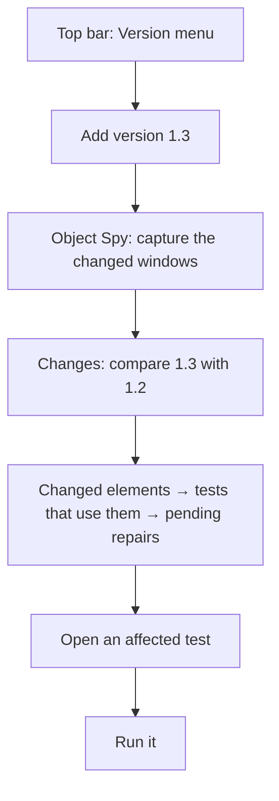
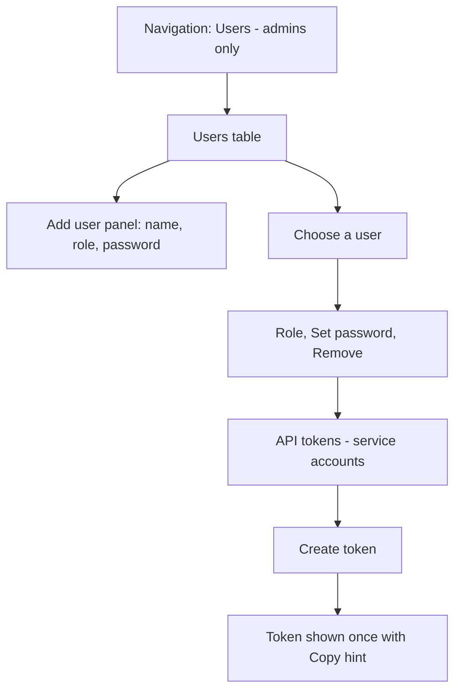

# AYNA client flows

Draft for the #183 team review. How a user moves between the screens of [wireframes.md](wireframes.md) for the main tasks. Screen names in **bold** are wireframe sections; UC numbers are the RS use cases.

## Map of places

## F1 · First run (UC-01)

- The first application choice is a centred card; later the user changes application from the top bar.
- If there is no version yet, the shell still opens; the top bar's version menu shows **Add version** with a highlighted hint, and actions that need a version (Add to repository, Run) are disabled with a tooltip that points to it.

## F2 · Daily start

## F3 · Build the repository (UC-02, UC-03)

- The panels do not move while the user picks one element after another; the form closes after saving and the next element can be picked at once.
- **Show in repository** opens Repository with that element chosen.

## F4 · Write and run a test (UC-06, UC-07, UC-08, UC-09)

- The NL panel is disabled with a message when the AI service is not reachable (FR-27, FR-28); everything else works.
- A second client with the same test open sees the same run bar and statuses (FR-20, NFR-06).

## F5 · Review a repair (UC-12)

## F6 · A new build arrives (UC-01, UC-05, UC-13)

## F7 · Interruptions (any screen)

| What happens | What the user sees | Where it returns |
|---|---|---|
| Session ended (401) | Login dialog over the current screen: "Your session has ended. Log in again." | Same screen, same unsaved input |
| Server unreachable | Page message under the header with **Try again**; the top bar shows the server as unreachable; the Spy keeps working (it needs only the agent) | Same screen |
| Agent stopped or failed | Top bar pill turns red; Spy and Run show a page message with **Start again** | Same screen |
| AI service down | NL panel disabled with a message; nothing else changes | |
| Application or version deleted on the server | Page message; the top bar opens its menu to choose again | |
| Not an admin | Users is not in the navigation; a link to it shows "Only admins manage users." | |

## F8 · Administration (UC-15)

