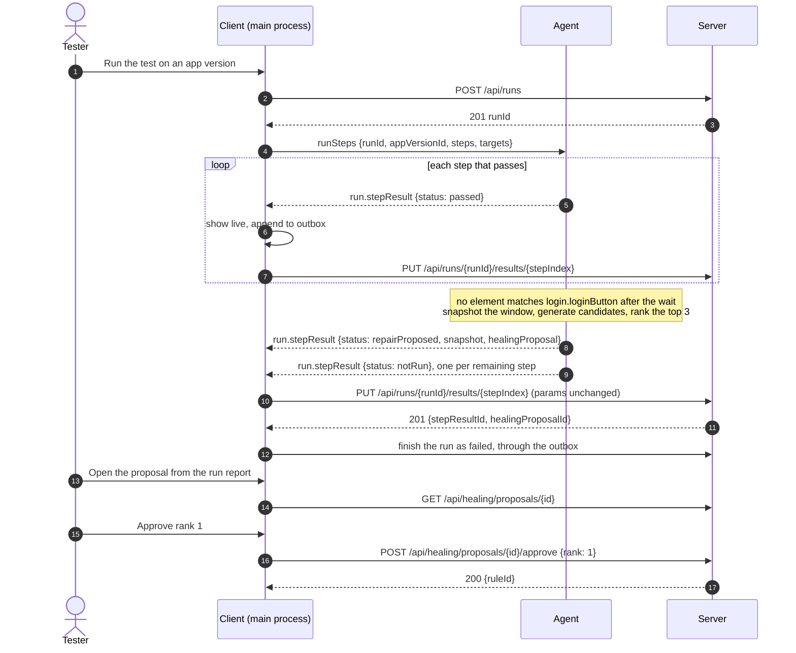
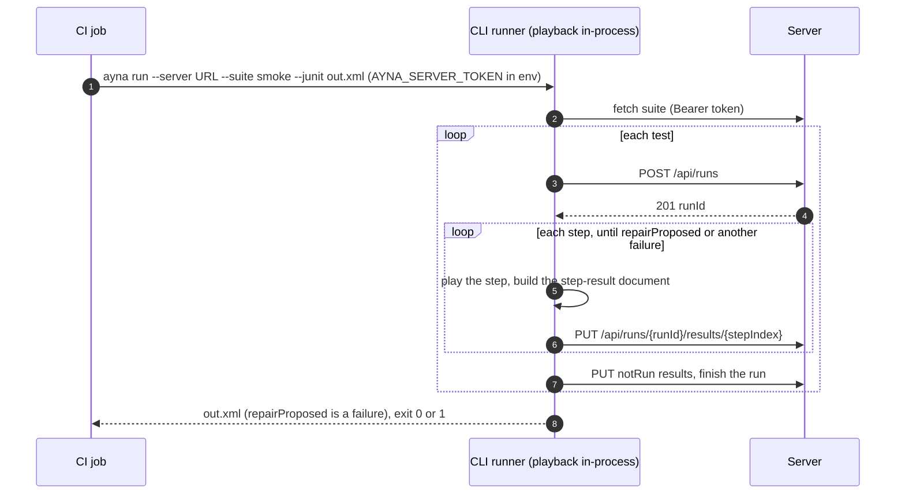

# Healing proposal transport: agent → client or CLI runner → server

- Date: 2026-10-28
- Status: Proposed — accepted when Galip, Ömerfaruk and Hasan approve the #149 PR
- Deciders: Galip (proposal, agent RPC, scorer), Ömerfaruk (client, server, graph), Hasan (playback, CLI runner)
- Issue: #149 (builds on #16, #49; consumers #73, #74, #75, #61; freeze #52)

## Context
- When no element matches a step's target after the smart wait, playback ranks candidate elements with the scorer and the step ends as "repair proposed" with the top 3, each with per-property contributions (ADR *Self-healing proposes, never applies mid-run*; FR-29, FR-30; #73). A reviewer then approves one candidate or rejects all on the server (#74) through the approval screen (#75; FR-31, FR-32).
- There are two ways a run happens. **Interactive:** the agent runs under the Electron client, and only the client talks to the server (ADR *Electron client per test machine, one central server*). **CI:** the CLI runner (#61) runs playback without the client and posts results itself (FR-23), with no interactive login (TBD-10).
- Agent JSON-RPC v0.1 (#16, PR #135) has only client → agent requests. Neither it nor the REST API has a message for a step result or a proposal (SDD AI-9 row 7).
- The scorer (#49, PR #141) computes with `fractions.Fraction`, so the contributions add up exactly to the score. SC-29 and #75 require that the contributions shown add up to the score.
- Neo4j cannot store a map as a property, so per-candidate contributions must be flattened (SDD AI-5.5; AI-9 row 8).
- The contracts freeze at G1 (#52, 7 Dec), but #73, #74 and #75 are built in week 10. The shape has to be settled before the code exists.

## Options considered

**1. How the result leaves the agent on the interactive path**
- a. *The agent pushes JSON-RPC notifications to the client, which forwards them to the server.* + Live step status (FR-20) needs a push anyway; the agent stays offline, with no server address or credentials. − The client must buffer while the server is unreachable.
- b. *The client pulls* (`run.results(since)` polling). + The agent keeps the state. − Polling delay or chatter, and no extra safety: the agent dies with the client (ADR agent-rpc-v0).
- c. *The agent posts to the server itself*, with the server address and the user's session from the client. + One code path with the CLI. − Puts the user's session into a second process, adds a second network client on the test machine, and the client still needs every result for live status.

**2. Unit of delivery**
- a. *The proposal rides inside the failing step's result*: one message, one REST write. + A "repair proposed" result can never exist without its proposal; ordering, retries and idempotency come from the step-result pipeline that exists anyway; the client forwards it with no healing-specific code. − The step-result write (#51) learns about proposals.
- b. *A separate `heal.proposed` notification and `POST /api/healing/proposals`.* + #74 owns its endpoint alone. − Two writes for one fact, an ordering rule between them, and a "repair proposed" step whose proposal has not arrived is a state every screen must handle.

**3. Where the candidates' Element nodes come from** (`CANDIDATE` and, after approval, `RESOLVES_TO` must point at Element nodes)
- a. *The failing step's result also carries the window snapshot the candidates were taken from* (a `schemas/snapshot.schema.json` document, #12), imported like any snapshot. + Candidates are ordinary elements in a window tree, made by one import code path; the version under test gets a real snapshot (useful to change impact, FR-33); real failures can be replayed offline with other weights or thresholds (#103 calibration, RQ5). − Up to about 1 MB, once per failed run; depends on #12's schema, which freezes at G1 too.
- b. *Only the candidates' properties*; the server creates up to 3 standalone Element nodes. + Small. − A second way to create Elements, outside any window tree.
- c. *The snapshot is uploaded through the snapshot import first and referenced by id.* + Reuses the import endpoint. − Two writes with an ordering rule again.

**4. Numbers on the wire**
- a. *Floats with a stated tolerance.* + Trivial for every consumer. − "Contributions add up to the score" holds only within a tolerance, and two consumers may round differently.
- b. *Exact fractions as strings* (`"151/192"`). + Exact and identical in Python, Java and TypeScript; any consumer can check the sum exactly with big integers; one value per quantity. − Consumers parse a string before drawing it (a few lines).
- c. *Both.* − Two values per quantity that can disagree.

**5. How the CLI runner signs in (TBD-10)**
- a. *An API token for a CI service account*, read from the environment variable `AYNA_SERVER_TOKEN` (never the command line, as for the agent token) and sent as `Authorization: Bearer <token>`. The server stores only a hash, an admin can revoke it, and its role may create runs and write results but not edit tests or decide proposals.
- b. *Username and password of a service account* in environment variables, signing in through #60's login. Reuses #60 as is; sessions may expire during a long suite.
- c. *No authentication from the CI network.* Conflicts with NFR-32.

## Decision
**1a, 2a, 3a, 4b**, and **5a** as the recommendation for #60 and #61 (it does not change the payload, so #60/#61 may still choose 5b).

### Interactive path

1. The client creates the Run (#44, #51) for the chosen AppVersion before playback starts, so every result carries the server's `runId`.
2. The run request (#40; the step schema ADR calls it `runSteps`) gives the agent `runId`, `appVersionId`, the steps and, for each repository object, the target the scorer compares against: the server Element id and its properties.
3. The agent sends one `run.stepResult` **notification** per step, in step order, on the connection that started the run. These are the first messages the agent sends on its own; the client never replies to them. Fields and examples: `docs/agent-rpc.md`, "Proposed (#149)".
4. The client shows each result live and appends its `params`, unchanged, to a durable outbox. One forwarder writes the outbox in order with `PUT /api/runs/{runId}/results/{stepIndex}`.
5. For a `repairProposed` result the server, in one transaction, stores the StepResult, imports the snapshot (idempotent by snapshot id), and creates the HealingProposal with its `CANDIDATE` edges. The client then finishes the run as failed (#51), through the same outbox.
6. The reviewer opens the proposal from the run report (#75) and approves one candidate or rejects all (#74).

### CI path

- The CLI runner calls playback in-process; there is no JSON-RPC and no agent token. Playback builds the same step-result document with the same serializer, and the runner writes it to the same endpoint. **One payload shape for both paths.**
- After a `repairProposed` step the test stops; the suite goes on with the next test.
- JUnit XML (#66): a `repairProposed` step is a `<failure type="repairProposed">` whose message names the logical name and the top candidates (rank, element id, score as a decimal).
- `--from-file` without a server builds the same documents. The ids only a server can give (`stepId`, `appVersionId`, `target.serverElementId`) are `null`, `runId` is a local UUID, and nothing is sent.

### Payload
The step result of a failed step whose target matched nothing, when at least one candidate is left (after #73's minimum score), has `status: "repairProposed"` and two more members:

- `snapshot`: the snapshot document (#12) of the window the candidates came from, captured when the wait ended.
- `healingProposal`: a document per **`schemas/healing-proposal.schema.json` (version 0.1, proposed in this PR)**, examples in `schemas/examples/healing-proposal/`:

| Field | Meaning |
|---|---|
| `version` | `"0.1"` |
| `runId`, `stepIndex`, `stepId` | The run (server UUID), the step's position from 0, the step's server id (`null` if unsaved). Equal to the envelope's. |
| `logicalName` | The repository object that was not found, e.g. `login.loginButton` |
| `appVersionId` | The AppVersion the run was played against; approval resolves the object for this version |
| `snapshotId` | The snapshot carried next to the proposal; every candidate `elementId` is an element of it |
| `target` | `serverElementId` (graph `Element.id` the target came from, or `null`) and `properties` exactly as scored |
| `scorer` | `id` (`"similo-v0"`) and `weights` per property, so every contribution can be recomputed |
| `candidatesScored` | How many candidates were ranked |
| `candidates` | 1 to 3, by score descending, then `elementId` ascending. Each: `rank`, `elementId` (id inside the snapshot, not a server id), `element` (properties as scored), `score`, `contributions`, `similarities` |

The step result's other fields (duration, message, failure category, screenshot) belong to #40, #54 and #63. No element matched and no candidate left: the step is `failed` with category "element not found", and there is no proposal.

### Exact numbers
- `score`, `contributions`, `similarities` and `weights` are exact rationals written as strings, as Python's `str(Fraction)` writes them: `"0"`, `"1"`, or `"p/q"` in lowest terms with `q > 1`. No floats on the wire.
- Invariants every consumer may check exactly (Python `Fraction`, Java `BigInteger`, TypeScript `BigInt`): scores, contributions and similarities lie in [0, 1]; for each candidate, `contributions[p] = weights[p] × similarities[p] / Σ weights` over the compared properties, and `Σ contributions = score`; the compared properties are the same for every candidate. The schema checks the form; `ai/tests/test_healing_proposal_schema.py` checks the arithmetic and is the reference for consumers' own checks.
- Screens convert to a double only to draw: bars and the shown score then agree within float rounding, and nobody compares floats for equality. The server stores a double copy of each score for sorting.

### Ordering, idempotency and failures
- **Order.** WebSocket delivery on one connection is ordered, the agent sends a run's results in step order, and the client's single forwarder writes the outbox first in, first out, including the call that finishes the run. The server does not depend on order: a result's key is `(runId, stepIndex)`.
- **Idempotency.** `PUT /api/runs/{runId}/results/{stepIndex}` is safe to repeat: the first write wins, and a repeat returns the stored result (`200`) without changes. The proposal and the snapshot are created in the same transaction, so a retry never duplicates them; a snapshot that already exists is not imported again.

| Situation | Behaviour |
|---|---|
| Server unreachable during a run | Playback goes on. Results wait in the outbox; the client shows "N results waiting for the server" and retries with backoff (1 s doubling to 60 s). The proposal appears for review once delivered. |
| Server answers 5xx, 408 or 429 | Same as unreachable: keep the item and retry. |
| Server answers 401 | Keep the item, ask the user to sign in again, then resume. |
| Server answers another 4xx (invalid document, unknown run) | Retrying cannot help: move the item to a dead-letter file next to the outbox, show an error naming the run and step, go on with the next item. |
| Client closed or crashed mid-run | The agent dies with it (ADR agent-rpc-v0); the application under test is left as it is. The outbox is on disk, so what the client had received is delivered at its next start, and the client then finishes that run as `aborted`. A server-side idle timeout is a safety net for clients that never come back. |
| Agent crashes mid-run | The client sees the connection close, delivers what it has and finishes the run as `aborted`. |
| Server unreachable when a run starts | The client cannot create the Run (or fetch the test), so it does not start playback. |
| CI: server unreachable | The runner retries each write with backoff for a bounded time, keeps running tests, writes what it could not deliver to `ayna-undelivered.jsonl` next to the JUnit file, and exits non-zero even if every test passed, because FR-23 requires the results on the server. The exact exit code is #61's choice. |

### Run stops after "repair proposed" (TBD-6)
The agent performs no further step of that test and never acts on a candidate. Each remaining step gets a `notRun` result, so the report shows the whole test. The run's status is failed (SC-29, SC-31). In a CLI suite, the next test runs.

### Screenshots (#54)
The `repairProposed` step's screenshot is taken at the same moment as its snapshot, and the step result records the screenshot's crop rectangle in screen pixels. The approval screen can then draw every candidate's `bounds` on it, also for CI runs, where the application under test is gone. In an interactive run the application is still at the failing screen, so the client can also outline a candidate live (a highlight method from the Spy work, outside this ADR). The proposal carries no image.

### Decision log (#63)
The `healingProposal` document is the full input of a healing decision (target, candidates, scores, contributions, similarities, weights, snapshot id). The server adds the outcome (approved rank or rejection, user, time; FR-40). Records join on `runId`, `stepIndex`, the server's proposal id and `snapshotId`. Because only the server holds both input and outcome, the JSONL export of healing decisions (FR-36) is proposed to run on the server; #63 decides the record format and where the export lives. Without a server, the CLI runner can write the same documents to a local JSONL file.

### Boundaries kept
- *Propose, never apply:* nothing in this flow changes a test or the repository. The only way to a new `RESOLVES_TO` is #74's approve call, with a user session.
- *Closed network:* the agent talks only to the client on 127.0.0.1; the client and the CLI runner talk only to the AYNA server. No new external call.

## Consequences
**Hasan (playback, CLI runner)**
- #40: `runSteps` carries `runId`, `appVersionId` and each object's target (server Element id + properties as scored, keys as in `heal/scorer.py`); playback emits one `run.stepResult` per step in order, with status `passed`, `failed`, `repairProposed` or `notRun`, plus #40's own fields.
- #73: on "element not found" (TBD-5): snapshot the window, generate candidates (#42), add features (#43), `rank(k=3)` (#49), drop those below the minimum score; if any are left, emit `repairProposed` with `snapshot` and `healingProposal` (numbers via `str(Fraction)`), else `failed`; then `notRun` for the rest. The criterion "proposal sent to the server" is met when the client or the runner writes that result.
- #61: write the same documents to the same endpoint; one Run per test; sign in with `AYNA_SERVER_TOKEN` (or 5b if #60 has no tokens); bounded retry, `ayna-undelivered.jsonl`, non-zero exit on undelivered results.
- #66: `<failure type="repairProposed">` with the logical name and the top candidates.
- #54: screenshot at the snapshot's moment, with its crop rectangle in screen pixels.
- #63: `repairProposed` steps have the category "element not found"; use the join ids above.

**Ömerfaruk (client, server, graph)**
- #44: create the Run first; forward `run.stepResult` params unchanged through a durable outbox (for example a JSONL file in the app's user-data folder) with one in-order forwarder; the retry and dead-letter rules above; finish unfinished runs as `aborted` at the next start.
- #51: `PUT /api/runs/{runId}/results/{stepIndex}`, idempotent as above, accepting `snapshot` and `healingProposal` on `repairProposed` results in one transaction and answering `{stepResultId, healingProposalId}`; accept bodies of at least 8 MB (snapshot plus screenshot); a Run records the AppVersion it was played against.
- #74: proposals are created by that write. Proposed endpoints: `GET /api/healing/proposals?status=pending|approved|rejected&appVersionId=…`, `GET /api/healing/proposals/{id}` (the stored document plus `id`, `status`, `decidedBy`, `decidedAt`, `approvedRank`, `ruleId`), `POST /api/healing/proposals/{id}/approve` with `{"rank": n}`, `POST /api/healing/proposals/{id}/reject`. A second decision answers 409. Validate the document against the schema and, ideally, the arithmetic.
- Graph (`docs/graph-model.md`): per-candidate data moves from the HealingProposal node to the `CANDIDATE` relationship: `rank`, `score` (double, for sorting), `scoreExact`, and `properties`, `contributions`, `similarities` as parallel lists in scorer order (SDD AI-5.5). The node keeps `logicalName`, `snapshotId`, `scorerId`, the weights, `candidatesScored`, the target and the decision fields. New `(StepResult)-[:PROPOSED]->(HealingProposal)` so the run report links to the proposal. The snapshot import keeps the agent's snapshot element id on each Element, so `(snapshotId, elementId)` finds it. Storing the whole document as one JSON string as well is your call.
- #75: bars from the exact strings, converted to doubles only to draw; candidate outlines from `bounds` on the step's screenshot.
- #60: API tokens for a CI service account (5a), or confirm 5b.

**Galip (agent RPC, scorer, documents)**
- This PR: `docs/agent-rpc.md` "Proposed (#149)", the schema, examples and checks. `rpc.py` is unchanged: `rpcVersion` becomes `0.2` when #40/#73 ship the notification.
- After acceptance: comment on #73 and #74 with a link to this ADR; add `SCORER_ID = "similo-v0"` to `heal/scorer.py`; update SDD AI-5.5 and AI-9 rows 7 and 8 (#50) and RS TBD-6, TBD-10 and FR-23's wording on undelivered results (#35).

**Freeze (#52)**
- Frozen at G1: the `run.stepResult` fields named here with its `snapshot` and `healingProposal` members (agent RPC 0.2), `schemas/healing-proposal.schema.json` 0.1, and the REST write and #74 endpoints in `docs/api/openapi.yaml`.
- Contract tests use the shared examples: the agent (#73) serialises the scorer's output and compares it with them, the server (#74) accepts the examples and rejects the invalid cases, and the client forwards them unchanged.
- #73, #74 and #75 come after the freeze. A gap found while building them is fixed with an additive change (minor version) and a new ADR.
- Revisit option 3c (snapshot by reference) if proposals from the pilot apps grow past a few MB.
